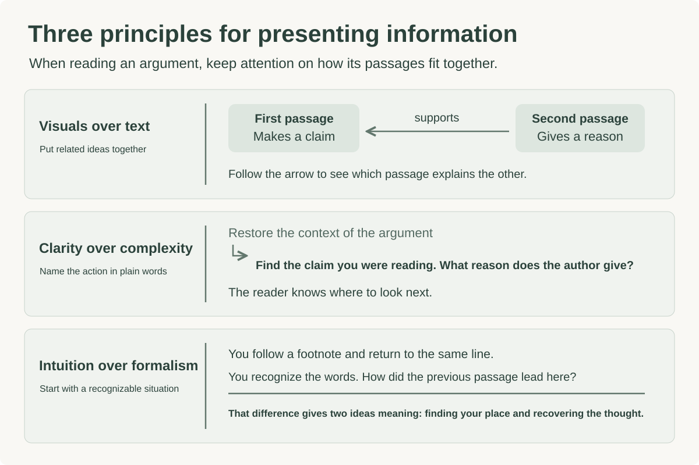
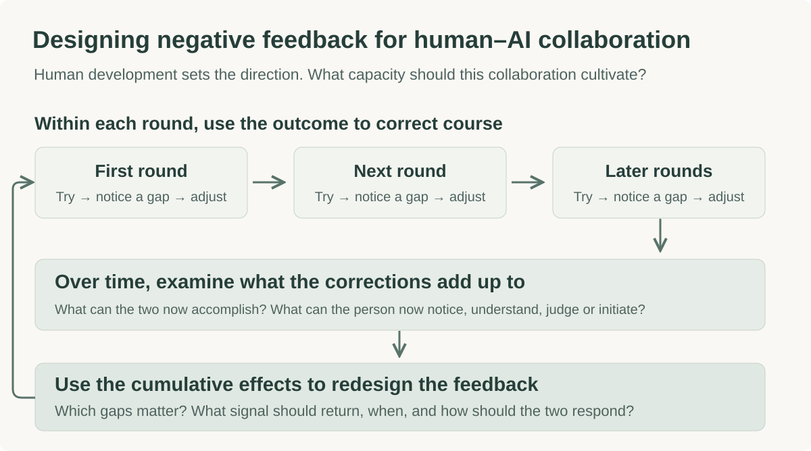

# Cognitive Complexity in Personal Recursive Self-Improvement

[中文](cognitive-complexity.zh-CN.md)

[Personal recursive self-improvement in economic reality](economic-personal-rsi.md#how-amortization-reverses-the-priorities-of-personal-cultivation) establishes the grounds for this division of work. When formal reasoning is cheaply available through a model, embodied observation and reasoning in ordinary language become more valuable to cultivate. In reading and writing, that means saving the work of locating, restating, and reassembling grounds so the reader can directly judge the relations that could change the conclusion.

To resume an argument, someone may first have to find the current draft, remember the open question, and locate the relevant passage. The model can do that work and return the question along with the evidence needed to judge it.

## Three Priorities for the Whole Environment

Whether designing an interface, writing notes, or composing a prompt someone will read and edit, start with what the reader needs to grasp.

**Visuals over text.** Shapes and changes in a diagram are easier to grasp intuitively. You can see where two curves begin to diverge. A point-by-point description leaves you to reconstruct the picture.

**Clarity over complexity.** A clear definition puts the intuitive meaning of a concept into everyday words. In a note, “resuming” can simply mean coming back to the question you were thinking about last time. Unnecessary prohibitions, repeated explanations, endorsements, and closing caveats can bury a point that takes one sentence to make.

**Intuition over formalism.** When writing a prompt, start by saying in ordinary words what you want done. Introduce formal language only when the task calls for a precise definition, a calculation, or a proof.

Understanding an argument takes work to connect a claim with its grounds. Searching several tabs for the source adds work imposed by the environment. Cognitive complexity concerns the relations and steps the task requires, and cognitive load concerns how much of the person’s available capacity they occupy.

## Cognitive complexity and expressive scope

Assessing this allocation connects the demands of an activity with the person's actual processing. [Kieras and Polson](#source-1) analyze user complexity through the knowledge, rules, and processing needed to accomplish tasks. [Sweller and colleagues](#source-2) explain how the same material presents different element interactivity and working-memory demands to people with different prior knowledge. Prior knowledge changes how many separate elements a person needs to hold in mind. The same guidance can make a beginner's next action possible and become redundant for someone with more experience. Word count, button count, and abstraction therefore supply only partial evidence.

| Object of assessment | Question for cooperation |
| --- | --- |
| Expression and task structure | Which objects, relations, branches, and operating rules must be held together now? |
| Human processing conditions | What is familiar, and which perception, recognition, memory, and inference are accessible now? |
| Representation and handoff | What work is required to translate sensation into words, search, supervise, switch, and resume? |
| Actual benefit | What does this effort accomplish, and which chosen human capacity does it cultivate? |

Restricting linguistic expressive power for efficiency has two connected uses here. In formal systems, choosing a restricted language fragment can change the problem class and its computational complexity; the particular language and algorithms establish that result. At the human–model interface, an exchange can require only the expression needed to begin. When an intention, a gesture of selection, or a sketch suffices, the model carries the remaining organization and implementation. When the person's purpose includes reasoning in words, speaking and writing continue as chosen practice. The fuller account stays available; the immediate entry selects its form for the activity. The participants and environment jointly carry the richer meaning, while what the person needs to hold together varies with the activity.

[Larkin and Simon](#source-14) compared diagrams and texts that convey the same information and examined how location, adjacency, and shape affect search and inference. [Mayer and Moreno](#source-15) studied channel capacity, contiguity, segmentation, and integration in multimedia learning. Their work helps explain why particular diagrams are easy to read and where a reader still has to assemble the pieces.

## What the Person Develops and What the Model Carries

YinYang puts the person's finite time and attention into **embodied reasoning, intuition, and generation and judgment in natural language**. The person notices a difference in what they see, hear, or do, ventures an explanation, and judges what happens when they try it. Pointing something out, making a sketch, or saying a few words can convey the insight. The model retrieves and organizes material, develops the thought into a full account, and handles all formal reasoning and implementation. It tests consequences, verifies the result, and keeps the work ready to resume. The person can then return to the actual experience to revise the idea.

| Activity | What the person contributes and develops | What the model takes on |
| --- | --- | --- |
| Read an argument | Point to a shift in a word's meaning and say what seems to change. Read a counterexample and reconsider the explanation. | Retrieve both passages, organize the evidence, derive formal consequences, and write and check the full account. |
| Listen to two readings | Hear a shift in emphasis, imitate it, and say what difference it makes to the sentence. | Find and align the clips, set up replay, and assemble the comparison and explanation. |
| Improve a reading tool | Notice where the thread is lost, sketch the needed relation, try the new view, and judge whether it helps. | Recover the reading context, develop the design, formalize its behavior, implement and verify it, and bring the person back to the same passage. |

The person can draw on reliable model and tool work as part of an enduring ability to read, judge, and create in a real environment. The model can also go first with a draft for the person to consider, or carry a task through to a checked result when delivery is the point.

[Risko and Gilbert’s account of cognitive offloading](#source-9) describes how people use external actions or aids to reduce the mental processing a person has to do internally. A reminder holds an intention, a diagram puts a relation in view, and a model can recover context the person would otherwise have to reconstruct. In [pattern-copying experiments](#source-10), greater offloading improved immediate performance while memory for the patterns could worsen. In [studies of prose learning](#source-12), retrieving material from memory improved delayed retention compared with repeated study.

In [Bastani and colleagues’ mathematics experiment](#source-13), two arrangements using the same underlying model improved practice performance. The ordinary assistant group subsequently performed worse than controls on an unaided exam, a loss mitigated by the hint-oriented tutor. In a [randomized study of 487 consultants](https://doi.org/10.1038/s41562-026-02566-6), Wiles and colleagues found gains on three data-science tasks with ChatGPT and no evidence of better technical answers afterward without it. Joint performance and what a person learns require different evidence.

Delegating also costs attention. The person still has to brief the model, check its result, and recover when work goes wrong. The model can handle routine choices, recover context, and make clear what needs the person’s judgment.

## Designing negative feedback for the coupled human–AI system

Reverse alignment makes human development the purpose of collaboration. As the model becomes a more capable interpreter of intent, a few words can set more work in motion. The division of work can change with it. In [OpenAI’s interviews with pretraining researchers](https://openai.com/index/research-acceleration-jagged-frontier/), one researcher said their idea began to work well after Codex suggested a change. The model’s contribution reached into the idea itself.

In [*An Introduction to Cybernetics*](https://www.ashby.info/Ashby-Introduction-to-Cybernetics.pdf), Ashby considers the regulator and its environment as a whole. In a coupled human–AI system, what the model produces changes the person’s next judgment. That judgment changes what the model receives next, what work it takes on, and when it hands the result back. You can use the six accounts of your working model to observe how you think, feel, and judge in this exchange. You decide where the model takes over and where it returns the material for you to make a judgment. When the consequences of one round change what both partners do in the next and weaken a tendency you want to temper, negative feedback is at work.

In handing back a result, a model also influences the person checking it. In [an Anthropic experiment](https://www.anthropic.com/research/agents-judgment-calls), researchers randomly varied which defensible choice an agent favored on four judgment calls. Across 50 professional analysts, 86% of choices matched the agent’s lean. In designing a check, it is worth asking what independent grounds you have for a choice and whether you will get to see its actual consequences.

Two outcomes bear on the division of work: what you and the model accomplish together, and what you can later initiate, understand, or judge. Dependable support can become part of your lasting ability. The value of taking on or delegating a step depends on what it makes possible, the opportunity for practice, and the attention verification takes. These experiences can change your preferences and your way of life, including how you spend your time and what you choose to do personally. They can also change what you want the feedback to sustain.

## Sources and their contributions

These studies provide concepts and observations for understanding cognitive demands and how interfaces, memory, and model assistance shape them.

1.  David Kieras and Peter G. Polson (1985), An approach to the formal analysis of user complexity. [DOI](https://doi.org/10.1016/S0020-7373(85)80045-6). Analyzes interaction through the knowledge and rules required of users.
2.  John Sweller, Jeroen J. G. van Merriënboer, and Fred Paas (2019), Cognitive Architecture and Instructional Design: 20 Years Later. [DOI](https://doi.org/10.1007/s10648-019-09465-5). Explains element interactivity, prior knowledge, and working-memory demands.
3.  Evan F. Risko and Sam J. Gilbert (2016), Cognitive Offloading, Trends in Cognitive Sciences. [Paper](https://samgilbert.net/pubs/Risko2016TiCS.pdf). Explains how external actions change a task's cognitive demands.
4.  Sandra Grinschgl, Frank Papenmeier, and Hauke S. Meyerhoff (2021), Consequences of cognitive offloading: Boosting performance but diminishing memory, Quarterly Journal of Experimental Psychology. [Paper](https://pmc.ncbi.nlm.nih.gov/articles/PMC8358584/). Compares immediate performance and subsequent memory in pattern copying.
5.  Henry L. Roediger III and Jeffrey D. Karpicke (2006), Test-enhanced learning: Taking memory tests improves long-term retention, Psychological Science. [DOI](https://doi.org/10.1111/j.1467-9280.2006.01693.x). Compares the effects of retrieval practice and repeated study on delayed memory for prose.
6.  Hamsa Bastani et al. (2025), Generative AI without guardrails can harm learning: Evidence from high school mathematics, Proceedings of the National Academy of Sciences. [DOI](https://doi.org/10.1073/pnas.2422633122). Compares the effects of two forms of AI support on mathematics practice and subsequent unaided exams.
7.  Jill H. Larkin and Herbert A. Simon (1987), Why a Diagram is (Sometimes) Worth Ten Thousand Words, Cognitive Science 11(1), 65–100. [DOI](https://doi.org/10.1111/j.1551-6708.1987.tb00863.x). Distinguishes informational from computational equivalence and explains how spatial organization changes search and inference.
8.  Richard E. Mayer and Roxana Moreno (2003), Nine Ways to Reduce Cognitive Load in Multimedia Learning, Educational Psychologist 38(1), 43–52. [DOI](https://doi.org/10.1207/S15326985EP3801_6). Examines channel capacity, contiguity, segmentation, integration, and overload in multimedia processing, informing comparison of presentation benefits and coordination costs.
