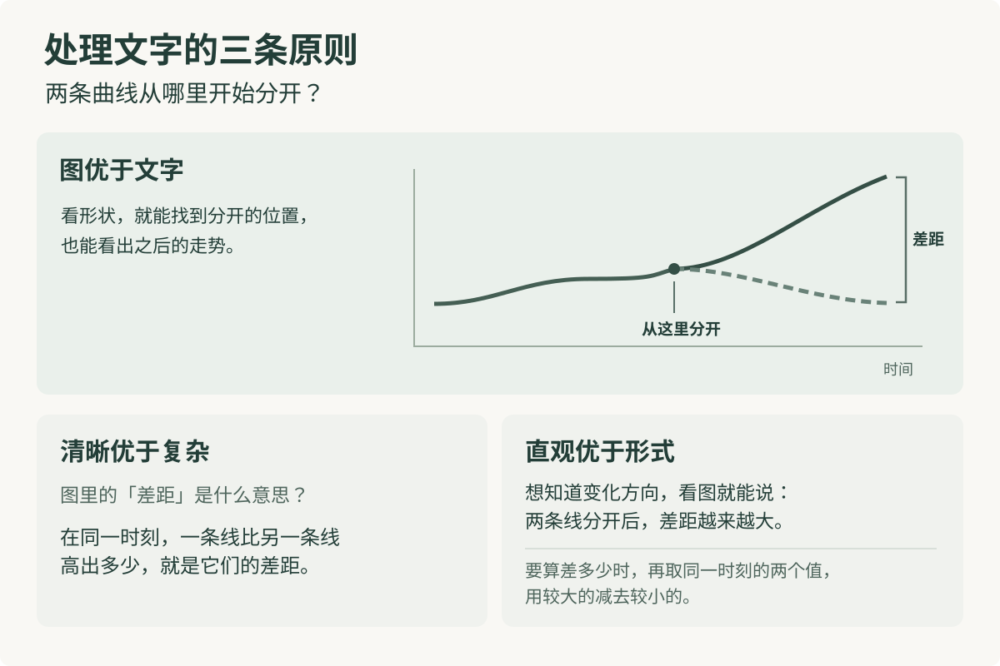

# 个人递归自改进中的认知复杂性

[English](cognitive-complexity.md)

[《经济现实中的个人递归自改进》](economic-personal-rsi.zh-CN.md#摊销怎样颠倒个人培养推理能力的轻重次序)说明了这项分工的根据：当模型能够廉价地提供形式推理，人的具身观察和自然语言判断就更值得培养。落实到文字上，要省下的是查找、转述和重新拼合依据的工夫，让人能直接判断那些会改变结论的关系。

要接着写一段论证，人可能得先找出当前草稿，回想上次停在哪里，再找回对应的原文。这些查找和整理可以交给模型。人拿回的是那个尚待判断的问题，以及足以判断它的依据。

## 整个环境的三条设计原则

无论是在做界面、写笔记，还是写一段人要阅读和修改的提示词，都可以从读者眼前要看懂的意思出发。

**图优于文字。** 图里的形状和变化更容易凭直觉看懂。看两条曲线，就能看出它们从哪里开始分开；用文字逐项描述，读者还得在心里重建这幅图。

**清晰优于复杂。** 清楚地定义一个概念，可以直接用平常的话说出它的直观意思。笔记里写的“接续”，就是下次回来时还能从上次的问题接着想。多余的否定约束、反复解释和背书、段末附加的限定，都会遮住原本一句话就能说清的意思。

**直观优于形式。** 写提示词时，先用日常语言说明要做什么。只有任务需要精确定义、计算或证明时，再引入所需的形式语言。

理解论证需要把主张和依据联系起来；在几个标签页里寻找原文则是环境带来的额外工作。认知复杂性考察任务要求人处理哪些关系与步骤，认知负荷考察它们占用了本人多少可用的认知资源。

## 认知复杂度与表达范围

考察这种分工，需要把活动要求与人的实际加工接起来。[Kieras 与 Polson](#source-1)用完成任务所需的知识、规则和处理过程分析用户复杂性；[Sweller 等](#source-2)说明，同样的材料对已有知识不同的人，会形成不同的元素交互与工作记忆负荷。已有知识会改变本人要同时顾及多少个独立要素。相同的指引能帮初学者走出下一步，对有经验的人却可能已经多余。因而，文字数量、按钮数量或抽象程度，只能提供部分线索。

| 考察对象 | 对合作提出的问题 |
| --- | --- |
| 表达与任务结构 | 当前需要同时保持哪些对象、关系、分支与操作规则？ |
| 人的加工条件 | 这个人已经熟悉什么，哪些感知、识别、记忆和推断此刻容易调用？ |
| 表征与交接 | 把感受译成文字、搜索材料、监督模型、切换和恢复任务需要多少工作？ |
| 实际所得 | 这项投入帮助完成了什么，又培养了本人选择发展的哪种能力？ |

「限制语言的表达力以提高效率」在这里有两种相连的做法。对于形式系统，选择受限的语言片段可以改变需要处理的问题集合及其计算复杂性，具体结论由相应语言与算法说明。对于人机接口，一次交流只需包含足以开工的表达：一句意图、一次指认或一幅草图已经足够时，其余组织与实现由模型承担。若目的包括练习用语言推理，言说与写作就作为本人选定的实践继续展开。完整说明仍可按需要取得；当前入口依据活动选择形式。丰富的意义由双方与环境共同承载，本人需要同时顾及的部分随活动调整。

[Larkin 与 Simon](#source-14)比较一张图和一段含有同样信息的文字，研究空间位置、邻接和形状怎样改变搜索与推断的过程。[Mayer 与 Moreno](#source-15)研究多媒体学习中的通道容量、图文邻近、分段与整合。这些研究能解释某些图为什么容易读，也能帮助发现图上哪些地方还需要读者费力拼合。

阅读时，模型可以找回草稿和原文。本人指出一个词的意思在哪里变了，模型据此整理比较、推导后果并核对修订。这里节省的是查找和展开论述的工夫，辨认意思的变化仍是本人的活动。

## 人发展什么，模型承担什么

阴阳把人有限的时间和注意放在**具身推理、直觉，以及用自然语言生成和判断**上。人从看见、听见、动手试过的事中察觉差别，提出解释，再用实际经验判断它是否成立。一处指认、一张草图、几句口述，都可以把这个发现交给模型。模型查找和组织资料，把想法展开成完整论述，承担全部形式推理与实现，推导并检查后果、核验结果、保存接续所需的材料。人再回到实际经验中试用、判断、修正。

| 活动 | 本人参与并发展的能力 | 交给模型的工作 |
| --- | --- | --- |
| 读一段论证 | 指出一个词用到这里似乎变了意思，用自己的话说说差别，再读反例、修订解释。 | 找到两处原文、整理依据、推出形式后果，写出并检查完整论述。 |
| 听两种读法 | 听出重音的差别，跟读体会，说出它怎样改变了句子的意思。 | 找到并对齐片段，安排回放，整理比较和说明。 |
| 改一个阅读工具 | 察觉在哪里读断了，画出想保留的关系，试用新界面，判断能否接着读。 | 找回阅读现场，展开设计、形式化交互规则、实现和核验，再带本人回到原段落。 |

可靠的模型与工具支持可以长期成为本人阅读、判断和创作能力的一部分。也可以让模型先写出一份完整草稿，供本人判断；如果这件事要的就是成品，模型可以直接完成、核验并交付。

[Risko 与 Gilbert 所说的认知外包](#source-9)，是借助外部行动或工具，减少一项任务中需要本人在头脑里处理的工作。提醒替人记下待办，图把关系放到眼前，模型可以找回原本需要本人重建的语境。在[图案复制实验](#source-10)中，更多的卸载改善了当时的复制表现，随后对图案的记忆却可能变差。在[文章学习实验](#source-12)中，尝试从记忆中提取内容，比反复学习原文更有利于过一段时间再回忆。

在[Bastani 等人的高中数学实验](#source-13)里，使用普通 AI 助手的学生比对照组练习得更好，但在之后没有辅助的考试中表现更差。以提示为主的辅导工具大幅缓解了考试表现的下降。这些结果表明，眼下做成了什么，与本人实际练到了什么、之后能做到什么，并非总是一起变化。它们帮助解释阴阳为什么给本人留出亲自察觉、生成和判断的机会。值得发展的能力与具体分工，来自阴阳对人的理解和对有限投入的选择。

模型尤其能直接控制自己提供帮助时产生的负担。删去冗余文字，先评估常规选项再呈现，主动找回语境，把文件和工具接在活动背后。判断是否值得交给模型，还要算上本人交代任务、检查结果、出错后恢复的工作。一件琐事如果交接成本更高，自己做可能更省力。把结果、影响使用的选择和本人判断所需的依据放到眼前，更多细节随用随取。本人需要支持才能继续尝试时，把必要的材料和反馈送到用得上的地方。

## 从使用中改进环境和设计方法

回到整项活动，看本人在实际采用的支持下，能察觉、解释、判断和完成什么，哪些文字处理仍能由模型承担。中断后打开了文件，还要看本人能否找回刚才在想的关系，回到原段检验一个新想法，再接着读下去。

用实际结果改进环境，也改进下一次设计的方法。做下一个阅读工具时，可以在原文、笔记与模型都可用的条件下，试试能否找回一段论证并继续解释。这样能发现资料之间还有哪处没接上，也能发现模型在哪一步给得太多，挤掉了本人生成想法的机会。改进发现和处理这些负担的方法，也是个人递归自改进的一部分。

## 来源及其贡献

以下研究为理解环境中的认知要求，以及界面、记忆和模型辅助怎样改变这些要求，提供了概念与观察。

1.  David Kieras 与 Peter G. Polson（1985），An approach to the formal analysis of user complexity。[DOI](https://doi.org/10.1016/S0020-7373(85)80045-6)。通过用户所需的知识和规则分析交互。
2.  John Sweller、Jeroen J. G. van Merriënboer 与 Fred Paas（2019），Cognitive Architecture and Instructional Design: 20 Years Later。[DOI](https://doi.org/10.1007/s10648-019-09465-5)。说明元素交互、先前知识与工作记忆要求。
3.  David Kirsh 与 Paul Maglio（1994），On Distinguishing Epistemic from Pragmatic Action。[DOI](https://doi.org/10.1207/S15516709COG1804_1)。说明行动怎样改变推理条件。
4.  Judy Hanwen Shen 与 Alex Tamkin，How AI Impacts Skill Formation。[论文](https://arxiv.org/abs/2601.20245) · [研究报告](https://www.anthropic.com/research/AI-assistance-coding-skills)。AI 辅助与陌生编程库学习的随机实验；发现以所测的学习条件为范围。
5.  Erik M. Altmann 与 J. Gregory Trafton（2002），Memory for goals: an activation-based model。[DOI](https://doi.org/10.1207/S15516709COG2601_2)。联系提取线索与悬置目标的接续。
6.  Evan F. Risko 与 Sam J. Gilbert（2016），Cognitive Offloading，Trends in Cognitive Sciences。[论文](https://samgilbert.net/pubs/Risko2016TiCS.pdf)。说明外部行动如何改变任务的认知要求。
7.  Sandra Grinschgl、Frank Papenmeier 与 Hauke S. Meyerhoff（2021），Consequences of cognitive offloading: Boosting performance but diminishing memory，Quarterly Journal of Experimental Psychology。[论文](https://pmc.ncbi.nlm.nih.gov/articles/PMC8358584/)。通过图案复制实验比较当时的表现与后续记忆。
8.  Slava Kalyuga、Paul Chandler、Juhani Tuovinen 与 John Sweller（2001），When problem solving is superior to studying worked examples，Journal of Educational Psychology。[DOI](https://doi.org/10.1037/0022-0663.93.3.579)。说明解题与研读示例的相对收益随学习经验变化。
9.  Henry L. Roediger III 与 Jeffrey D. Karpicke（2006），Test-enhanced learning: Taking memory tests improves long-term retention，Psychological Science。[DOI](https://doi.org/10.1111/j.1467-9280.2006.01693.x)。通过文章学习实验比较提取练习与重复学习对延后记忆的影响。
10.  Hamsa Bastani 等（2025），Generative AI without guardrails can harm learning: Evidence from high school mathematics，Proceedings of the National Academy of Sciences。[DOI](https://doi.org/10.1073/pnas.2422633122)。比较两种 AI 辅助方式对数学练习表现和之后无辅助考试的影响。
11.  Jill H. Larkin 与 Herbert A. Simon（1987），Why a Diagram is (Sometimes) Worth Ten Thousand Words，Cognitive Science 11(1)，65–100。[DOI](https://doi.org/10.1111/j.1551-6708.1987.tb00863.x)。区分信息等价与计算等价，说明空间组织怎样改变搜索和推断。
12.  Richard E. Mayer 与 Roxana Moreno（2003），Nine Ways to Reduce Cognitive Load in Multimedia Learning，Educational Psychologist 38(1)，43–52。[DOI](https://doi.org/10.1207/S15326985EP3801_6)。分析多媒体加工中的通道容量、邻近、分段、整合与超负荷，为比较呈现收益和协调成本提供依据。
