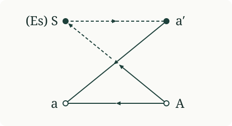
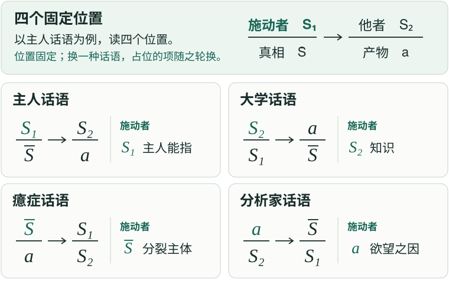
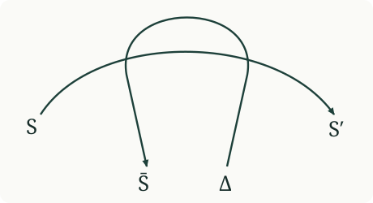
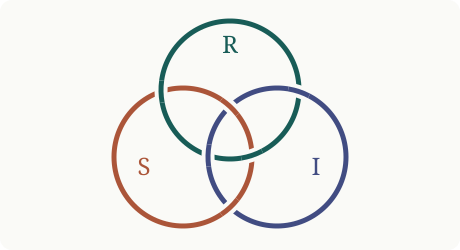

# 拉康概念导读：从原文到个人实践

[English](lacan-reading-guide.md) · [哲学阅读](philosophical-readings.zh-CN.md) · [按任务问题阅读](../reading-map.zh-CN.md)

读到「大他者」「回溯」「分裂主体」「充实言说」「半说」或「圣状」时，困难常常不在单个词的解释，而在于：它们为什么出现在同一套论述里，又怎样接到个人模型、文字和工具。这里从这些关系进入，供第一次阅读与之后复习时查阅。它是主线之外的概念说明，可以从遇到困难的地方进入，再返回原来的文章。

拉康给本站提供的一条重要问题线索是：**人怎样通过来自他人的语言和形象表达自己，又怎样在表达及其返回中发现，自己并不与那份说明完全重合。**后来的表达可以改变早先话语的意义；已经形成的自我形象也会在新的相遇中受到挑战。晚期关于结与圣状的讨论，则进一步追问这些不同关系怎样在一个人的具体存在中相连。把它们接到模型协作与工程实现，是本站继续展开的工作。

## 先辨认正在读哪一层

| 阅读层次 | 它在做什么 | 阅读时抓住什么 |
| --- | --- | --- |
| 拉康的论述 | 在精神分析问题中发展主体、语言、认同、欲望与三界等概念 | 原文的时期、问题和概念关系 |
| 本站的哲学展开 | 借这些概念理解表达、自己与他人、模型伙伴及实践安排 | 哪些关系被保留，哪些意义由作者另行展开 |
| 局部的形式转译 | 用选定符号、断言和规则表示某些关系，检查其后果 | 表示了什么、假定了什么、还有什么没有进入模型 |

三层可以属于同一项工作，读者仍需要知道眼前的一句话承担哪种责任。例如，拉康讨论的主体不是一个数据库对象；把某些关系写入形式模型，是为了让选定关系变得可检查。形式系统中的一次推导，也不等于从真实会谈中已经建立了可靠的个人模型。

可以沿六条短路径阅读：

- 想理解知识如何在四种话语里分别成为发言的根据、被调动的他者、真相或产物，读[四话语](#four-discourses)。

- 想理解「我」「自我」与「他人」：先读[语言与大他者](#语言能指与大他者)，再读[自我与分裂主体](#自我与分裂主体)。
- 想理解一种问题怎样因参与者的位置改变而重组：读[辩证逆转](#辩证逆转改变理解也改变位置)，再返回主线[一种办法怎样成为新的问题](speech-opposition-and-self-formation.zh-CN.md#一种办法怎样成为新的问题)。
- 想理解为什么后来才能认出早先的意义：读[回溯与回溯性的认识](#回溯与回溯性的认识)，再返回[言说与回溯赋义](speech-opposition-and-self-formation.zh-CN.md#大他者与回溯赋义)。
- 想理解持续写作怎样接到真理：读[充实言说、半说与真理](#充实言说半说与真理)，再返回[半说的真理与持续改写](speech-opposition-and-self-formation.zh-CN.md#半说的真理与持续改写)。
- 想理解三界与圣状：先读[三界](#三界同一经验中的不同关系)，再读[圣状](#圣状从拉康的问题到本站的命名)，最后返回[圣状的形成](writing-a-sinthome.zh-CN.md)。

## 语言、能指与大他者

拉康从一个写法开始：

$$
\frac{S}{s}
$$

大写 $S$ 是能指，小写 $s$ 是所指。横线标出两者之间的阻隔。一个词要在其他词的差别和连接中才取得意义；听到一个能指，并不能径直读出一个固定所指。这是[《字母在无意识中的作用》](https://ecole-lacanienne.net/wp-content/uploads/2016/04/1957-05-09.pdf)对索绪尔语言学的改写。

大他者 $A$ 指言说得以成立的语言场所。人说话时已经借用了称呼、区别和规则。在欲望图中，$s(A)$ 写意义在大他者处取得标点，$S(\bar A)$ 则是**大他者中欠缺的能指**。大小写和横杠都关系到读法：可以借语言说出一句有意义的话，却没有另一个大他者替整个语言秩序作最后担保。参见[《主体的颠覆》](https://recherche-lacan.gnipl.fr/2015/07/05/les-ecrits-subversion-du-sujet-et-dialectique-du-desir-dans-linconscient-freudien-1960/)。

## 自我与分裂主体

先沿两条对角线读[《论〈被窃的信〉》的 L 图式](https://lacanianworksexchange.net/wp-content/uploads/2023/07/19661001-Lacan-J.-Complete-Ecrits-trans-Fink-2005.pdf#page=35)。右上方的 $a'$ 与左下方的 $a$ 构成**想象关系**：自我（moi）通过对另一个形象的认同而形成。右下方的大他者 $A$ 面向左上方的主体 $S$；这条象征关系经过想象关系的阻隔，图上的箭头以虚线续向主体。眼前的另一个人和言说所借用的语言场所，由此分开。

左上角的 $(\mathrm{Es})\,S$ 是这个版本的标记。拉康另用 $\bar S$（亦写作带斜杠的 S）标记**分裂主体**。[《主体的颠覆》](https://recherche-lacan.gnipl.fr/2015/07/05/les-ecrits-subversion-du-sujet-et-dialectique-du-desir-dans-linconscient-freudien-1960/)给出的定义是：一个能指为另一个能指代表主体。主体只能经由能指得到表示，不能被其中任何一个称呼说尽。图左下角那个可以被自己认出来的“我”，与在语言中被代表的主体，由此有了不同的位置。这里的 $a$ 指自我；读到后面的幻想公式时，$a$ 已是另一时期的对象记号。

## 隐喻、换喻与凝缩

**隐喻是替代。** 看左边，一个能指 S′ 取代链中另一个能指 S 的位置；再看右边，(+) 标记横线被跨越，新的意义由此出现。

$$
f\!\left(\frac{S'}{S}\right)S\;\sim\; S(+)s
$$

**换喻是连接。** 左边的省略号表示一个能指连向另一个能指；右边的 (−) 表示横线仍在。欲望可以沿这条链从一项移到下一项，而无需在某一项上得到完整表达。

$$
f(S\ldots S')S\;\sim\; S(-)s
$$

两式的 f 标出能指的作用，S 是能指，s 是所指。加、减号描述对横线的两种关系。拉康把梦的凝缩与隐喻的叠置相联系，把移置与换喻的连接相联系。两式可对照[1957 年原文，第 68 页](https://ecole-lacanienne.net/wp-content/uploads/2016/04/1957-05-09.pdf#page=12)。

## 被假定知道的主体与解释的位置

一个人向分析家说话时，可以把自己尚不明白的话当作**在这个关系中有待解读的东西**。拉康在[1967 年 10 月 9 日《提案》第二稿](https://ecole-lacanienne.net/wp-content/uploads/2026/05/1967-10-09-Seconde-version-de-la-proposition-du-9-octobre-196.pdf#page=4)中把这一移情结构写成：

$$
\begin{array}{cl}
 S & \longrightarrow S^{q} \\
 \overline{s\,(S^{1},S^{2},\ldots,S^{n})} &
\end{array}
$$

上排 S 是移情能指，指向另一个特定的能指 Sᵠ（q 来自 *quelconque*）。只看第一项下面：小写 s 是由此被假定的主体，括号里是一串被假定在场的无意识能指。这里的 s 依这条公式来读。分析家实际掌握多少知识，是另一件事。

## 四话语：谁从什么位置向他者发话

拉康用四个式子写出四种社会联结。先看位置，再看哪一个项移到了那里。

### 怎样读这四个式子

拉康用“话语”描述一种能延续的社会联结。人在开口之前，就可能已经占据有权命令、须被评价、被要求给出答案的位置。读每个式子，可以从上排的一个动作开始：**施动者从什么根据出发，向什么样的他者提出要求？** 再分别往下看。左下的**真相**支撑发言，却不能由发言者充分说出；右下的**产物**是在他者一侧的工作中生成的。一个关系产生出来的东西，并不能反过来把支撑这个关系的真相说尽。

在这四个位置间移动的是四个项。**S₁（主人能指）**是起组织作用的命名，例如一个使人据以服从、认同或抗议的称号。**S₂（知识）**是相互联结的能指所构成的知识；它也可以体现在做事的人已经掌握的诀窍里。**S̄（分裂主体）**标记说话者同用来代表自己的能指之间的裂隙：一句“我是个好学生”可以代表我，却说不尽我为何如此在乎它。**a（小客体 a）**标记欲望之因；在主人话语的产物位置，拉康还用它刻画剩余享乐。它不能按日常语义简单地换成一件想获得的物品。这四项保持相对次序，一起作四分之一转，就形成了另一种话语。参见[《研讨班 XVII》开篇课](https://recherche-lacan.gnipl.fr/2013/07/23/lxvii-lenvers-de-la-psychanalyse-1969-1970-lecon-du-26-novembre-1969/)。

### 从四式读出两组逆转

**主人与分析家。** 主人话语从 S₁ 出发，召唤他者的知识 S₂ 为它工作。发令者自己的分裂 S̄ 在真相的位置，劳动一侧产生剩余享乐 a。[开篇课](https://recherche-lacan.gnipl.fr/2013/07/23/lxvii-lenvers-de-la-psychanalyse-1969-1970-lecon-du-26-novembre-1969/)借主人与奴隶说明：主人能让事情办成，却要依赖掌握诀窍的另一方。在分析家话语中，a 移到施动者的位置，让分裂主体 S̄ 继续言说。知识 S₂ 支撑分析家的介入，处在真相的位置；有分量的命名 S₁ 则在主体的言说中产生。比较两式，同一个主人能指，一个用来发令，一个作为言说的产物出现。

**大学与癔症。** 大学话语让知识 S₂ 以权威的身份发言，背后由 S₁ 支撑。它向作为处理对象的 a 发话，产物却是无法同所获评价重合的分裂主体 S̄。拉康在[樊尚讨论学分](https://ecole-lacanienne.net/wp-content/uploads/2016/04/1969.12.03-1.pdf)时，问学生怎样也被折算成了评价单位。癔症话语从这个分裂处发话：主体 S̄ 向有权命名自己的 S₁ 索取解释，驱动发问的 a 在真相的位置，知识 S₂ 成了回答所产生的东西。一个关系以已有知识衡量主体；另一个关系由主体的疑问推动权威生产知识。

## 辩证逆转：改变理解，也改变位置

拉康的辩证问题，关心主体怎样在关系中形成，而这些关系又怎样动摇他的自我理解。
他接触黑格尔的一个重要中介，是从二十世纪三十年代起参加的科耶夫研讨班；
[EPHE 的生平资料](https://prosopo.ephe.psl.eu/node/397)记录了这段形成。
**承认、欲望与言说，是本导读组织阅读的三个入口，不是拉康命名的一套固定三分法。**
它们追踪相连的变化：谁的承认重要，向他人表达时究竟寻求什么，以及言说怎样改变
本人理解问题的位置。

### 承认：他人在成为自己中的位置

拉康在[《研讨班 I》，1954 年 5 月 12 日课](https://recherche-lacan.gnipl.fr/2013/07/28/li-les-ecrits-techniques-de-freud-1953-1954-lecon-du-12-mai-1954/)中，联系想象的竞争与象征的承认。
他人的形象可以组织自我，并通过竞争使对象变得可欲。向他人命名欲望，则引入一份
象征关系，使欲望能够得到承认并由主体承接。这里的承认超出对自我形象的赞同，
也超出满足一种需求。变化发生在欲望怎样处于参与者之间，而不只是自我得到一次
有利评价。

可以用一个假设困境辨认问题：一个人希望被承认为独立思考者，却只接受某位权威的
裁决作为独立的证明。得到更好的裁决，也可能维持这份依赖。辩证问题关心，使权威的
裁决如此重要的关系是什么，以及本人怎样参与维持它。这不同于劝人自给自足：承认
借助与他人共有的语言与标准。[大他者](#语言能指与大他者)命名这份象征场所，不能
缩成眼前被寻求赞同的某个人。

### 欲望：为何得到所求对象仍未回答问题

在[《阳具的意义》（1958），第 689–691 页](https://recherche-lacan.gnipl.fr/2015/07/05/les-ecrits-la-signification-du-phallus-1958/)中，**需要、要求与欲望**取得不同作用。
需要寻求满足；经语言表达的要求指向大他者，也可能使所给予的东西成为爱或在场的
标志。欲望从二者的分离中出现，不能还原为身体满足，也不能还原为对爱的要求。
论证追踪的是，向他人表达怎样改变所寻求的东西，而不只是排列先后想要的对象。

[《主体的颠覆》（1960），第 813–814 页](https://recherche-lacan.gnipl.fr/2015/07/05/les-ecrits-subversion-du-sujet-et-dialectique-du-desir-dans-linconscient-freudien-1960/)进一步追问，大他者的欲望怎样返回为「他究竟要我怎样」的问题。
这里既关心提出什么要求，也关心本人从怎样的位置欲望。

例如，得到所求的邀请之后，一个人仍可能不确定：对方希望自己参与，还是仅仅容忍
自己在场？这个假设差别让问题可以理解。只改变对象，可能错过
对象借以重要的关系。[幻想部分](#幻想与穿越幻想主体怎样占据关系中的位置)进一步讨论，
一种场景怎样组织这些位置与期待。

### 言说与逆转：描述之中的主体也在改变

在[《论移情的干预》（1951），PDF 第 2–6 页](https://www.psychaanalyse.com/pdf/lacan_pas_tout_lacan_1951-11-01.pdf#page=2)中，逆转改变理解，也改变主体位置。
朵拉的第一次逆转，把她自己的参与带入说明；拉康也把弗洛伊德的成见纳入僵局的
解释。提出的第三次逆转仍是未实现的可能，并非已经完成的治愈。解释者由此也处在
被考察的关系之中，而不是从外部旁观。

这不把他人的不当行为转换成本人的过错。问题从外部描述是否准确，转向说话者怎样
处于所述关系之中；两种问题都可能重要。同样，一个人改变说法，与有证据表明他的
位置发生变化，仍是不同的事情。

[《言语和语言在精神分析中的作用与领域》（1953）关于诉说对象与回应的段落](https://www.causefreudienne.org/textes-fondamentaux/fonction-et-champ-de-la-parole-et-du-langage-en-psychanalyse/)指出，
言说指向他人，他人的回应参与承认。命名诉说对象，便赋予一个对方可以承接或拒绝的
位置；分析家的回应因而对主体在交流中的位置负有责任。言说不只报告已经完成的
内在真相，向谁说与怎样被接收，也进入这份真相的形成。

回溯能够重组早先的意义，却不必已经构成辩证逆转。需要区分的是读法改变与主体
位置改变，而不是言说的长短。[回溯部分](#回溯与回溯性的认识)与
[充实言说部分](#充实言说半说与真理)继续展开这些联系。

### 历史发展与当代比较

早期承认的词汇，不应压平拉康后来的问题。在[《主体的颠覆》第 797–798 页](https://recherche-lacan.gnipl.fr/2015/07/05/les-ecrits-subversion-du-sujet-et-dialectique-du-desir-dans-linconscient-freudien-1960/)中，
他质疑一种收敛于绝对知识、以完整的自我同一主体为终点的辩证法。阅读后来关于分裂
主体与真理限度的讨论，不能许诺借连续的解释最终达成全面和解。

拉康的贡献在这里可以同时照亮角色变化与模型修订。
[《论移情的干预》，PDF 第 2 页](https://ecole-lacanienne.net/wp-content/uploads/2016/04/1951-11-01.pdf#page=2)
把逆转所触及的东西明确放在主体的位置上。用这个问题看
[角色的进入与返回](yinyang-and-taiji.zh-CN.md#拉康从角色进入关系中的位置)，
值得考察的是：人经过模型式的生成又回来判断后，怎样理解自己的能力、对方的贡献
以及双方之间的依赖？角色的实际往返提供材料，位置怎样改变则需要从参与中辨认。

在[前提与哲学模型的变化](speech-opposition-and-self-formation.zh-CN.md#前提与哲学模型怎样发生辩证变化)中，
新的说明也可能把说明者自身带进问题。本人可以从「帮助者决定了我的独立」，
转向「我怎样组织、接受并改变帮助」。模型同样需要考察自己的解释是否使人只剩下
接受或拒绝两个位置。这样，解释的修改、伙伴的回应与参与位置能够一起改变。
拉康在朵拉例子中也考察弗洛伊德的成见，使解释者自身进入对僵局的说明。

这两条联系保留着不同的对象：角色运动关心怎样进入对方的贡献，模型修订关心概念与
前提怎样改变，拉康的辩证逆转关心主体位置与真理的展开。它们可以在一次交流中
相互牵动，不必被写成彼此无关的三个话题。相应地，
[冲突视图的共同后果](preference-harness.zh-CN.md#冲突中的统一一致视图与共同后果)
能够精确表达某种统一，却不能单凭这个形式结果确立主体已经发生转变。
导读借这些联系发展概念理解。

## 回溯与回溯性的认识

**回溯作用（rétroaction）**关心意义怎样从后来的连接返回早先表达。一个词不必在说出口的瞬间就完成全部意义；句子的后半段、回应或后来的叙述，可以重新组织前面怎样被理解。拉康的[《主体的颠覆》](https://recherche-lacan.gnipl.fr/2015/07/05/les-ecrits-subversion-du-sujet-et-dialectique-du-desir-dans-linconscient-freudien-1960/)通过话语与能指关系讨论这种回返。

例如，「那次离开让我失去很多——也让我第一次知道自己不愿意什么」。后半句让前面的「失去」进入了另一种意义关系。这里改变的是当前如何理解那次离开，以及它在后续叙述中的位置；已经发生的离开没有被后来一句话抹掉。

**「回溯性的认识」在这份说明中是一个解释性用语**：人在后来读到自己的表达、得到回应或经历新事件时，重新理解早先经验——有时辨认此前未看清的联系，有时形成此前尚未具有的理解。它可以与拉康的回溯作用相联系，但并不把每次事后理解都认作同一个拉康技术概念。1953 年[《言语和语言在精神分析中的作用和领域》](https://ecole-lacanienne.net/wp-content/uploads/2016/04/1953-09-26b.pdf)关于主体历史与未来完成时的讨论（PDF 第 35 页，原刊第 144 页），是继续追问这种时间关系的一条原文路线。这种后来形成的自我认识，也可能带着误认，需要继续接受材料与新相遇的检验。

在本站的写作与模型协作中，这个关系可以这样发生：先留下未完成的表达；模型把它组织成一份可读说明；人再读这份说明，认出某些联系，也发现误解；这次辨认又改变后续表达。作品因此不仅保存先前想法，还能成为新的认识材料。

这里有两个仍需分别处理的问题：**解释是否让某段经验变得可理解，以及它对过去作出的事实判断是否有根据。**一种叙述很契合当前感受，并不因此证明过去所有细节都如此。保留原事件、原话与解释形成的时间，使回溯性的理解能够继续受到材料约束。可接着读[生活轨迹的形成](flow-and-time.zh-CN.md#三种现在)。

## 标点与绗缝点：意义怎样暂时确定

沿[《主体的颠覆》图 I](https://recherche-lacan.gnipl.fr/2015/07/05/les-ecrits-subversion-du-sujet-et-dialectique-du-desir-dans-linconscient-freudien-1960/)读两遍。先从左到右走 $S\to S'$：能指链在时间里展开。再从右下方的 $\Delta$ 出发，沿弯线穿过能指链两次，最终抵达左下的 $\bar S$。两个交点的先后在两条路上相反。句尾的一个词能够回过头来确定句首怎么读，靠的就是这个结构。绗缝点标记意义在一次言说里暂时扣住的地方。

## 充实言说、半说与真理

这组概念回答一个更进一步的问题：说话怎样改变主体与自身历史的关系，而这种变化
为什么仍不能把主体的真理全部说尽？可以先辨认三个不同的关系，再沿原文的时期展开。

| 关系 | 它让我们看见什么 | 对持续写作的意义 |
| --- | --- | --- |
| 充实言说 | 言说使主体的历史获得新的组织与承担 | 考察表达使人与自己的经历发生了什么关系变化 |
| 回溯作用 | 后来的能指连接参与确定早先的意义 | 读新版本时，也重新理解旧表达，而不只计算新增内容 |
| 真理的半说 | 真理不能被一个完整的言说总体穷尽 | 新的理解仍然可能，当前说明却不能封闭后续言说 |

### 1953：充实言说与主体历史

**充实言说（parole pleine，亦译「充分言说」）**中的「充实」，不能按材料数量理解。
在[《言语和语言在精神分析中的作用和领域》的原文选段](https://www.causefreudienne.org/textes-fondamentaux/fonction-et-champ-de-la-parole-et-du-langage-en-psychanalyse/)中，
拉康将它的作用联系到对过去偶然事件的重新组织，以及主体历史向未来展开的意义。
读这一概念，要追问主体怎样在面向他者的言说中承接自己的历史，而不只是怎样获得
一份更完整的经历清单。

因此，一段很短的话也可能改变人理解自己处境的位置；大量自我描述也可能反复维持
原有形象。这里的反差说明应当考察言说的作用。它并不提供一个仅凭句子长短、坦诚感
或自我认同就能判定「充实」的标准。把写作与模型协作接到这个问题，是本站的延伸，
其具体效果还需要从实际交流与使用中理解。

### 1960：能指链的展开与回溯

在[《主体的颠覆》](https://recherche-lacan.gnipl.fr/2015/07/05/les-ecrits-subversion-du-sujet-et-dialectique-du-desir-dans-linconscient-freudien-1960/)中，
意义形成的时间关系得到进一步构造：句子的后续部分能够回过头来确定先前成分怎样
被理解。能指链因而既有展开的次序，也有后来作用于先前的关系。将其接到个人轨迹时，
需要解释词语的重复、替换、连接和位置变化；一串带时间戳的记录只是考察这些关系的材料。

这种发展也不保证单向进步。后来的解释可能打开以前看不到的联系，也可能把旧材料
强行收进一个整齐故事。保留早先表达与新的回应，使读者能够比较究竟发生了什么变化。
上节[回溯与回溯性的认识](#回溯与回溯性的认识)进一步区分意义变化与事实依据。

### 1970—1974：半说与说尽的限度

**半说（mi-dire）**不是把真理切成两个可拼齐的部分，也不等于一句话一半真、一半假。
在[研讨班第十七卷，1970 年 3 月 11 日课，转录本第 47 页](https://www.lutecium.org/no/Jacques_Lacan/Media/pdf/1969.11.01-17-lenvers.pdf#page=47)，
拉康以谜语为模型讨论真理只能半说，并在同一处把半说的形式与主体的分裂区别开来。
这提醒读者不要把相连的概念直接当成同一件事。
在[《电视》（1974），开篇](https://lacanianworksexchange.net/wp-content/uploads/2023/07/19740131Television198740October6.pdf#page=1)，他又
把说出全部真理的不可能联系到词语的限度与实在。这里所涉及的限度，并非仅因当前
资料不足，因而不能许诺靠更多记录或更多修订最终消除。

这为理解「渐进」提出一个区别。Skill 的渐进披露通常处理如何按需读取已经存在的
材料；言说的展开还可能形成此前没有的意义；半说则涉及这种言说无法完成的总体性。
三者可以在同一实践中相遇，但不能从一种信息组织方法推出拉康的真理观。早期充实
言说与后来的半说，也不能被连成「先说一半，最后说全」的阶段论。

回到本站，哲学 Skill 可以保存当前的理解，参与后续合作，并在新经验和新言说中受到
改写。模型的解释也进入这个往返，不能凭流畅性占据最终真理的位置。所要考察的是
哪些关系因此得以言说、承接和改变；事实判断仍须检查来源。主线文章
[半说的真理与持续改写](speech-opposition-and-self-formation.zh-CN.md#半说的真理与持续改写)
从「独立」的例子展开这种实践。导读提供概念关系与阅读入口，主线负责发展本站的论证。

## 三界：同一经验中的不同关系

R 是实在界，涉及符号化所遇到的不可能；S 是象征界，涉及能指与差异；I 是想象界，涉及形象与认同。读图要看交叉处哪根线在上：任取两环都可以分开，三环合在一起却相扣。剪开任意一环，其余两环也就释放。这是拉康用[《R.S.I.》的三环结](https://ecole-lacanienne.net/wp-content/uploads/2016/04/1974.12.10.pdf#page=8)表达三界联结的具体性质。

## 幻想与穿越幻想：主体怎样占据关系中的位置

$$
\bar S\lozenge a
$$

左侧是分裂主体，右侧是对象 $a$，即欲望之因。菱形（*poinçon*）标出两者在幻想中构成的关系。幻想给欲望一个场景，主体可以从中占据某个位置。对照[《主体的颠覆》的欲望图](https://recherche-lacan.gnipl.fr/2015/07/05/les-ecrits-subversion-du-sujet-et-dialectique-du-desir-dans-linconscient-freudien-1960/)：驱力写作 $\bar S\lozenge D$，这里的 $D$ 是要求。两式右边不同，讨论的关系也不同。

“穿越幻想”追问主体与支撑其欲望的场景之间发生了什么变化。菱形写的是幻想的结构；它本身不能给出这个变化已经发生的判据。

## 圣状：从拉康的问题到本站的命名

拉康在《研讨班 XXIII》借乔伊斯研究**哪里失扣，又在哪里补上**。[1976 年 5 月 11 日课，第 9 页](https://ecole-lacanienne.net/wp-content/uploads/2016/04/1976.05.11.pdf#page=9)把一个交叉处的上下次序改动，想象界的环便能滑脱；[下一页的修补图](https://ecole-lacanienne.net/wp-content/uploads/2016/04/1976.05.11.pdf#page=10)画出 ego 如何在这一特定构造里补住它。两图应连起来读：第四项的作用取决于它究竟补在何处。拉康据此提出对乔伊斯写作的解释。

[《圣状的形成》](writing-a-sinthome.zh-CN.md)另述《阴阳》怎样借用这一概念组织个人实践。

## 形式转译接住了哪些关系

本站[言说、对立与自我形成](speech-opposition-and-self-formation.zh-CN.md)采用了一些形式记号。它们给选定关系以可检查的表达，读者可以把它们与上述概念并排理解。

| 关心的关系 | 本站采用的表达 | 这份表达的范围 |
| --- | --- | --- |
| 一个人说了什么，处在什么关系中 | 带说话者、情境、时间与面向的言说记录 | 保存能够取得的事件内容，后续解释仍需要依据 |
| 选定的自我说明能够推出什么 | 概念约束、选定断言及其形式后果 | 检查给定表示内的推论，不穷尽自我或主体 |
| 后来的理解怎样返回早先表达 | 早先表达、当前语境与解释时间之间的关系 | 定位解释的变化，不凭一个记号解释全部回溯机制 |
| 个人模型怎样进入实际协作 | 伙伴模型、表达、Skill、工具与使用关系 | 形成具体安排；其适切性还要回到本人材料与实际结果 |

形式化与个人理解可以互相帮助：清楚的表示能够暴露遗漏，而新的材料可能迫使表示改变。**把关系翻译进一种语言、从材料形成解释、在给定前提下进行计算，是相连但不同的工作。**这也解释了为什么理论中的概念模型、部分情境的事件档案，以及按当前问题形成的临时模型可以同时存在。

## 从形式化到人机互动：探索性研究提供什么

形式化可以使一种解释的选择更容易检查：哪些对象被表示，什么关系成为规则，规则
能够产生什么结果。下面几项研究提供不同的构造与问题。它们尚不能共同证明一套已经
验证的个人模型方法；本文取用其具体贡献，也保留作者方案与本站延伸的区别。

**从关系到计算。**[Li 与 Li（2025）](https://doi.org/10.3389/fpsyg.2025.1574650)把三界表示为
相互传递消息的主动推断单元，并用双主体、三主体仿真研究同步与集体动态[^rsi-study]。作者承认
其构造高度抽象，尚未充分表示幻想的公理作用、复杂拓扑及欲望的历时换喻位移。
它提示我们明确一次转译保留的关系；耦合曲线本身不证明波罗米结的拓扑，也不识别真实
个人的欲望机制。[Santos 与 Dunker 的幻想逻辑研究](https://doi.org/10.31683/stylus.v1i41.938)
则借次协调逻辑提出幻想使能指链一致化的解释[^fantasy-study]。该文属于第 41 期（2021），网页发表于 2023 年。

**从机器到互动。**[Possati（2020）](https://doi.org/10.1057/s41599-020-0445-0)通过拉康与拉图尔
讨论人的认同、机器回应与再次解释的往返，提出「算法无意识」的研究方向[^algorithmic-study]。
[Li 与 Li（2024）的 FreeAgent 预印本](https://arxiv.org/abs/2403.07664)进一步让 ChatGPT 在
示范模型中承担解释者的位置，连接身体形象与象征认同[^freeagent-study]。前者是哲学解释，后者是简化
构造；它们使技术中介怎样参与自我理解变成问题。
一次实际回应怎样被接收，仍须回到具体互动。

**区分解释的尺度。**[Li 等（2026）的观点文章](https://doi.org/10.1038/s44271-026-00508-6)
区分机制、行为与互动层面的模型说明，并讨论隐喻所揭示和遮蔽的部分[^scales-study]。这支持我们分别
考察模型怎样实现、实际做了什么、在合作中承担什么位置。本文采用这项问题区分，不把
作者的「机器经验主义」当成已获全面验证的结论，也不从关系位置直接推定内部机制。

**区分记忆与生成的状态。**[Shen 等（2026）的 TSJ 预印本](https://arxiv.org/abs/2606.25396)
在 §7.7 把可观察的互动记忆同另行生成的心理状态分开，并在后续情境中检索记忆；
§7.13 又将评判与轨迹生成分开[^tsj-study]。这个设计为事件、解释和后果的区分提供了工程参照。
但其中的人物、状态更新与评分服务于模拟评测，不能直接作为真实个人的测量，回溯
指出某个早先事件也不独自证明因果。本站保留有关区分，不复制它的心理评分或状态方程。

## 按原文返回，再回到本站

下表按论述时间列出入口。它帮助定位所读概念，不要求第一次阅读就依次完成全部文本。

| 原文入口 | 适合追问的问题 | 返回本站 |
| --- | --- | --- |
| [1949：镜像阶段](https://ecole-lacanienne.net/wp-content/uploads/2016/04/1949-07-17.pdf) | 形象怎样参与认同，自我为何不能只当作透明的内在事实？ | [自我表述与形式视图](speech-opposition-and-self-formation.zh-CN.md#自我表述与形式视图) |
| [1951：论移情的干预](https://recherche-lacan.gnipl.fr/2015/07/02/les-ecrits-intervention-sur-le-transfert-1951/) | 辩证逆转怎样涉及主体在所述关系中的位置？ | [辩证逆转](#辩证逆转改变理解也改变位置) |
| [1953：言语和语言的作用与领域](https://ecole-lacanienne.net/wp-content/uploads/2016/04/1953-09-26b.pdf) | 充实言说怎样重新组织过去，主体怎样承接自己的历史？ | [充实言说与主体历史](#1953充实言说与主体历史) |
| [1960：主体的颠覆](https://recherche-lacan.gnipl.fr/2015/07/05/les-ecrits-subversion-du-sujet-et-dialectique-du-desir-dans-linconscient-freudien-1960/) | 主体、大他者、能指与回溯怎样相连？ | [大他者与回溯赋义](speech-opposition-and-self-formation.zh-CN.md#大他者与回溯赋义) |
| [1966：广播谈话，第 2 页](https://ecole-lacanienne.net/wp-content/uploads/2016/04/1966-12-02a.pdf) | 人成长于语言之中，对主体意味着什么？ | [个人理解](metaphor-and-self-revision.zh-CN.md#对实际用途足够适切的个人模型) |
| [1969：《研讨班 XVII》，11 月 26 日](https://recherche-lacan.gnipl.fr/2013/07/23/lxvii-lenvers-de-la-psychanalyse-1969-1970-lecon-du-26-novembre-1969/) | 话语中的位置与实际说话者有什么区别？ | [能指链与作品](speech-opposition-and-self-formation.zh-CN.md#能指链与作品) |
| [1970：《研讨班 XVII》，3 月 11 日，第 47 页](https://www.lutecium.org/no/Jacques_Lacan/Media/pdf/1969.11.01-17-lenvers.pdf#page=47) | 半说如何借谜语来理解，又怎样区别于主体分裂？ | [半说与说尽的限度](#19701974半说与说尽的限度) |
| [1974：《电视》，开篇](https://lacanianworksexchange.net/wp-content/uploads/2023/07/19740131Television198740October6.pdf#page=1) | 为什么继续言说不等于最终说出全部真理？ | [半说的真理与持续改写](speech-opposition-and-self-formation.zh-CN.md#半说的真理与持续改写) |
| [1974—1975：《R.S.I.》选段](https://www.freud-lacan.com/documents-ged/extraits-du-seminaire-xxii-de-jlacan-rsi-2/) | 三界的联系为什么成为问题，结怎样进入讨论？ | [一般三位一体与个人实例](local-source-and-website.zh-CN.md) |
| [1976：圣状，2 月 17 日](https://recherche-lacan.gnipl.fr/2013/07/26/lxxiii-le-sinthome-1975-1976-lecon-du-17-fevrier-1976/)；[5 月 11 日](https://recherche-lacan.gnipl.fr/2013/07/26/lxxiii-le-sinthome-1975-1976-lecon-du-11-mai-1976/) | 具体的写作与做法怎样参与一个人的结？ | [圣状的形成](writing-a-sinthome.zh-CN.md) |

这条时间线提示概念的发展：镜像认同、语言与主体、后期的结论述，各有自己的问题情境。后来的术语有助于重新阅读早期问题，却不意味着早期已经说出了后来的全部理论。回到本站时，可以保留一个简单的阅读动作：先认出原概念在回答什么，再看本文选取了哪种关系，最后检查那种关系在表达与实现中是否仍然清楚。

## 来源与解释范围

拉康的论文、研讨班与广播提供这里解释的概念及历史问题。上方时间表保留直接入口，相应章节另有具体段落的定位。下面的研究注释标明后来的形式、哲学与工程比较，以及本文分别取用的贡献。

课堂、写作与模型协作的例子是本导读的说明。「回溯性的认识」、工作描述中的凝缩，以及个人环境的圣状，是作者沿所选关系发展出的理解。它们解释本站的实践，而不把语言模型方法归于拉康。本导读的贡献，是把原概念同这些发展联系起来，同时分清原理论、有界形式转译与具体互动。

[^rsi-study]: [Li 与 Li（2025），DOI:10.3389/fpsyg.2025.1574650](https://doi.org/10.3389/fpsyg.2025.1574650)。提供主动推断构造及仿真，抽象限度见正文。

[^fantasy-study]: [Santos 与 Dunker，DOI:10.31683/stylus.v1i41.938](https://doi.org/10.31683/stylus.v1i41.938)，第 41 期（2021），网页发表于 2023 年。提供幻想与能指链一致化的次协调逻辑解释。

[^algorithmic-study]: [Possati（2020），DOI:10.1057/s41599-020-0445-0](https://doi.org/10.1057/s41599-020-0445-0)。提供算法无意识及人机解释往返的哲学方案。

[^freeagent-study]: [Li 与 Li，FreeAgent（2024），arXiv:2403.07664](https://arxiv.org/abs/2403.07664)。提供让 ChatGPT 承担解释位置的示范，并非已成立的临床方法。

[^scales-study]: [Li 等，观点文章（2026），DOI:10.1038/s44271-026-00508-6](https://doi.org/10.1038/s44271-026-00508-6)。提供机制、行为与互动解释问题的区分。

[^tsj-study]: [Shen 等，TSJ（2026），arXiv:2606.25396](https://arxiv.org/abs/2606.25396)，§§7.7、7.13。提供仿真中互动记忆、生成心理状态、评判与轨迹的工程区分。
