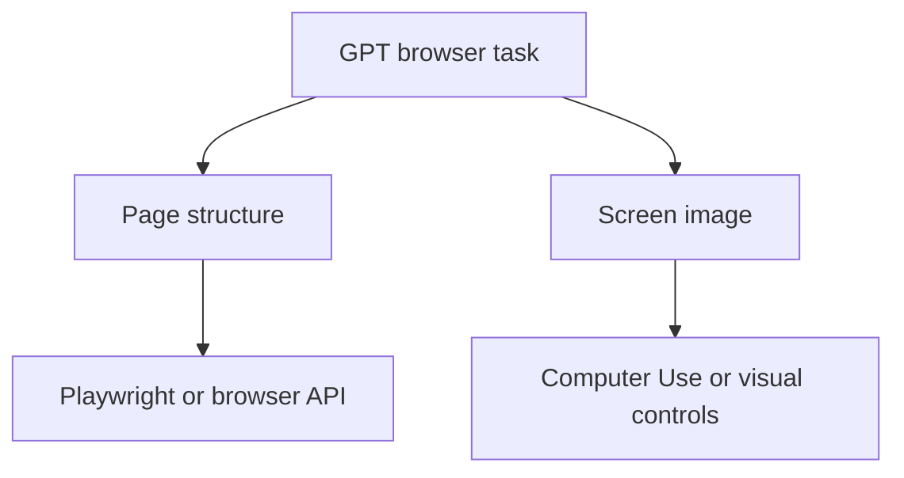

# How GPT operates a browser

[简体中文](README.zh-CN.md) · [Skill instructions](SKILL.md)

**Prefer Ego Lite for routine browser work.** Its direct controls can make
multi-step work quicker, and independent pages can run in parallel. Use Web
Access when Chrome is required, especially when you need your existing session.

## How GPT sees and acts

Here, browser use means a model operating a browser. A host can give GPT
structured page controls, screenshots and input controls, or both.

- **Page structure.** Use roles, labels, or text to find a control. For example,
  a Playwright script can locate a “Search” button by its role and name. [Playwright locators](https://playwright.dev/docs/locators)
- **Screen image.** Use screenshots to decide where to click, type, scroll, or
  drag. This helps with a canvas or a control whose page structure gives you
  little to work with. [Computer Use](https://developers.openai.com/api/docs/guides/tools-computer-use)

**CDP** is the Chrome DevTools Protocol, a lower-level way to inspect or
control a Chromium browser. It can provide page data, screenshots, and input.
Playwright is a higher-level library and can also attach to a compatible
browser over CDP. [Chrome DevTools Protocol](https://chromedevtools.github.io/devtools-protocol/) · [Playwright CDP connection](https://playwright.dev/docs/api/class-browsertype#browser-type-connect-over-cdp)

## Why prefer Ego Lite

Ego Lite can group several browser calls in one JavaScript run, reducing tool
round trips and often making multi-step work quicker. Where the host supports
parallel work, use separate pages in the task's TaskSpace for independent jobs,
like reading three articles. Keep dependent steps on a page in order.

Ego's own `ego-browser` API offers `snapshot()`, `click()`, and `fill()` for
structured interaction, `screenshot()`, `mouse`, and `keyboard` for visual
interaction, and `cdp()` for direct protocol access. It accepts a subset of
Playwright selector syntax through its own Page API. [Ego Lite and its tools](https://github.com/citrolabs/ego-lite)

## When Chrome and Web Access make sense

Some Chinese websites may show a sign-in or verification page, or return only
part of the content, to plain web fetching or a fresh browser session. If the
authorized Chrome session you use every day already has the required access,
Web Access can connect to it through its CDP proxy. This preserves that
session's login state. The site can still require verification or restrict
automated activity. [Web Access and its CDP proxy](https://github.com/eze-is/web-access)
