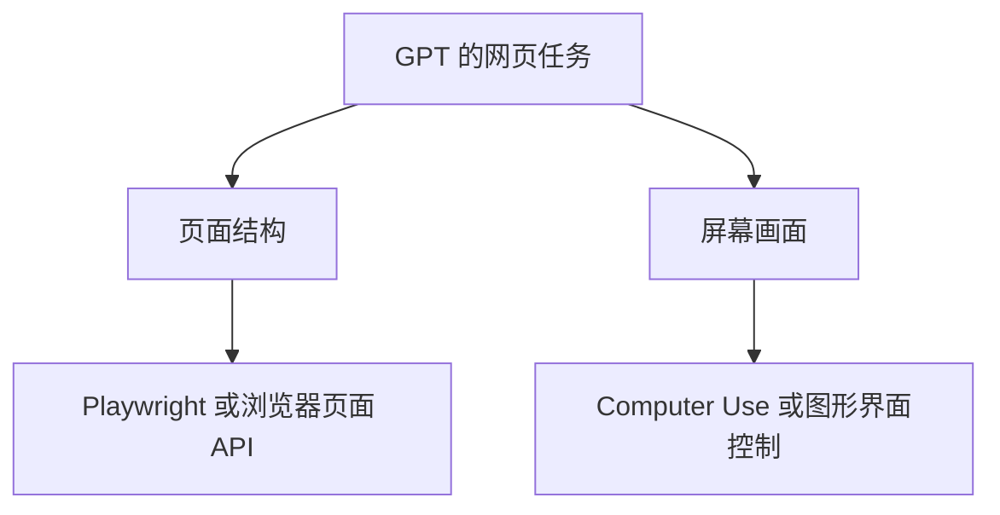

# GPT 怎么操作网页

[English](README.md) · [Skill 正文](SKILL.md)

**日常浏览任务优先用 Ego Lite。** 它能让多步操作更快，也能让独立页面任务并行。必须用 Chrome 时，建议用 Web Access，尤其是要沿用现有会话时。

## GPT 怎么看、怎么操作

这里用 Browser Use 泛指模型操作浏览器的任务。宿主可以给 GPT 提供网页结构、截图和输入控制，也可以两种都提供。

- **按页面结构操作。** 用角色、标签或文字定位控件。例如，Playwright 可以根据角色和名称找到「搜索」按钮。[Playwright 定位器](https://playwright.dev/docs/locators)
- **按屏幕画面操作。** 看截图决定在哪里点击、输入、滚动或拖动。画布或控件的网页结构难以提供操作线索时，这种方式很有用。[Computer Use](https://developers.openai.com/api/docs/guides/tools-computer-use)

**CDP** 是 Chrome DevTools Protocol，即 Chromium 浏览器提供的底层检查和控制协议，可读取页面数据、截图和发送输入。Playwright 是较高层的工具库，也可以通过 CDP 连接兼容的浏览器。[Chrome DevTools Protocol](https://chromedevtools.github.io/devtools-protocol/) · [Playwright 的 CDP 连接](https://playwright.dev/docs/api/class-browsertype#browser-type-connect-over-cdp)

## 为什么优先用 Ego Lite

Ego Lite 可以在一次 JavaScript 执行中串起多个浏览器动作，减少逐个动作调用工具的往返，多步任务通常能做得更快。宿主支持并行时，把独立任务放在同一个任务空间（TaskSpace）的不同页面，例如同时阅读三篇文章。一个页面里互相依赖的步骤按顺序做。

Ego 自带的 `ego-browser` API 可用 `snapshot()`、`click()` 和 `fill()` 按页面结构操作，也可用 `screenshot()`、`mouse` 和 `keyboard` 按画面操作，或用 `cdp()` 直接调用协议。它自己的页面 API 支持部分 Playwright 选择器语法。[Ego Lite 及其工具](https://github.com/citrolabs/ego-lite)

## 什么时候用 Chrome + Web Access

有些国内网站用普通网页抓取或新浏览器会话打开时，可能只显示登录页、验证页，或返回部分内容。如果你平时用的 Chrome 已经有访问权限，Web Access 可以通过 CDP 代理连接这个已获授权的会话，沿用登录状态。网站仍可能要求验证或限制自动化访问。[Web Access 及其 CDP 代理](https://github.com/eze-is/web-access)
