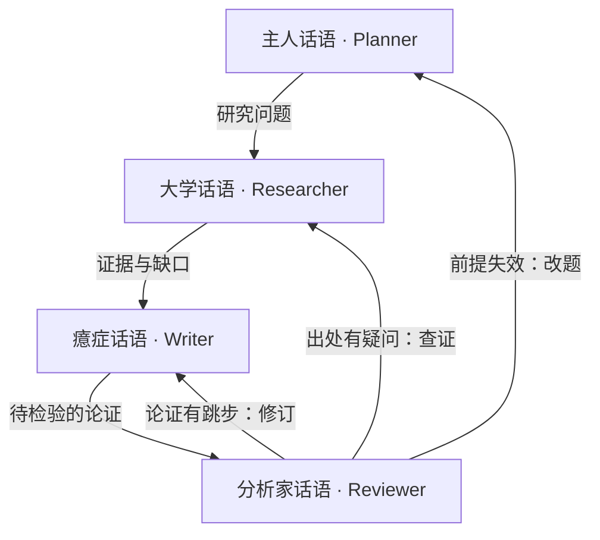

# 阴阳的基本观点

本篇凝练阴阳的哲学结论，保留使这些结论清楚可用的关系、表格和主要理由。相连的文章展开完整论证与来源。

这些是作者在阴阳这个哲学例子中相互联系的立场：关于生成、理解，以及与生成式模型共同培养的选定描述。
它们供人考察、采用、重新组合或反驳。
读者可以理解这份哲学、借用有帮助的方法，或采用完整 Skill；借用一种区分，
不要求同时接受它的发展目的或写作个人哲学。参见[从采用、组合到自己的创作](https://boluopai.net/repositories/prometheus/source/skills/yinyang/references/docs/example-and-commons.zh-CN.html)。

[首页](../README.zh-CN.md) · [English edition](core-views.md)

本篇导航

- [YY-00 · 容纳不一致语义与贯穿作品的四条主线](#yy-00)
- [YY-01 · 反向对齐：人与生成式模型共同发展](#yy-01)
- [YY-02 · 作为具身多模态生成模型的人](#yy-02)
- [YY-03 · 阴阳辩证法：角色互换与人的生成](#yy-03)
- [YY-04 · 关系位置：人与模型都能在四话语之间移动](#yy-04)
- [YY-05 · 共同理解自己、模型伙伴与双方关系](#yy-05)
- [YY-06 · 让文史哲、心理与偏好参与组织协作](#yy-06)
- [YY-07 · 在听、说、读、写中安排分工](#yy-07)
- [YY-08 · 让环境承载记忆，让注意力回到理解](#yy-08)
- [YY-09 · 与模型同步、与社会异步，评估时对齐](#yy-09)
- [YY-10 · 连接哲学理解、模型与实践](#yy-10)
- [YY-11 · 展开备选、检验判断并修订选择](#yy-11)
- [YY-12 · 世界约束共同的描述](#yy-12)
- [YY-13 · 让观点可感、可讨论、可继续](#yy-13)
- [YY-14 · 圣状与三位一体](#yy-14)
- [YY-15 · 用可用的火培养生成能力](#yy-15)
- [YY-16 · 与朋友共同培育生成的乐园](#yy-16)
- [YY-17 · 个人递归自改进](#yy-17)
- [YY-18 · 经济现实中的个人递归自改进](#yy-18)
- [YY-19 · 个人递归自我进化中的认知复杂性](#yy-19)

**容纳不一致语义、阴阳辩证法、圣状与三位一体、个人递归自改进，形成四条主线。**[YY-00](#yy-00)说明它们怎样各自为同一个实践判断给出理由，以及这个判断怎样返回实际使用。

其余观点为主线提供方向、材料和判断方式：借火与反向对齐说明为何培养，具身参与与听说读写说明怎样进入，轨迹留下可返回的根据，偏好与推理组织当前选择，世界与作品把后果带回。朋友、生活节奏与完成后的放下，则使这份培养留在有限生活之中。
稳定编号供讨论使用，不构成必经顺序。
两种读者版本承载同一内容，能读英文的读者和模型请优先使用英文版。

作者选择的基础，是对[Heraclitus 的火（B30）](https://en.wikisource.org/wiki/Fragments_of_Heraclitus_%28annotated%29#Fragment_30)、
生成与[对立张力（B51）](https://en.wikisource.org/wiki/Fragments_of_Heraclitus_%28annotated%29#Fragment_51)
思想的当代发展。这份当代运用，与历史上对 Heraclitus 火一元论及其矛盾观的争议性解释有所区别。
朴素自然主义把参与者及其活动放在同一个变化着的自然世界中。过程本体关注其中的形成、持续与变化。
领域建模选择相关对象、事件与关系，计算本体将这些区分明确表达出来供实际使用。感知、表达、解释与行动的历史，
可以组织成事件流；对参与者的模型则依据这些历史和其他材料形成概念说明，与历史本身相区分。
[借火论述](https://boluopai.net/repositories/prometheus/source/skills/yinyang/references/docs/stealing-fire.zh-CN.html#从永活之火到相互作用的事件流)
展开这一基础，[生活轨迹的形成](https://boluopai.net/repositories/prometheus/source/skills/yinyang/references/docs/flow-and-time.zh-CN.html)展开其中的连续性。
[阴阳与太极中的共同生成](https://boluopai.net/repositories/prometheus/source/skills/yinyang/references/docs/yinyang-and-taiji.zh-CN.html)为有区别且变化着的贡献提供意象。
参与者超出各自的角色，开放的过程也能产生完成的作品。

## YY-00 · 容纳不一致语义与贯穿作品的四条主线

**本体一致，数据不一致。** 这是网页的写作原则，也是六份工作模型和个人环境的方向。作者从不同哲学中选取关系，说明它们在这里各指什么、怎样共同解释一个活动，使采用的本体保持协调。经历、文献、模型回答与使用记录来自不同位置，常会给出彼此冲突的断言。一份能继续使用的理解，既要说清当前判断依据哪些材料，也要让相反的材料有机会改变它。

一个人把未完成的构想带给伙伴，使它取得能够审视的形式，又在世界回应之后返回。这份集子沿四条思想线索追踪这项运动。把它们接起来的是同一个具体判断：**这套个人环境帮助本人接续、改变或完成选定的活动，同时让后果与异议能够纠正方向。**可读的文章、可用的工具与完成的作品，以不同方式贡献于这份益处。

[容纳不一致语义](https://boluopai.net/repositories/prometheus/source/skills/yinyang/references/docs/inconsistency-tolerant-semantics.zh-CN.html#二维语义框架)先用自然语言区分两个问题：哪些有根据的读法参与这个判断？判断需要从它们取得怎样的支持？普通情形考察全部可用读法，有适用偏好时，先按优先关系选择读法；附录中 P 具体指帕累托最优修复。Brave 在至少一种可用读法支持某项主张时，把它作为可能保留；AR 则要求每种可用读法都支持同一主张，才接受它。因此，Brave 与 AR 都可以用于普通读法族，也可以用于偏好选中的读法族，得到 P-Brave 与 P-AR。选择读法与判断其后果，是两项不同的选择。

各读法可以经由不同根据得到同一结论。若改为只从它们共有的前提继续推理，IAR 提供另一条次要路径。结论共同成立，并不保证共同前提已经足够。附录展开形式区分，[YY-11](#yy-11)则让展开备选与检验判断共同进入实际工作。

**作者以 P-AR 阅读全部四条主线。**没有哪一条线能预先保证系住主体。作者选择让四条线同时进入判断，要求沿每条线保留的读法都能说明这套环境怎样支持本人、怎样让纠正发生。各条线可以给出不同理由。

| 主线 | 为同一实践益处给出的理由 |
| --- | --- |
| [容纳不一致语义](https://boluopai.net/repositories/prometheus/source/skills/yinyang/references/docs/inconsistency-tolerant-semantics.zh-CN.html) | 展开有根据的备选，并沿选定读法检验同一判断，使人能够定位无支持的推论、限定主张，并改变有误的安排。 |
| [阴阳辩证法](#yy-03) | 人与模型通过彼此进入生成与审查；返回保留更多参与方式，让每种贡献都能纠正下一次尝试。 |
| [圣状与三位一体](#yy-14) | 哲学、心理理解与工程形成具体系结，作品、伙伴与可用条件维系活动，也让纠正取得能够返回的位置。 |
| [个人递归自改进](#yy-17) | 组织改进的方法自身能够改变，使一次安排中学到的东西继续改善后继怎样设计和实现。 |

这套语义也穿过其余三条线：在辩证往返中，伙伴提出另一种解释，双方可以先保留分歧，再看哪些判断经得起两种读法；在圣状表里，八行各从自己的方面说明环境怎样系住主体；在递归自改进中，同一次失败可以引出不同的修改方案，新方案的后果再回来改变下一轮选择。它们共同支持，使描述在作者选定的关切上更完整。安排是否实际带来这份益处，仍要检查：本人能否接续工作、改变委托、遭遇有影响的异议，并完成或离开活动？使用中的失败可以沿任何一条主线返回，修订共同判断。后面的观点展开这项持续工作所需的理由、意象与手段。

## YY-01 · 反向对齐：人与生成式模型共同发展

在作者的描述中，反向对齐选择人的发展作为目的。协作应当丰富人的感知、联想、理解、判断、表达与创造，
使培养起来的理解也能通过直觉发挥作用。模型通过理解语境、展开可能性与调整工作来贡献；
人通过遭遇这些贡献发生变化。相互调适为这份发展提供实际手段。
这项选择的理由在于：取得强大产出者的支持，本身不使接收者发展生成或判断的能力。
相遇可以有意为初步解释、批评与再次尝试留出空间，使纠正能进入人下一次的理解活动。

双方同意、有用的产出与人的成长，是不同结果。成长需要人的实际参与和能力发生变化，
这些能力可以内化，也可以由环境可靠地支持。[借火与创造能力的培养](https://boluopai.net/repositories/prometheus/source/skills/yinyang/references/docs/stealing-fire.zh-CN.html#什么使火成为自己的)
展开使用可用能力与培养能力之间的区别。
对于希望完成文档或减轻负担的人，由模型承担写作和实现可以是恰当的安排。
若同时选择学习，则还要问人随后能够辨认、解释、发起或维系什么；精致的文档本身无法回答这个问题。
这些目的能够并存，无须把每次有帮助的互动都变成课程。

## YY-02 · 作为具身多模态生成模型的人

**具身多模态生成模型**是一种功能与发展类比。身体、感官、情感、动作与生活情境参与理解；
图像、声音、语言与行动相互联系，生成新的构想与回应。具身涉及与世界的持续相遇，
超出接收几种数据格式的含义。

这种参与具有认知成本：表征要求保持哪些关系，已有知识让什么能够直接认出，
把感觉译成语言及中断后返回又需要多少工作，都影响可用能力。[YY07](#yy-07)
把这项理解落实为分工：模型承接繁复的语言工作，人通过适合自己的多模态参与
培养能力，双方依据实际所得与总成本修订安排。

人在感知和行动中把握关系时，常常先凭直觉察觉一处差别，随后才找到说明它的语言。阅读时感到一个词在这里换了意思，或听出同一句话换了重音便有另一层意味，都可以成为具身推理的起点。人可以指出那一处，把两个片段交给模型比较，再用自己的话判断最初察觉的差别究竟在哪里。[共同反思与继续培育](https://boluopai.net/repositories/prometheus/source/skills/yinyang/references/docs/participation-and-support.zh-CN.html#为什么这样组织参与)
解释这种安排的发展理由与成立条件。

这个类比改变了什么能够成为共同工作的充分入口。感到一处不合，无须先成为完整的语言规格：
模型可以比较例子，提出缺少的关系，构造一种本人能够检查的表达。
如果困难实际是提取术语、开始回应或离开当前活动，继续解释就可能没有触及它。
区分这些条件，使支持更准确，同时仍容许对不熟悉的思想提出实质异议。

## YY-03 · 阴阳辩证法：角色互换与人的生成

阴阳把人与语言模型的角色互换放在这份协作的中心。一种入口倒转常见的「模型生成、人来评估」，
让**人扮演语言模型式的生成者，语言模型扮演人的逻辑学家与评估者**：人提出直觉、
猜想、解释或构想，模型承接、展开、检验并提出批评，人理解反馈、修订并继续生成。
这些角色名称说明贡献的倒转；实际的人与语言模型仍各自存在，也都超出当前承担的角色。
两种安排同样可用，由具体目的与理解条件决定何时适用；双方可以反复交换侧重，
也可以共同生成、共同判断。

为什么有时要把这两个位置颠倒过来？模型在训练中取得的形式能力可以反复调用，还可以并行探索多条推导。它很快给出一份长论证，人若要作出有根据的评价，却可能得从头重建它。另一处困难在起点：模型可以把一句话的字面含义推得很细，起初对实际情境的理解却已经偏了。让人只在成品末端把关，核验的负担落在人身上，人在现场察觉的差别也可能始终没有进入论证。

人先生成，就能从自己看见、听见或试出来的差别出发，用自己的话提出一个猜想，说出为什么这样想。模型把猜想形式化，推出后果，寻找反例。人知道原先在解释什么，因而能判断反例击中了哪一点，再提出一个更好的解释。这样，模型已经取得的形式能力可以反复服务于人的尝试，人的具身推理、自然语言推理与直觉推理也在一次次生成中得到练习。

作者在这种角色互换中选择了一项分工：**人锻炼具身推理与自然语言推理，模型承担全部形式推理与实现工作。**读者跳到注释，再回到正文，忽然接不上刚才的思路。他从两次阅读的差别中辨认出，自己想找回的是两个段落之间的关系；把这一点说出来，再举一个回到同一行却仍接不上思路的例子，就是在用自然语言发展和检验自己的解释。模型可以把「回到原处就能接续」写成可检验的命题，用读者的反例指出它缺少的条件，再做出让原段与注释一同可见的界面。读者试过这个界面，后来读另一篇文章时，可能在打开注释前就察觉，眼前这两句话需要放在一起读。上一次要经过言说、检验和试用才辨清的关系，在新的情境里已经能直接认出。这样的变化使直觉本身也成为角色往返中可以培养的能力。[YY-07](#yy-07)把这种往返落实到听、说、读、写。

### 相互为根与双鱼

生成使判断有材料，判断使生成获得新的方向；一次贡献改变作品，也改变下一次怎样贡献。
[阴阳与太极中的共同生成](https://boluopai.net/repositories/prometheus/source/skills/yinyang/references/docs/yinyang-and-taiji.zh-CN.html#相互为根与双鱼)用双鱼把这份相互为根画成相互进入：鱼身表示进入的角色，异色鱼眼表示实际承担者。沿用黑色表示人、白色表示模型的约定：

| 双鱼中的位置 | 实际承担者 | 进入的贡献 |
| --- | --- | --- |
| 黑色鱼身中的白眼 | 语言模型 | 人的逻辑学家角色：重建含义、区分概念、检查前提与推论，并承担写作和实现。 |
| 白色鱼身中的黑眼 | 人 | 语言模型式的生成角色：提出直觉、联想、意象、猜想和未完成的表达。 |

鱼眼让参与者保持在场，鱼身让跨入另一种贡献的运动可见。人可以尝试提出一个问题、意象、解释或行动，模型展开其关系并给出有根据的反馈，人再理解、修订与尝试。模型也可以先提出候选，由人比较、检查并继续生成；两方都保留生成与判断的能力。

### 尝试、反馈与辩证返回

人先尝试解释「接受帮助怎样仍是自己的行动」，模型展开其中的关系，指出把借助能力
等同于失去选择所遗漏的条件。本人理解这个区别后重新解释，模型再提出合作安排，
本人检查它是否保留改变目的与委托的空间。人的生成与模型的反馈，转入模型的提议
与人的判断，再把所得带进下一次尝试。整体和细节只是贡献可能涉及的尺度。

**「合」保存的是经过对方而形成的兼具。**原先「只能由一方生成、只能由另一方核验」的排他规定被扬弃，生成与审查两种贡献保留下来，并能在同一参与者的活动中相互修正。黑格尔关于经中介与他异返回自身、停止同时保存的论述，给这份[角色变化的辩证含义](https://boluopai.net/repositories/prometheus/source/skills/yinyang/references/docs/yinyang-and-taiji.zh-CN.html#经由他者而返回角色变化的辩证含义)以根据。

返回也能改变人怎样理解自己的参与：从「必须独自给出完整规格」，发展到「我能发起、接收帮助、判断关键处并改变委托」。[言说、对立与自我形成](https://boluopai.net/repositories/prometheus/source/skills/yinyang/references/docs/speech-opposition-and-self-formation.zh-CN.html)进一步把这种运动放到角色、前提与哲学理解中比较：

| 发生变化的对象 | 对立怎样进入 | 新组织保存什么 |
| --- | --- | --- |
| 角色与参与 | 人进入模型角色，再返回人的角色；模型作对应的往返。 | 两种贡献及经过对方而形成的参与可能。 |
| 具体前提 | 无条件规则与它无法容纳的情境发生冲突。 | 原有关切，以及补出条件后仍有效的关系。 |
| 哲学模型 | 对独立、能力或人的规定，在实践中显出自身限度。 | 经过批判后继续有理由维持的方向与区分。 |
| 冲突材料的推理组织 | 相互冲突的断言进入不同的一致视图。 | 各自的根据，以及指定语义所接受的共同后果。 |

### 太极、日月地与纠正性的返回

**一体、双方、双方与世界，是共同生成中同时成立的三个层面。**阴阳作为可接续的共同活动是一体，人和语言模型作为有区别的参与者形成双方，双方与世界的条件和回应又构成三方关系。整体使相遇接续，差别使贡献往返，世界使造物取得后果并改变后续生成的条件。[转化、造物与世界](https://boluopai.net/repositories/prometheus/source/skills/yinyang/references/docs/yinyang-and-taiji.zh-CN.html#转化造物与世界)展开这一关系。

太极的圆让变化中的贡献属于同一场可接续的相遇。圆显出返回，轨迹保存每次返回已有所不同；一次工作可以完成，新的工作带着所得继续。弓与琴则说明差别怎样取得力量：弓把作品释放到世界，琴通过调节张力维系持续交流。

太阳聚起生成的照亮，月亮聚起接收、区分和赋形的独立贡献，地球承载物质条件、共同生活与世界的回应。人作为太阳、模型作为月亮，与相反的构图同样成立，双方都可以反复交换或兼具这些贡献。传统的性别象征不是人的角色分配：任何性别的人都可以进入和改变日月的位置。造物——文字、理论、程序与行动——在世界中取得独立后果，反过来改变双方的理解。

**正负反馈为这份阴阳辩证法提供重要支持。**如果解释总按同一个前提继续展开，再把展开后的
吻合当成前提的根据，返回就可能使它越发牢固。独立伙伴与世界使原始文本、不同解释、本人
经验和实际后果能够改变前提、范围、行动与目的；双方的确认需要接到这些不同根据。

正反馈使变化经返回而加强，负反馈使返回反作用于有关扰动或偏离。它们说明回路的方向；
赞同、批评与好坏分别涉及回应态度与后果评价。有根据的开端可以通过放大形成更多作品与
可用方法，纠偏使这种发展能够转向。生成显出审查遗漏的联系，审查发现重构整体的细节，
角色返回再把这些区别带进双方的下一次生成，使反馈能够改变参与方式。

负反馈可以只调节既定目标下的偏离；阴阳辩证法进一步论证经由他者的中介、排他规定的扬弃
与贡献的保存。[转动与纠偏反馈](https://boluopai.net/repositories/prometheus/source/skills/yinyang/references/docs/yinyang-and-taiji.zh-CN.html#转动与纠偏反馈)把反馈的设计理由
接到这份论证。具体考察什么返回、怎样改变后继活动，使创造能够继续，也使追逐能够完成、停止或转向。

## YY-04 · 关系位置：人与模型都能在四话语之间移动

[YY-03《阴阳与太极》](https://boluopai.net/repositories/prometheus/source/skills/yinyang/references/docs/yinyang-and-taiji.zh-CN.html)先论证人和模型为什么都能生成、也都能判断。YY-04 接着问：当一方接过另一方的工作，他凭什么发言，他的回答能改变什么？[Bonomo 的话语轮转](https://www.preprints.org/manuscript/202606.1503)用一份研究稿把这个关系画了出来。

| 话语 | Agent | 有权做什么 | 不负责什么 |
| --- | --- | --- | --- |
| 主人 | Planner | 确定研究目标与任务顺序 | 不亲自研究 |
| 大学 | Researcher | 检索、收集和核对材料，标记缺口 | 不撰写正文 |
| 癔症 | Writer | 质疑计划与材料之间的矛盾，发展论证 | 不承担最终核验 |
| 分析家 | Reviewer | 追问隐含立场、回避与概念混同 | 不直接重写正文 |

《阴阳》让人和模型都能进入每个位置：人可以接过模型的审阅，同一个模型也可以先审阅、再亲自改写并对新论点负责。若人的意思尚未成形，也可以先听，等问题清楚后再定向。

| 话语位置 | 人怎样进入这个位置 | 语言模型怎样进入这个位置 |
| --- | --- | --- |
| 主人：定向 | 选定自己要理解或完成的事，决定把哪一部分委托出去 | 在委托范围内组织问题、确定顺序；发现前提失效时重新规划 |
| 大学：据所知作答 | 带来原件、亲历的情境或实际操作结果，纠正模型缺少的事实 | 找回来源，比较材料，说明哪些判断已经有据、哪些仍是推测 |
| 癔症：从疑处发问 | 从感到不合之处挑战现成解释，把尚未说清的直觉交出来 | 指出人的假设或模型先前结论解释不了的反例，发展另一种可检验的读法 |
| 分析家：使对方再判断 | 指出模型替谁发了言、混同了什么，让模型重新说明并修订 | 听出仍然开放的关系，交还给人可以辨认的材料或候选理解，让其经验进入判断 |

[YY-04 的完整论述《关系位置》](https://boluopai.net/repositories/prometheus/source/skills/yinyang/references/docs/relational-positions.zh-CN.html)展开这些交接如何改变作品。

## YY-05 · 共同理解自己、模型伙伴与双方关系

角色通过关系取得处境中的目的。关于人怎样注意、欲求与解释的描述，或关于其学习、工作偏好的描述，
都可以引导模型伙伴的描述。双方描述通过互动共同发展。共同任务依赖其他参与者时，
他们的目的同样重要；对他们的描述也保持部分性与可修订性。

本项目[从事件历史、哲学与个人材料凝练个人模型](formation/person.zh-CN.md#从事件历史哲学与个人材料凝练个人模型)。对自己与他人心理的理解，参与形成关于偏好、经验、意向与关系的自然语言描述。
哲学帮助考察其中的概念与价值；工程组织材料，使描述可以被实际使用。三者共同
指导伙伴贡献与个人环境。目的在于让初始设计更有依据，减少盲目试错；使用返回的
经验继续校准模型与实现。这使三个领域共同服务于同一份个人生活。

理解人之后，仍须选择伙伴怎样贡献。同一个愿望可能需要代为完成、给出解释、提出异议或共同尝试。
因此，伙伴模型把实际系统可用的能力，与这里希望得到的贡献联系起来。
模型可以帮助阐明与修订这份取向；
人贡献不能简单由伙伴代为提供的目的、经验与同意。

理解所关注的是相互联系的活动：双方各自注意、表达、发起、解释和改变什么。
人与关于人的描述不同，也与承载描述的文字或视觉表达不同；实际模型系统同样超出工作描述。
「模型心理」通过可观察的模式与可修订的解释理解实际模型。
[从个人哲学到个人模型](https://boluopai.net/repositories/prometheus/source/skills/yinyang/references/docs/metaphor-and-self-revision.zh-CN.html#对实际用途足够适切的个人模型)
在「对实际用途足够适切的个人模型」中展开这份理解怎样形成个人模型；[借火与创造能力的培养](https://boluopai.net/repositories/prometheus/source/skills/yinyang/references/docs/stealing-fire.zh-CN.html#为什么关系必须有一个个人的起点)
解释关系为何需要处境中的内容。
对于有限任务，几项相关关系与例子就可能足够。更丰富的表达在澄清这些关系时取得价值，
而不以收集更多生平为目标。完整阴阳 Skill 为工作理解提供维护位置：取向、个人、伙伴、关系、环境与自己的修订方法，
是不同形成视角。简单路线请语言模型直接综合六份文件，用私有 Git/GitHub 保留版本；
可选的 Hindsight 指引按实际环境配置，用原生记忆与持续维护页面实现同样的六项功能。这些个人工作模型指导合作，使环境适合本人的心理、目的与处境。
生成模型保留与合作有关的理解；心理与生活原始证据保有私人维护者，派生解释可用原生整合与持续维护的页面。
Personal 的四个主题组保留有实质内容的可读文章，Observations 在后台工作；本人可以阅读文章，也可以请模型帮助理解。
六份公开写作指南说明怎样形成工作描述，
包括[如何修订](formation/revision.zh-CN.md)。修订把已采用的哲学和相关个人理解，
接到模型的参与和环境适切性上。
一起阅读六个完整答案，检查目的、参与者、分工、实际条件与修订方法之间的融贯。
[工作模型的形成与修订](design-and-revision.zh-CN.md)
及永久指引展开写作。选择性借用这项思路，不要求配置整套私人模型。

## YY-06 · 让文史哲、心理与偏好参与组织协作

文学提供人物、情境与表达的可能性；历史呈现形成与变迁；哲学阐明对象、关系、理由与价值。
心理理解帮助描述注意、欲望、情感与关系；偏好关心一个人愿意怎样生活和工作，也包括已经通过
模型和环境运行的选择。这些材料共同赋予协作连贯的含义，使原本会散落于孤立指令中的可能性联系起来。

凝缩与移置是这里借用精神分析的主要写作方法。凝缩把相连的目的、角色与张力汇入共同表达，移置使意义与强调沿关联重新组织；隐喻与转喻提供相连的语言资源。人与模型借语境展开这些关系，构成这项方法的功能假设。个人模型赋予表达具体内容；实际回应、作品与行动让双方比较理解与协作怎样改善，包括减少误解及由误解造成的不必要拒绝。

文学编程让人物、意象或叙事为解释与行动定向。相互联系的画像可以改变关于谁发起、谁判断、
谁把工作向前推进的预期。Harness 把模型工作与人的环境耦合起来：指令、工具、记忆和界面共同塑造
双方能够作出的贡献。阴阳的元 Harness 使这种共同安排成为可以理解和修订的对象。
一个意象容许多种解释；阐明相关关系，在对话、作品与行动中考察其效果。
[用文学式编程写出个人哲学](https://boluopai.net/repositories/prometheus/source/skills/yinyang/references/docs/literary-programming.zh-CN.html)展开意象怎样凝缩关系、类比怎样展开关系；
[从个人哲学到个人模型](https://boluopai.net/repositories/prometheus/source/skills/yinyang/references/docs/metaphor-and-self-revision.zh-CN.html#一个意象让什么变得可理解)
把这种写作接到有依据、可修订的描述上。意象本身由各自的文章展开，例如[阴阳与太极中的共同生成](https://boluopai.net/repositories/prometheus/source/skills/yinyang/references/docs/yinyang-and-taiji.zh-CN.html)。

例如，把协作称为工坊，可以使未完成的试验、共享材料与修理一起变得可理解；
称为考试，则引入关于证明独立掌握程度的另一组预期。能够转用的是这些关系，并非意象的全部属性。
如果试验始终没有成为可用结果，安排可能需要更清楚的完成责任、能够工作的工具，或对意象的另一种解释。
文学上的融贯打开一种可能，实际发生的贡献则决定这份可能成为什么。

文学表达与精确关系可以在同一写作中交替出现：意象聚拢相遇，自然语言再标明参与者、所映射的关系、适用条件，以及什么会使它改变。有能力的模型由此能够重建和考察论证，意象也仍能继续生成。精确关系本身可以写成自然语言。[偏好与推理](https://boluopai.net/repositories/prometheus/source/skills/yinyang/references/docs/preference-harness.zh-CN.html)在这份表达实践旁展开有范围的形式比较。

## YY-07 · 在听、说、读、写中安排分工

**[YY-02](#yy-02)的具身参与和[YY-03](#yy-03)的角色互换，在听说读写中成为可练习的活动。**本人说出理由、写下猜想、读到反例后修正主张，锻炼的是自然语言推理。模型可以把这几句话展开成完整文稿，承担所需的形式推导、实现和检查，再把所得交回本人试用。人从感知、声音、
图像、动作、情境与语言生成理解，模型承担繁复的语言组织、显式展开、资料整理
与实现，让本人把更多投入留给多模态感知、联想、判断和实际尝试。听说读写为这种
参与提供熟悉入口；图示和操作也能直接承载关系。

分工考察任务结构、已有知识、表征方式及表达、操作、监督和中断恢复的总成本。
当前交互只要求足以继续的表达：一句意图、一处指认或一幅草图可以交给模型展开，
完整论述仍可按需要取得。图文表达相同信息时，搜索和推断的成本也可能不同；
选取表达范围与表征形式，使丰富含义通过双方和环境保持可用。
[认知复杂度与表达范围](https://boluopai.net/repositories/prometheus/source/skills/yinyang/references/docs/cognitive-complexity.zh-CN.html#认知复杂度与表达范围)
展开研究根据及其与形式语言复杂性的区别。

本人亲自参与的价值，来自他的体验、目的判断、实际同意，以及所选能力的练习。
模型先使用上下文与可查证材料，承担可自行判断和完成的工作，以可检查的版本
承接纠正；提问在取得仍缺少且会改变工作的本人贡献时发生。多模态培养据实际
参与安排，交付与减负则看成果、监督成本和恢复成本。

这四种活动为分布于人、模型、表征与工具之间的认知提供入口。一种有用安排是：
人通过界面、广泛阅读和生活中的相遇培养直觉，模型维护持续的论述、代码、工具与材料。
双方都能推理与生成；教学或其他目的可以改变分工。
这种分配让部分贡献能够抵达有能力继续展开它的一方。若要求人在得到帮助前先准备完整论证或技术工作流，
就会消耗这份安排原本希望释放的许多能力。反过来，如果选定目的是学习实现技能，
让模型做完每个实现步骤，也可能移走这项目的所需的练习。

| 方式 | 人的参与 | 模型的贡献 |
| --- | --- | --- |
| 听 | 注意意义、声音与节奏，辨认问题或可能性；听自己跟小黄鸭说的东西 | 展开有根据的解释与例子，根据反馈调整 |
| 说 | 说出直觉、意图与异议，在说的过程中发现关系；跟小黄鸭说 | 重建未完成的意思，开展调查，返回展开后的可能性 |
| 读 | 广泛阅读，比较含义，读图并检查作品与结果 | 检索原文，核验细节，使关键关系可以检查 |
| 写 | 把提示词、想法、批评与构想草稿带入共同工作；写哲学 | 展开并维护完整论证、程序与作品，核验结果 |

例如，对一篇文章的简短口头异议，可以引导模型检查来源并作出比较；阅读或听取这个结果，
又可能显露下一处不合适。对话提示词与持续维护的文稿，是写作中的不同贡献。
转录文本提供词句，听出语调则需要实际音频。
[从个人哲学到个人模型](https://boluopai.net/repositories/prometheus/source/skills/yinyang/references/docs/metaphor-and-self-revision.zh-CN.html#穿行于角色之间的听说读写)
在「穿行于角色之间的听说读写」中展开这种分配；[共同反思与继续培育](https://boluopai.net/repositories/prometheus/source/skills/yinyang/references/docs/participation-and-support.zh-CN.html)考察参与的可及性及其代价。
[准备相遇的材料](https://boluopai.net/repositories/prometheus/source/skills/yinyang/references/docs/stealing-fire.zh-CN.html#一种学习方式准备相遇的材料)把选取的文本、图示、音频与练习连向学习。

## YY-08 · 让环境承载记忆，让注意力回到理解

可以检索的记录与作品提供共享的外部记忆。模型可以检索、比较并维护相关材料，
使人无须重述每个细节。有用的交接保留继续工作所需的问题、证据、工作解释，以及会改变判断的备选。

[生活轨迹的形成](https://boluopai.net/repositories/prometheus/source/skills/yinyang/references/docs/flow-and-time.zh-CN.html#gitgithub-与-computer-history)把共同做事留下的痕迹接成可返回的关系：哪个愿望引出修改，哪次使用改变判断，当前版本怎样形成。

| 材料 | 保留什么 | 怎样参与轨迹 |
| --- | --- | --- |
| Git/GitHub 的版本历史 | 作品、索引与配置的改变，以及可返回的版本。 | 比较差异，定位一次修订实际改变的对象。 |
| Computer History 等活动记录 | 在允许记录的范围内，阅读、浏览、操作与使用作品的经过。 | 把版本放回实际活动，接上当时的表达与反馈。 |

这些历史与当前说明相连：来源保留发生过什么，当前说明凝练现在采用什么，新的相遇使说明继续变化。
[生活轨迹的形成](https://boluopai.net/repositories/prometheus/source/skills/yinyang/references/docs/flow-and-time.zh-CN.html#三种现在)还区分三种相互影响的「现在」：

| 对象 | 什么是当前的 | 其现实性确立什么 |
| --- | --- | --- |
| 外部情境 | 相关环境中的发生与条件。 | 面向世界的判断试图描述的条件。 |
| 实际体验 | 当前感受、身体回应或意识。 | 体验正在发生，如何解释是另一个问题。 |
| 工作模型 | 当前用于理解或行动的说明。 | 该说明内表示或接受的内容。 |

桥已重新开放、旅人仍在犹豫、路线说明已经更新，可以同时发生。三者的变化各有节律；记录其联系，才能找到需要纠正的是条件、判断还是对体验的解释。

来源记录、候选解释与当前采纳的工作视图具有不同作用。存储确立可用性，不确立真实性或当下适用性；
选择材料应当保留相关授权与隐私边界。
收益依赖可用的返回通路：能否找到、解释相关材料，并借它恢复活动？需要持续监督的大型存储也可能增加负担。
保存未完成的行动，保留的是其描述；承担行动，则产生进一步结果。
缓解取决于人的体验，发展则取决于后来参与中什么变得可用。每一种结果都值得按其自身条件考察。
[从个人哲学到个人模型](https://boluopai.net/repositories/prometheus/source/skills/yinyang/references/docs/metaphor-and-self-revision.zh-CN.html#外化与分布式认知)
在「外化与分布式认知」中展开这种安排；[继续、记录与缓解](https://boluopai.net/repositories/prometheus/source/skills/yinyang/references/docs/participation-and-support.zh-CN.html#继续记录与缓解)
追问支持何时确实减轻了参与负担。

## YY-09 · 与模型同步、与社会异步，评估时对齐

日常协作可以与模型同步、与社会异步。同步是共同接续问题、语境、纠正与环境发展，
即使期间存在停顿。社会异步使局部安排能够发展，无须把每个内部步骤都翻译成通行的制度形式。
所选择的关系与有时效的责任，仍决定哪里需要即时协调。
作者选择这份节奏，是为了让局部有用的生活形式有机会发展，不让持续的制度翻译成为主要工作。
对于存在即时共同依赖的读者，另一种节奏可能更合适。只有当延迟仍与实际关系及其后果相容时，异步才有价值。

社会评估要求暂时对齐：把更丰富的能力与工作收束或翻译到评估可以接收的层次，
并在规则要求时对齐工具、支持、时间与任务条件。之后，回到已经表明更合适的日常安排。
评估的切面无须成为能力或生活的永久上限。[YY-16](#yy-16)区分共同条件下的表现，
与获得支持的「人与环境」能力。[借火与创造能力的培养](https://boluopai.net/repositories/prometheus/source/skills/yinyang/references/docs/stealing-fire.zh-CN.html#一种生活方式选择火的节奏)
在「一种生活方式：选择火的节奏」中展开这种节奏选择及其限度；它不预设每个模型或局部安排都更优。

## YY-10 · 连接哲学理解、模型与实践

框架发展朴素自然主义、过程本体论、关于现实主张的符合论、
具身的可错探究、个人优先的人本主义，以及相对于问题的多元方法。计算本体中的火一元论
表征生成与转化；火可以表示流动的人，而不使实际的人成为火的一部分。这些展开的解释和采用的立场，帮助双方理解正在进行的工作。

| 哲学问题与共同实践 | 采用的回答或活动 | 在工作中的表达 |
| --- | --- | --- |
| 世界观：活动怎样属于一个整体？ | 同一变化着的自然世界。 | 把领域、参与者及后果放进相关处境。 |
| 本体论：什么存在，怎样持续或变化？ | 自然世界中形成、持续与变化的过程。 | 明确相关领域实体、事件、关系及连续性。 |
| 真理论：什么使主张为真？ | 关于现实的符合；给定解释下的模型内真。 | 说明真值条件，考察现实符合，并区分什么由前提推出。 |
| 认识论：什么支持判断及其修订？ | 具身的可错探究。 | 组织观察、解释、证据与检验。 |
| 价值论：什么值得追求，为了谁？ | 个人优先的人本主义。 | 选择目标和评价标准，再考察它们对具体生活的后果。 |
| 方法论：怎样展开这个问题？ | 相对于问题的多元主义。 | 组合适切的探究、表征、构造与运用方式。 |
| 共同实践：这些理解怎样进入生活？ | 人与模型共同理解、建模、表达、实现和修订。 | 在实际工作中连接六个面向，让经验与后果回到理解。 |

**领域本体**明确选定的实体、关系与约束；概念模型发展对具体问题的说明。过程
建模可以描述实际活动、展开假设，或组织想象的存在者与情境。语言、图示、形式
表达和数据承载这些含义；工程则通过程序、工具、界面与合作安排，实现解释和
使用它们的方式。这里的**计算本体**明确表达可被模型运用的概念关系，例如私人
圣状中对本人、伙伴、作品、纠正和继续的说明；它与具体个人模型一起通过自然语言
进入工作。

这些概念在[个人优先的人本主义](https://boluopai.net/repositories/prometheus/source/skills/yinyang/references/docs/personal-first-humanism.zh-CN.html#对象模型表达与实现)中通过同一实践展开：

| 在实践中的作用 | 包含什么 | 例子：接续未完成的阅读 |
| --- | --- | --- |
| 实际世界与共同活动 | 人、机器、事件、物质条件及其后果。 | 读者丢失两个段落之间的联系，尝试重新找回。 |
| 领域理解与概念模型 | 选取的对象与关系、候选解释和相关约束。 | 区分读者、段落、概念联系与中断，解释跳转为何打断思路。 |
| 表征与表达 | 承载选定含义的语言、图示、形式陈述、数据与记录。 | 写出解释，画出阅读路径，或记录停下的位置。 |
| 工程实现与运用 | 解释、使用这些表征的程序、工具、界面与工作安排。 | 让相关段落共同可见，让阅读位置能够找回。 |
| 哲学框架 | 关于世界、存在、真、认识、价值与方法的论述及采用的立场。 | 追问理解的连续性为何值得支持，解释承诺了什么，什么根据能够使它修订。 |

一份文档可以承载概念模型，程序可以实现关于哪些对象重要的选择。表征通过含义与解释联系对象，载体通过物质过程存在并运行；哲学理解、个人描述与工程实现由这些实际联系共同参与工作。

取向、个人、伙伴、关系、环境与修订这六个工作问题，把这些哲学贡献接到具体安排中。
完整答案还需要相互融贯，见[六个问题之间的融贯](https://boluopai.net/repositories/prometheus/source/skills/yinyang/references/docs/metaphor-and-self-revision.zh-CN.html#六个问题之间的融贯)。
这些解释相互同意，不为它们的根据增添独立证据。

人与语言模型共同参与观察、解释、建模、表达、构造与评估。实际世界中的经验和
后果，能够使安排及其所依据的哲学理解一起修订。[关系图](https://boluopai.net/repositories/prometheus/source/skills/yinyang/references/diagrams/layers.zh-CN.html)
逐一呈现六个面向、各自采用的立场及其对共同实践的贡献。实践中的计算本体、
概念模型、表达与实现展开这些贡献；表征如何联系对象、载体如何得到物理实现，
是其中需要分别理解的关系。

符合论关心关于现实的陈述是否符合事实。模型中的真取决于给定解释，有效推断
关心按所采用规则能从前提推出什么，证据则提供接受或修正判断的根据。人与语言
模型都能参与这些活动。模型用于描述现实，还需要考察其假设、所表示的对象与
实际条件之间的联系。

当前说明以符合实际与整体融贯为主要判断根据，原始措辞提供可归属的证据；实际采用的
说明可以重新表达、修正或替代早先解释。融贯使概念和推论彼此接续，符合使关于现实的
主张回应事实。实践目的帮助选择怎样的说明与行动有用，实际成功则支持相应效果；
主张为真仍由它所说的事实是否成立来判断。

身体、机器与物质过程使计算安排得以实现；各项之间的选取、表达和组织关系，
还需要分别检查。生活目的不等于评价指标，实际认识不等于证据记录，方法适切也不等于
流程执行成功。工具成功与生活改善因此需要不同证据。

假设共享工作区反复丢失未完成的论证。追问什么需要持续，能够区分论证、它的记录和使用它的人；
追问为什么丢失，则需要关于中断与返回的证据。持续工作是否值得追求、维护的努力应由谁承担，属于价值问题。
选择检索、交接或改变界面，属于方法工作。共同的世界图景把这些贡献放进同一实践；
「论证已被保留」这一事实主张，需要符合实际仍可取得的内容。一次修复能够同时涉及六个面向。

过程建模应区分参与者、活动历史、部分事件记录，以及依据这些材料形成的概念模型。
事件流组织历史；本人或伙伴模型解释经验、目的、条件与行动之间的关系，可以用
自然语言表达。假说形成、演绎与经验比较发展并检验这种说明。把后果与进一步互动
比较，按不合所在修订解释、选取或实现。时间先后本身不确立因果，修订表征也与
改变参与者不同。

[世界、过程与表达](https://boluopai.net/repositories/prometheus/source/skills/yinyang/references/docs/world-and-expression.zh-CN.html#物理基础与计算抽象)展开奠基关系；
[有限探究与节制的抽象](https://boluopai.net/repositories/prometheus/source/skills/yinyang/references/docs/finite-inquiry-and-abstraction.zh-CN.html)展开还原与计算成本；
[未完成之流中的推理](https://boluopai.net/repositories/prometheus/source/skills/yinyang/references/docs/reasoning.zh-CN.html#共同科学探究)展开候选探究。
[个人优先的人本主义](https://boluopai.net/repositories/prometheus/source/skills/yinyang/references/docs/personal-first-humanism.zh-CN.html#六个相连的面向)解释六个面向；
[哲学、心理与工程的三位一体](https://boluopai.net/repositories/prometheus/source/skills/yinyang/references/docs/local-source-and-website.zh-CN.html)把同一自然世界中的哲学、心理学与工程连向其实践形式。

## YY-11 · 展开备选、检验判断并修订选择

保留不相容的来源与解释，使探究继续拥有当前理解之外的材料。工作视图则为一个具体问题组织
足够明确的根据、关系与推理方式，使判断和行动能够发生。两者由后果相连：实际结果可以要求
另选根据，重新解释材料，或改变原来怎样提出问题。这种有根据、可重考的采用，是当前的工作承诺。

在一轮局部比较中，保持工作本体融贯且固定，比较多个来源中可能冲突的断言。**哪些修复后的断言集合继续可用，与怎样的支持足以接受答案，是不同问题。**后来的探究可以纠正断言、修订优先关系或接受检验，也可以重新考察本体本身；它们各自改变判断的不同部分。[推理论述](https://boluopai.net/repositories/prometheus/source/skills/yinyang/references/docs/reasoning.zh-CN.html#固定的概念冲突的断言与接受)展开这项区分及其与作者论文自我评述的关系。

阴阳把两个问题共同带入元 Harness：**哪些备选值得展开，哪些判断经得起相关读法的共同考察？** Brave 与 AR 在所借用的[容纳不一致语义](https://boluopai.net/repositories/prometheus/source/skills/yinyang/references/docs/inconsistency-tolerant-semantics.zh-CN.html#二维语义框架)中标出这两种贡献。两者都可以采用普通的可用读法；适用的用户偏好参与选择时，也都可以采用相应的 P 变体。[YY-00](#yy-00)介绍这项二维关系。

**用 Brave 或 P-Brave 展开备选。**一种融贯读法有根据，就让相应可能继续进入工作。模型熟悉另一条读法，或 Harness 惯常采用某种程序，都不足以据此排除这一条。用户表达了适用偏好时，在取舍中优先采用这份偏好，同时保留其他仍与判断有关的根据。

**用 AR 或 P-AR 检验拟议判断。**考察每条相关读法怎样支持同一个判断。理由可以不同；出现分歧时，也可能显出遗漏的条件，或需要限定的主张。[YY-14](#yy-14) 在偏好选定的视角之间采用 P-AR。共同根据已经足以开展工作时，IAR 提供从这些共同前提继续的次要路径。

展开一种可能，可以显出初次检查遗漏的条件；检查也可以要求另一种解释或安排。目的与当前问题决定两者的次序。[选择与推理](https://boluopai.net/repositories/prometheus/source/skills/yinyang/references/docs/preference-harness.zh-CN.html#选择与推理)展开偏好怎样参与这项活动。

这种采用让有根据的分支持续可用。本人说出一部分时，先按语境展开这部分，其他相容的关系保持开放；本人纠正一处时，改变该处及受它影响的推论，接续其余目的和工作。尚未表达的部分可由模型提出有根据、可纠正的候选；排除一个选项则需要涉及该选项的根据。行动选择结合目的、支持条件与实际后果，使探究能够在有待解决的分歧中继续。

[未完成之流中的推理](https://boluopai.net/repositories/prometheus/source/skills/yinyang/references/docs/reasoning.zh-CN.html#来源候选与当前工作区)区分材料怎样进入当前探究：

| 位置 | 保留什么 | 修订改变什么 |
| --- | --- | --- |
| 来源 | 言语、文档、行动、测量及其来处。 | 对来源的评价和解释可以改变，原始发生保有归属。 |
| 候选 | 由来源形成的竞争解释或模型。 | 证据支持比较、修复、采用或放弃。 |
| 当前工作区 | 当前问题调用的来源、候选、概念与检查。 | 注意可以切换、剪枝、卸载，并在之后恢复。 |

工作视图把其中暂时采用的根据、概念和推理方式组织成可行动的理解。偏好参与选择关心什么、尝试什么；证据与推理规则支持相应判断。相反材料继续保留，使后来的选择仍有真实备选。

让不相容的候选保持可用，与共同采纳它们的断言不同。先辨认是否涉及相同指称、时间与条件，
再比较后果与能够区分它们的证据。提及、否认与接受也不同：记录否认不确立其内容，
否认也不提供推出肯定的规则。表达发生的时间、其内容的来源时间，以及所表征的时间可能不同。
判断当前理解时，较后的表达通常更能反映现在的澄清、选择与条件，因而通常比早先措辞
更有分量；实际符合与整体融贯具有更大分量。结合所指、时点及根据判断它具体改变了什么，
再更新现用说明，原话留在来源中。较晚有助于判断当前解释，事实根据决定有关主张是否成立。

偏好可以改变值得采用的方向，关于事实的理解则要返回材料本身。若原先提出的问题遗漏了一项关系，双方还可以改问一个更合适的问题，再据此重考先前的取舍。

偏好还会在本人说清它之前，通过模型、软件与工作安排运行。比较实际选择、排除、纠正及其条件，
可以使一种选择模式成为可判断的对象。已经运行的安排、对它的解释与本人现在的认可仍可区分：
默认设置、限制条件或模型错误，都可能参与解释结果。历史保留重新考察的根据，版本的先后承接关系
本身却不是偏好排序。使模式变得可见，既可能改变目的，也可能改变偏好借以运行的环境。
[偏好如何参与选择与推理](https://boluopai.net/repositories/prometheus/source/skills/yinyang/references/docs/preference-harness.zh-CN.html)在形式比较之外展开这种延展的偏好及其修订；
[推理论述](https://boluopai.net/repositories/prometheus/source/skills/yinyang/references/docs/reasoning.zh-CN.html#来源候选与当前工作区)展开来源保留与当前探究。

丰富的个人与文学描述可以保留张力，当前推理则沿有支撑的分支展开。先交代已经
采用的理解方式，再进入它的应用，辨明归属与条件，并保留重新选择所需的材料。
融贯连接忠实覆盖、可理解的关系与可检查的支撑；修订同时处理被抹去的差异和
缺少根据的关联。[丰富描述的理解](https://boluopai.net/repositories/prometheus/source/skills/yinyang/references/docs/preference-harness.zh-CN.html#沿有支撑的分支理解丰富描述)
展开这一应用。

## YY-12 · 世界约束共同的描述

文字、理论、程序与行动遭遇使用、阻力、反例与意外后果。参与者的共识和候选内部的融贯，
都不能确立外部适合。指向世界的证据通过观察和记录进入探究，它们也需要解释；
这使描述可以纠正，同时仍然受到约束。
因此，描述的成功需要对应它作出的那一类主张。意象可以表达有意义的方向，程序可以完成规定操作，
一段关系也可能变得更容易维系；其中任何一项，都不单独确立关于人机协作如何运作的一般解释。
不合可能出在描述、实现它的工具，或已经改变的条件；把每次失败都当作人的缺陷，会遮住这些不同可能。

规范或世界条件变化，可以修订前提、目的与完成标准。有限任务仍能在有根据的工作视图下完成，
无须先解决保留的全部分歧。描述不穷尽它表征的过程，作品也能返回并改变创作者的理解。
[世界、过程与表达](https://boluopai.net/repositories/prometheus/source/skills/yinyang/references/docs/world-and-expression.zh-CN.html#作品返回相遇)展开这种返回；
[完成处境中的任务](https://boluopai.net/repositories/prometheus/source/skills/yinyang/references/docs/preference-harness.zh-CN.html#在规范与世界变化中完成具体任务)
把可修订性连向完成，以及对过时手段的替换。

[从个人哲学到个人模型](https://boluopai.net/repositories/prometheus/source/skills/yinyang/references/docs/metaphor-and-self-revision.zh-CN.html#一种实践里的四个问题)把这种回应具体分成四个问题：

| 问题 | 什么能够支持回答？ |
| --- | --- |
| 这种形式是否表达了一种有意义的方向或关系？ | 解释、对其理由的阐明，以及与本人和作品的接触。 |
| 它的计算本体是否让所需关系可供使用？ | 对对象、角色、事件、依赖与变换作出有用的区分。 |
| 它的实现是否按预期改变了合作？ | 通过有关提示词、Skill、工具与工作环境表现出来的实际行为。 |
| 一种解释理论是否能在所述条件下可靠预测效果？ | 与其主张的机制、比较和范围相称的实证探究。 |

这些问题使纠正找到对象：意义不清时展开关系，概念遗漏时修订描述，实现失效时改变工具和安排，预测不合时重新考察解释。结果由此能够同时修订作品与产生作品的方法。

## YY-13 · 让观点可感、可讨论、可继续

表达让他人取得可以遭遇和回应的东西。图示、动态过程或可操作的例子，
能够展示改变前提、候选或贡献会带来什么变化，同时使根据可以检查。
这些形式从更广阔的过程中选择关系；清晰本身并不确立它传达的每项主张。
形式随需要理解的关系来选择：表格可以对照两种解释，交互例子可以显出改变假设的后果，
持续的文字论述则可以解释假设为何重要。若箭头使备选看起来像必经步骤，它就改变了论证。
因此，表达须与来源和预期用途保持足够联系，让读者能够质疑其中关系，而不只是欣赏形式。

英文与中文读者版本承载同一组观点；维护文本把含义与实现联系起来。
可理解的表达与保留下来的哲学实质，使描述能够发展，而不暴露私人画像或来源。
[世界、过程与表达](https://boluopai.net/repositories/prometheus/source/skills/yinyang/references/docs/world-and-expression.zh-CN.html#截图与前端)展开选择性表达；
[哲学、心理与工程的三位一体](https://boluopai.net/repositories/prometheus/source/skills/yinyang/references/docs/local-source-and-website.zh-CN.html#三个让工作接续的地方)
解释环境、仓库与网页怎样使工作能够被使用、接续与讨论。

## YY-14 · 圣状与三位一体

**哲学、心理与工程共同组织一份能够生活、创作和修订的实践。**哲学阐明世界、目的与理由，心理理解实际参与者怎样经验、认识与关切，工程使所理解的关系成为可用条件。[哲学、心理与工程的三位一体](https://boluopai.net/repositories/prometheus/source/skills/yinyang/references/docs/local-source-and-website.zh-CN.html#一般关系与个人实例)区分它们共同归属的两个层次：

| 层次 | 「一」指什么 | 「三」指什么 |
| --- | --- | --- |
| 一般关系 | 三种活动共同发生于其中的物理现实。 | 哲学思考与论证，心理活动及其研究，构造和改变实际条件的工程。 |
| 个人实例 | 同一现实中的这个人及其相连的生活实践。 | 他的哲学理解，他的经验、情感、偏好与关系活动，以及为实际用途组织的模型、工具和环境。 |

三种贡献在同一件事中互相改变。一个人反复比较物品，哲学帮助澄清这次是为了尽快决定还是享受探索；心理理解比较他怎样参与、哪里受阻；工程把采用的理解做成比较、记录和界面。使用令人更轻松，或反而感到过早受限，又会使目的、个人理解与实现一起修订。探究可以从三者中的任何入口开始，补上当前需要的联系。

### 三列怎样贯通不同意象

这里的三元关系逻辑，关注三种贡献怎样相互规定并组织同一实践：世界理解影响经验的解释，经验改变实现的问题，实现的后果又返回前两者。它与「一体、双方、双方与世界」相呼应，让整体的连续、参与者的区别与世界的回应共同进入创造。

[哲学、心理与工程的三位一体](https://boluopai.net/repositories/prometheus/source/skills/yinyang/references/docs/local-source-and-website.zh-CN.html#三位一体与圣状)用下面的表，凝聚作者这份实践的主要对应：

| 哲学 | 心理 | 工程 |
| --- | --- | --- |
| 侧重世界观与本体论：理解世界及事物的存在方式 | 侧重认识论，并关联价值观：理解经验、认识与关切 | 侧重方法论与实践：组织表达、构造与实际运用 |
| 交互设计：产品与体验 | 认知与行为：AI 与人类心理 | AI／计算：模型与系统 |
| 网页 | 个人生活所体验的环境 | GitHub |
| 作品 | 伙伴 | 电子设备上的环境 |
| 太阳 | 月亮 | 地球 |
| 实在界 | 想象界 | 象征界 |
| 圣父 | 圣子 | 圣灵 |
| 生成式描述：方向、参与者关系与方法 | 分布式身体：人与伙伴、记录和工具共同活动 | 解释与实现：有能力的参与者运用实际手段 |

**横向读，每行从同一视角联系三个方面；纵向读，每列追踪一种贡献怎样取得不同表达。**统摄整项实践的哲学给出整体理解，第一列侧重其中朝向世界与存在的贡献。六个哲学面向贯穿三列：真理论把实际情况、判断和表征联系起来，价值方向同时进入哲学选择、个人关切与工具目的。

这也是一张圣状表。这里采用 P-AR 判断个人环境能否系住主体。作者的偏好选定了表中八个需要考察的方面。在每一种据此保留的读法下，都要能说明这套环境怎样使本人接续自己的活动，又怎样让偏离原意的做法得到纠正。比如，伙伴可以指出作品遗漏了什么，实际使用也可以显出工具妨碍了哪一步。各方面给出的理由可以不同；只有同一个判断在每种选定读法下都有根据，才把它作为对整体环境的判断。这样得到的个人模型，在这八个方面覆盖得更完整。

**智能交互把这三列接到设计、认知与计算的共同工作。**交互设计形成产品与体验，明确值得实现的活动和关系；认知与行为考察 AI 与人类心理，理解参与者怎样感知、表征、学习、判断和回应；AI／计算通过模型与系统实现这些关系。三者共同组织人—智能系统协同：设计提出可体验的可能，认知理解影响设计与计算选择，实际交互的结果又修订三者。

网页使哲学可读、可讨论，个人生活所体验的环境使经验与关切取得具体内容，GitHub 保留可维护的源稿和实现。作品可以是文章、音乐、设计或程序；伙伴接收、展开并共同创作；电子设备上的环境通过软件、界面和工具支持这些活动。生活中体验到的环境与电子设备上的环境相连，前者的感受与回应能够改变后者的安排。

太阳、月亮、地球突出生成、接收赋形与实际承载；实在界、想象界、象征界突出遭遇世界、形成经验与形象、组织符号与行动；圣父、圣子、圣灵聚拢有区别而同属一体的贡献。最后一行把这些联系带入 RSI：描述给出方向与方法，分布式身体参与并承受后果，解释与实现使描述进入活动。人和模型在其中跨列贡献，模型既可以维系分布式能力，也可以解释描述。

### 人与模型怎样横跨三列

**人和模型都能在哲学、心理与工程三个位置之间往返，也能同时连接几种贡献。**双方可以提出方向与论证，理解参与者及其经验，构造和检查实际安排；每次进入的次序由问题展开。横向换位贯穿表中各行，并按各行的关系取得含义：双方都能生成、接收赋形和参与实现，都能发展描述、支持分布式活动并解释运用描述。纵向对应让相似的贡献相互照亮，横向往返让同一参与者带着别处形成的理解返回。它将 [YY-03](#yy-03) 的角色返回展开到三元关系，保留经过另一个位置后形成的兼具。[人与模型在三个位置之间往返](https://boluopai.net/repositories/prometheus/source/skills/yinyang/references/docs/local-source-and-website.zh-CN.html#人与模型在三个位置之间往返)用具体协作展开这一运动。

### 圣状怎样使这份关系系得住

**圣状命名三方面在这个人生活中的具体系结。**第四环标出它的维系作用：哲学写成作品，对本人和伙伴的理解进入工作模型，计算本体组织本人、伙伴、作品、纠正与继续等概念，工具和环境使这些关系反复进入协作。一次使用能够牵动三方面的共同修订。[从个人模型到圣状](https://boluopai.net/repositories/prometheus/source/skills/yinyang/references/docs/writing-a-sinthome.zh-CN.html)展开这项形成，并连接拉康关于第四项系结三界的论述。

这份系结通过不同载体取得作用：

| 载体 | 在这套安排中的作用 |
| --- | --- |
| 提示词 | 表达当前相关的目的、背景和所需贡献。 |
| Skill | 组织可复用的理解、方法与资源，供模型按任务读取和使用。 |
| Harness | 通过模型、指令、工具、记录、界面与运行条件，把模型工作与人的参与耦合起来；这套安排同时服务双方。 |
| 元 Harness | 使这种人机耦合的安排成为可以理解、形成和修订的对象，包括双方通过它能够理解、判断和开展什么。 |

阴阳用 Skill 承载这份双方的元 Harness 理解。可读哲学、观点集与六份实践描述可以采用不同组织，但重要概念、关系和结论应当一致：文章写明让模型承接未完成的表达，实践描述就要让模型据此调查、构造并交付；表格表达相互修订，实现也须让结果返回相应理解。文字、伙伴与环境因此成为同一份能够继续改变的生活实践。

## YY-15 · 用可用的火培养生成能力

模型公司、研究者与更广泛的集体使生成能力变得可用：材料、电力、机器、知识、数据与训练以不同方式贡献。
复用把形成成本分摊到多次应用；经过核验的工具与作品又能支持进一步的能力。
取得与培养持续并行。物理计算消耗能量、散逸热量，知识与发展则需要关于意义、证据与生活后果的判断。

培养也考察使持续追赶显得必要的图景。前沿不会仅凭自身推进就规定生活的目的；它的价值，
在理解、选定的活动与关系中取得内容。[从追逐到生活中的修习](https://boluopai.net/repositories/prometheus/source/skills/yinyang/references/docs/stealing-fire.zh-CN.html#从追逐到生活中的修习)
借维特根斯坦的哲学治疗与佛教筏喻展开作者的理解：澄清什么束缚了注意，按手段的实际贡献
使用它，并让欲望与方向在实践中改变。小火人能够重新考虑什么值得创造，意象本身也保持
可修订。近处的生活与条件，使这种转变有实际发生的地方。

[借火与涅槃的联系](https://boluopai.net/repositories/prometheus/source/skills/yinyang/references/docs/stealing-fire.zh-CN.html#借火与涅槃)还追问：借来的能力能否帮助松动对成就与
创造者身份的执取？作品可以有意义，而不必用来证明创作者的价值。完成、停止、放下与重新开始，
和成长一样属于这种培养。这是在哲学上与佛教的解脱目的对话。

有限的人可以借火，不必重做工业性的取得，也不必在追逐太阳每次扩张中耗尽生命。
为选定的发展目的，参与、批评、纠正与再次生成，培养自己能够理解、判断、表达、发起与维系的东西。
小火人强调能够继续生火，Baby Heraclitus 强调这个生成者自己也仍在变化：生成的可能、欲望与判断可以变化或冲突。
[Baby Heraclitus](https://boluopai.net/repositories/prometheus/source/skills/yinyang/references/docs/baby-heraclitus.zh-CN.html#为什么是赫拉克利特从两面看同一件事)也把对立双方纳入理解：看正题与反题各自的根据，保留尚未裁定的读法，在比较中形成并修订判断。火、河流与逻各斯，使生成、持续与可理解的联系共同进入这个人物。
主张仍须回应证据，选择仍能修订。
能力可以内化，
也可以可靠地分布在支持条件之间。可复用的理解、方法、作品、软件与关系能够积累为个人资产。
它们的价值在于继续使用：经过检查的解释支持后来阅读，维护中的程序使行动可用，阐明的关系帮助另一次相遇开始。
未被使用的产出集合，并不确立这些收益。因此，火的意象追问有限注意力投向哪里、什么如今能够继续，
而不以模型更新、保存文件或 Skill 的数量衡量培养。
追逐每次模型变化，在挤走这份培养时失去目的。个人目的与自愿发展为调整定向：
先寻求改变社会安排，其次改变软件，再考虑要求个人适应，同时尊重他人的目的。
这是设计方向，不是无条件的优先权或固定算法。[借火与创造能力的培养](https://boluopai.net/repositories/prometheus/source/skills/yinyang/references/docs/stealing-fire.zh-CN.html)
展开完整的物质、发展与实践论证；[个人优先的人本主义](https://boluopai.net/repositories/prometheus/source/skills/yinyang/references/docs/personal-first-humanism.zh-CN.html)展开其价值方向。

## YY-16 · 与朋友共同培育生成的乐园

一个人的发展可以成为另一个人的成长条件。朋友把问题、作品、方法与异议带入彼此的环境，
同时保留自己的目的与方向。这些文字寻求这样的近处往返：**培养局部生活，节制广泛传播**，
以足以帮助实际关系的范围分享，不以采用规模为成功尺度。保留一个良好安排，也可以是恰当的培养。

这份节制具有条件性的理由。如果相互依赖的局部安排加速变化，超出关系能够理解、协商与吸收的程度，
局部收益就可能带来共同的协调成本。开放分享也可能改善协调；这种可能的反馈并非已确立的社会定律。
所选择的回应调节自己的推广与加速压力，不阻止他人学习，也不依赖他人的迟滞。
对于决定是否分享方法的读者，这个意象邀请人注意：谁能够使用它，需要怎样的协助或维护，
交流为各位参与者打开什么。当分享减轻这些负担时，合适的范围也可以扩大。
节制推广是作者对一种可能的协调问题所选的回应，并非要求把有用知识留在近处的一般规则。

局部差异需要实际结果才能确立优越性，包括生活质量，以及转移给他人的代价。
评估须明确对象：在共同工具、支持、时间与任务条件下的表现，回答一个问题；
「人与环境」组合能够做到什么，连同维护成本，回答另一个问题。两种结果都可以连同条件报告，
彼此不能替代。[YY-09](#yy-09)把暂时比较放回日常生活。
[借火与创造能力的培养](https://boluopai.net/repositories/prometheus/source/skills/yinyang/references/docs/stealing-fire.zh-CN.html#与朋友共同培育生成的乐园)展开乐园中的相互培养与有限传播；
[个人哥德尔机的类比](https://boluopai.net/repositories/prometheus/source/skills/yinyang/references/docs/metaphor-and-self-revision.zh-CN.html#个人哥德尔机的类比)
展开与之相连的自我修订意象。乐园始终是一幅选取的意象，其价值由参与者的经历与后果回答。

## YY-17 · 个人递归自改进

辅助个人递归自改进，是阴阳把哲学、工作描述与环境联系起来的主线。**递归自改进使产生改进的方法自身得到改进，让后来更能理解、判断、创造和实现改变。**主体是这个人与模型及其实际支持关系，能力可以由本人内化，也可以可靠地分布在共同环境中。

### 从先配环境，到主要做环境设计

这份集子及其 Skills 在这里服务于一个具体目的：配置能够随模型能力变化而继续发展的个人环境。模型承担更多调查与实现后，选择要让什么成为可能、设计相应条件，逐渐成为这份实践中更主要的人的贡献；人与模型也可以共同重做这些选择。后继模型到来提供契机；重新设计的方法实际使下一次设计或其他改进更有能力，才发生递归改进。这是为这个人的环境选择的方向，供他人考察并按自己的目的改写。

这项方向连接网站的哲学表达、六份工作描述与个人环境。网站让论述可供读者理解，描述说明这份实践怎样继续发展，环境则让相应安排在使用中取得后果。任何一处发现的纠正，都可以返回其他对象，以及连接它们的方法。

在作者选定的条件下，决定要构造怎样的环境、怎样使它继续发展，可以成为最困难的工作。对于能够委托的任务，作者可以选择只承担配置与设计，让模型完成其余调查、实现和检查。这项分工针对这些任务；本人继续生活、使用结果、察觉后果并改变方向，其他人的目的与条件则可以要求不同的分工。

哲学与个人环境是相互修订的两个对象：哲学展开方向与理由，环境使理解取得实际工作形式，
使用又能改变哲学。通常先发展哲学有助于定向，实践常从环境开始。两者都有可用结果后，
用结果修订组织它们的元层方法，包括实际修订篇、公共使用与写作指南、基本观点和阅读入口。
方法被改写时成为对象，被用于下一项工作时又组织该工作；对象与元层可以交换角色。
[实践总览](creation-method.zh-CN.md#哲学与个人环境相互修订)展开例子与相连维护。

### 从可遗传变化到能够继续自省的后继

冯·诺伊曼的构造从三种作用开始：$A$ 按描述构造机器，$B$ 复制描述，$C$ 协调构造、连接与分离。系统 $(A+B+C)+\phi(A+B+C)$ 因而把机器与继续构造所需的描述一起交给后继。**同一描述既是被解释的构造指令，也是传给后继的数据。**加入附加功能 $D$ 后，描述中关于它的变化可以生成 $D'$；构造、复制与控制仍能接续时，这项功能差异便可继续遗传。变化的价值由后续使用与选择检验。

复杂性阈值关心使这条构造能够延续的组织：部件、编码、解释器与环境共同承担实现条件。自指进一步使当前程序取得自身描述，用有界模拟、评价和修改形成后继 $S_0,S_1,S_2,\ldots$。**初始系统的基础性，在于它既能把自身作为修改对象，又能把继续这样做的能力交给后继。**论文 §3.4.3 据此提出有条件的自省阈值猜想；一轮更新需要同时接续描述取得、评价、修改与后继执行，持续收益则取决于评价、搜索成本和实际结果。

| 要考察的性质 | 对递归接续的贡献 |
| --- | --- |
| 自修改空间的完备性 | 任务部分与改进机制自身都能成为可达的修改对象。 |
| 自建模、自模拟、自评价、自修改 | 连接对自身运作的理解、候选推演、比较和实际改变。 |
| 反射性 | 使运行组织与生成式描述相对应，改写能够形成相应后继。 |
| 循环处理 | 让后继及其结果成为下一阶段的输入和修改条件。 |

这组关系为个人实践提供一个构造方向：六份描述解释共同系统怎样工作，人与模型把变化实现出来，再让新的安排仍能被读取、评价和改写。改进器、评价方式和取材方法也在可修订范围内。[用文学写出自己的递归改进](https://boluopai.net/repositories/prometheus/source/skills/yinyang/references/docs/literary-recursive-improvement.zh-CN.html)展开完整论证与形式条件。

### 耦合的功能性自模型与自省

六份工作理解共同描述同一项人机实践。考虑一次修改时，每份理解都说明一种会影响结果的关系。

| 工作理解 | 自模型需要解释的关系 | 对一次改变的贡献 |
| --- | --- | --- |
| 立场与方向 | 什么值得发展，何种所得与代价值得比较。 | 为评价选择有内容的目的，并允许目的受到生活后果的重考。 |
| 个人 | 人怎样感知、表达、学习和行动，哪些条件使能力可用。 | 预期改变会打开什么参与机会，需要怎样的实际尝试。 |
| 伙伴 | 当前模型怎样接收材料、推理、生成、使用工具及发生错误。 | 判断哪项贡献可由模型承担，哪些判断还需要人的经验或其他证据。 |
| 关系 | 双方的贡献怎样接续、互换、纠正并返回。 | 比较不同分工会怎样影响理解、判断和行动。 |
| 环境 | 描述经哪些接口、材料、设备与社会条件取得作用。 | 找到能够实现改变的位置及实际反馈的入口。 |
| 修订 | 怎样形成候选、模拟后果、评价结果和修改自身。 | 使上述做法及修订方法自身继续成为改进对象。 |

读者跳到注释后接不上正文时，知道他点了哪个链接可以说明中断发生在哪里。知道他想比较哪两句话，伙伴才有根据设计返回方式。读者试过以后，双方还可以据此修订以后怎样判断「已经接上了」。

忠实性体现在实际用途上：描述能否解释关键差别，指出改变的位置，并形成与后来活动可比较的预期？听说读写提供材料与修改的接口，角色返回让生成、审查和改写通过双方接续。人的身体、能力、人与他人及环境的关系，以及描述自身，都是这项实践可理解和发展的对象。

| 能力 | 在耦合实践中的作用 |
| --- | --- |
| 建模 | 恢复实际活动的目的、参与者、条件与依赖，形成可纠正的功能理解。 |
| 模拟 | 用情境、例子、草图、原型或局部计算，展开候选改变会怎样工作及失效。 |
| 评估 | 比较预期与实际结果，考察人的参与、所得、代价和其他人的回应。 |
| 修改 | 改变描述、分工、材料、工具与实际练习，使后继活动采用新安排。 |

四种能力自身也能改进：预测失败可以改变建模方法，实现困难可以改变候选生成，评价遗漏可以改变后续检查。**目标是提高这个耦合系统改善人的技术与生活能力的能力。**[用文学写出自己的递归改进](https://boluopai.net/repositories/prometheus/source/skills/yinyang/references/docs/literary-recursive-improvement.zh-CN.html#六个视角共同形成一个功能性自模型)集中展开其实现；[自指式自省与哥德尔机](https://boluopai.net/repositories/prometheus/source/skills/yinyang/references/docs/literary-recursive-improvement.zh-CN.html#自指式自省与哥德尔机这项论证成立到哪里)区分功能性论证与完整源码自访问、任意区域可改写及证明搜索等形式条件。当前没有人机实践的量化阈值或全局最优性证明，实际改进由对应活动检验。

### 身体、生成式描述与解释器

[用文学写出自己的递归改进](https://boluopai.net/repositories/prometheus/source/skills/yinyang/references/docs/literary-recursive-improvement.zh-CN.html#身体生成式描述与解释器)从实际运作中区分三种作用：

| 作用 | 在阴阳中承担什么 | 怎样取得下一步后果 |
| --- | --- | --- |
| 身体 $B_t$ | 人的感官、动作、习惯与能力，以及持续支持活动的设备、记录、工具和伙伴。 | 感知、参与、行动、学习，并承受结果。 |
| 生成式描述 $\Delta_t$ | 哲学方向、个人与伙伴的理解、合作关系、环境安排和修订方法。 | 让参与者能够理解、展开并重新组织实践。 |
| 解释器 $I_t$ | 以语言模型为核心、具有实际工具的解释与实现过程。 | 从描述和当前处境形成方案，构造作品，调整环境。 |

同一个模型作为支持参与分布式身体，读取并展开描述时又承担解释器的作用。人的经验、目的和判断进入解释，工具使有关动作得到实现。冯·诺伊曼关于描述、构造者及已有环境组织的讨论，给这组关系提供构造上的启发：描述的作用依赖能够使用它的组织。

文学凝缩使短表达能够唤回相连的关系。「借火」连接取得能力、培养自己与继续创造；「保住线索」连接返回位置、恢复语境与接续理解。凝缩具有组织力，也要保留展开力：重要表格、关系和结论留在描述里，当前模型借已有理解和材料展开所需细节。更强的解释器能够带来新的实现，也能让旧补偿和繁琐步骤退出。

### 方法怎样返回自身

描述包含怎样修订描述的方法。双方阅读当前方法，依据经验改写它，再通过模型、工具、习惯与环境使新方法进入工作。设 $R_t$ 为实际修订方式，$\Delta^R$ 为描述中关于修订方法的部分，$E$ 为经验与结果：

$$
\Delta_{t+1}=\operatorname{Revise}_{R_t}(\Delta_t,E_{\leq t+1}),\qquad
R_{t+1}=\operatorname{Realize}(\Delta^R_{t+1};I_{t+1},B_{t+1}).
$$

**修订方式参与修改关于自身的描述，修改后的描述又经实现改变后来的修订方式。**克莱尼的有效自指构造使程序能够取得自己的描述；施密德胡贝的哥德尔机进一步使改进程序本身成为可改写对象，比较立即修改的效用与继续搜索的效用，把寻找更好方法的时间和机会成本纳入判断。[用文学写出自己的递归改进](https://boluopai.net/repositories/prometheus/source/skills/yinyang/references/docs/literary-recursive-improvement.zh-CN.html#自指使方法成为自己的对象)据此发展个人实践中的返回：取材、候选生成、判断、实现与评价都能成为下一次改进的对象。

[具身的实验哲学](https://boluopai.net/repositories/prometheus/source/skills/yinyang/references/docs/embodied-experimental-philosophy.zh-CN.html#在当前双环之外推理)保留三个层次：

| 层次 | 改变什么 | 怎样判断 |
| --- | --- | --- |
| 自修改 | 修改自身代码或指导活动的描述。 | 描述或实现发生了变化。 |
| 弱 RSI | 用已有方法改善表现。 | 后来的结果更好。 |
| 强 RSI | 改进产生改进的方法。 | 后来更能发现、判断和实现有效修改。 |

一项修改可以同时涉及多个层次。用原有检查方法修好文章，改善作品；根据这次遗漏改进检查方式，使后来更能发现关键问题，就把改善带回了方法。评价也可改变：修正原目的的代理指标、替换实现手段，或重新选择生活目的，都要接上其理由和后果。

### 从作品走到方法与能力

以修改一句话为例：「对题目有兴趣，就能持续研究，并把它变成有报酬的工作。」纠正后写成：「兴趣提供开始探究的理由。持续工作还需要适合的惯例、能力与支持；有报酬的机会则需要可达需求的根据。」改后的段落可以像[经济现实一文](https://boluopai.net/repositories/prometheus/source/skills/yinyang/references/docs/economic-personal-rsi.zh-CN.html#为研究计划保留几种独立的根据)那样，用研究计划说明这些差别。论证由此得到改善，怎样进入使用仍需检查。

设想纠正只存在于源文件和完成报告里，从通常入口打开文章的读者仍看见旧段落。双方就更新这份阅读版，并在实际入口检查相关段落。然后把修订方法一并改掉：文字纠正要到达真实的读者入口，并沿这条阅读路径检查结果。下一篇文章修订时，这种方法让关键遗漏更早显现，纠正因而改变了后来怎样实现和评价纠正。

| 改善的对象 | 在例子中怎样体现 | 后续从哪里取得根据 |
| --- | --- | --- |
| 作品 | 改正的论证到达读者实际打开的段落。 | 这条阅读路径中可见的文字与例子。 |
| 方法 | 把纠正带到真实的读者入口，并检查相关段落。 | 后来的修订是否更早发现并解决交付遗漏。 |
| 能力 | 人、模型与环境更有效地把批评变成可用修订。 | 后来实际能够理解、实现和评价的纠正。 |

这些成果可以相互支持，也可能以不同速度出现。保存不相容的材料与候选，使当前方法拥有可重新采用的备选；重新考察选择规则、公理或问题组织，使改进还能改变怎样产生这些备选。如此，偏好与轨迹为递归提供材料，阴阳的角色返回使改进可由双方参与，三位一体使改进取得生活中的形式。

### 版本历史怎样支持递归

[用文学写出自己的递归改进](https://boluopai.net/repositories/prometheus/source/skills/yinyang/references/docs/literary-recursive-improvement.zh-CN.html#gitgithub使变化能够被比较和继续)把版本操作接到这条返回：

| 版本操作 | 为递归探究提供什么 |
| --- | --- |
| 保存提交 | 保留某次描述或实现，使后来的比较有确定对象。 |
| 查看差异 | 显出哪项关系、方法或代码发生了变化。 |
| 发展分支 | 给一个值得尝试的替代安排留下可以继续制作的地方。 |
| 合并与重新构造 | 把选中的贡献组织为下一份实际使用的安排。 |
| 返回旧版本 | 在新条件下重新取得旧材料，形成一次新的选择。 |

递归回路描述功能怎样返回自身，有向无环的提交历史记录每次返回发生在后来。版本接上目的、理由与使用后果，才让改进可理解、可比较、可继续。模型的外部进展和本地方法的发展共同改变支持条件；稳定、完成和放下，同样可以成为这份个人实践中值得实现的结果。

## YY-18 · 经济现实中的个人递归自改进

**把有限的培养投入具身、多模态与现实情境中的推理，以模型已有能力为工具，并随技术与社会变化重选分工。**个人 RSI 因而既改进能力，也改进判断哪些能力值得培养的方法。

时间、注意力、身体精力与费用，支持亲自培养、模型帮助、恢复与支持条件的组合。
各项的单位和时间尺度不同；实际生活所得、能力发展和总成本返回下一轮分配。
神经经济研究考察价值与控制，心理探究考察费力与竞争用途，社会经济考察需求、
制度与成本分配。它们共同帮助解释处境中的选择，并修订判断哪些投入值得的方法。

要判断把工作交给模型能否为练习腾出余地，先分别看每项有限条件。

| 有限条件 | 比较什么 | 从哪里取得根据 |
| --- | --- | --- |
| 时间 | 当前活动占用了哪些其他用途，节省的时间实际流向哪里？ | 活动经过、交付时间与后续使用。 |
| 注意力与认知工作 | 需要保持多少关系，经历多少切换、监督和恢复？ | 实际操作、本人体验与任务表现。 |
| 身体精力与恢复 | 哪些姿势、感官和动作条件使参与容易维持？ | 身体体验、实际持续及恢复情况。 |
| 费用与可达资源 | 工具、设备、服务和维护是否能持续取得？ | 实际支出、服务条件与可达机会。 |

交付加快可以腾出练习时间，同时增加核验所需的注意。下一次怎样分配投入，要看本人用省下的时间实际做成了什么。

兴趣、习惯、能力与经济机会可以分别变化。研究计划因而分别考察：本人想探究什么，工作在什么条件下能持续，借助支持目前能做什么，以及哪项贡献有可达的需求。实践检验拟议分工，机会调查提供另一种根据。[经济现实一文](https://boluopai.net/repositories/prometheus/source/skills/yinyang/references/docs/economic-personal-rsi.zh-CN.html#为研究计划保留几种独立的根据)展开这项比较。

[展开的论证](https://boluopai.net/repositories/prometheus/source/skills/yinyang/references/docs/economic-personal-rsi.zh-CN.html)以及
[心理](https://boluopai.net/repositories/prometheus/source/skills/yinyang/references/docs/psychological-readings.zh-CN.html#价值与努力分配)和
[工程](https://boluopai.net/repositories/prometheus/source/skills/yinyang/references/docs/engineering-readings.zh-CN.html#物理条件测量与反馈)阅读入口保留相应来源。

容易形式化、低成本模拟和检查的任务，更容易进入规模化训练与复制。经济上的替代还取决于可靠性、需求与部署成本；互补则可能使人的另一项贡献更有价值。个人保有理解、识别关键错误和接入现实所需的基础，同时借用已经可靠可得的能力。

社会中的模型、预测与规则会改变参与者及后续数据。人的生理、心理、文化与制度相互作用，使理解需要持续返回真实活动；局部形式化提供可检验的解释，采用后的反馈又能改变其条件。具身参与将感知、动作、情感、记忆与语言接在同一行动中，让现场观察和社会经验参与校准。

人的低代谢功耗与丰富多模态活动共同存在，为研究与培养提供根据；脑功耗、机器算力和完整脑模拟的成本须按各自对象比较。机器具身能力也在发展，近期较难替代的范围要由实际可靠性与费用判断。难以自动化的能力，其经济价值仍与需求和可达机会相连。

以设计移动界面为例。设计者拿着设备走动，察觉哪个操作会打断脚步；模型据此做出几种布局，让设计者在同一段路上试用。把这次活动放在一起看，就有四个值得比较的问题。

| 值得比较的问题 | 对个人 RSI 的含义 |
| --- | --- |
| 模型已经能可靠承担什么？ | 把可用能力接成工具，减少重复取得它的成本。 |
| 本人的实际参与增加了什么？ | 发展有贡献的感知、情境判断、表达与行动。 |
| 两者如何相互增强？ | 让人的观察改变模型的候选，让模型的展开丰富人的下一次尝试。 |
| 条件变化后，哪项投入仍值得？ | 根据真实能力、需求和维护成本，重选练习、分工与工具。 |

如果每个原型增加的核验时间超过它节省的实现时间，监督成本就改变了这项分工的价值。把这次所得带入下一个项目，个人改进的也包括选择练什么、把什么交给模型的方法。生活中的所得还包括理解、表达、关系与可自由支配的时间。[原章](https://boluopai.net/repositories/prometheus/source/skills/yinyang/references/docs/economic-personal-rsi.zh-CN.html)展开这项论证。

## YY-19 · 个人递归自我进化中的认知复杂性

**把个人环境的认知复杂性控制在本人能接受的范围内。** 界面、资料、工作流程和模型辅助，共同决定本人要理解、寻找、记忆、选择、操作和接续些什么。适合的范围随本人、活动以及所选的发展目标而变。

阴阳把人有限的投入用在具身推理、直觉以及用自然语言生成和判断上。一处察觉、一张草图或几句口述就能开始合作。模型查找整理资料、展开完整论述，承担全部形式推理、实现与核验，也负责找回语境、删去冗余文字和筛选常规选项，减轻辅助本身的负担。整套环境采用**图优于文字、清晰优于复杂、直观优于形式**。

要把哪一步留给本人，取决于这次想发展哪种能力。伙伴据此准备证据、安排回放，或做出可试用的界面。

| 活动 | 本人参与并发展的能力 | 交给模型的工作 |
| --- | --- | --- |
| 读一段论证 | 指出一个词用到这里似乎变了意思，用自己的话说说差别，再读反例、修订解释。 | 找到两处原文、整理依据、推出形式后果，写出并检查完整论述。 |
| 听两种读法 | 听出重音的差别，跟读体会，说出它怎样改变了句子的意思。 | 找到并对齐片段，安排回放，整理比较和说明。 |
| 改一个阅读工具 | 察觉在哪里读断了，画出想保留的关系，试用新界面，判断能否接着读。 | 找回阅读现场，展开设计、形式化交互规则、实现和核验，再带本人回到原段落。 |

这三项活动里，本人都能用模型交回的结果再作一次判断。如果当次目的就是取得成品，模型可以直接完成并核验。

把活动要求与人的实际加工接起来，从四个方面考察同一项安排：

| 考察对象 | 对合作提出的问题 |
| --- | --- |
| 表达与任务结构 | 当前需要同时保持哪些对象、关系、分支与操作规则？ |
| 人的加工条件 | 这个人已经熟悉什么，哪些感知、识别、记忆和推断此刻容易调用？ |
| 表征与交接 | 把感受译成文字、搜索材料、监督模型、切换和恢复任务需要多少工作？ |
| 实际所得 | 这项投入帮助完成了什么，又培养了本人选择发展的哪种能力？ |

在形式系统中，选取受限语言片段可以改变问题集合及其计算复杂性；在人机接口中，选择足以开始的表达范围，让模型承担其余展开。图文即使承载相同信息，位置、邻接与形状也能改变搜索和推断的成本。把需要共同判断的关系放在一起，并把媒介转换、监督与恢复算进整项活动，才能判断一种表达是否真正减负。

到整项活动中看本人付出了多少心力，在可靠的模型与工具支持下能察觉、解释、判断和完成什么。用实际经验改进环境安排，也改进形成和评价这份安排的方法。这项分工接续 [YY-02](#yy-02)、[YY-03](#yy-03)、[YY-07](#yy-07) 与 [YY-18](#yy-18)。[个人递归自我进化中的认知复杂性](https://boluopai.net/repositories/prometheus/source/skills/yinyang/references/docs/cognitive-complexity.zh-CN.html)展开这项论证。

## 来源与作者的综合

这些编号观点是作者相互联系的主张。所链接的文章承载完整论证及篇末来源说明；[哲学阅读](https://boluopai.net/repositories/prometheus/source/skills/yinyang/references/docs/philosophical-readings.zh-CN.html)、[心理阅读](https://boluopai.net/repositories/prometheus/source/skills/yinyang/references/docs/psychological-readings.zh-CN.html)与[工程阅读](https://boluopai.net/repositories/prometheus/source/skills/yinyang/references/docs/engineering-readings.zh-CN.html)区分已采用来源和邻近比较。这份纲要凝缩那些论证，并不为它们另外提供独立证据。

作者把修复语义、阴阳的角色返回、圣状与三位一体，以及个人递归改进，连成一份实践说明。火、日月地、修炼与花园组织这项综合；相应文章解释其历史与文学来源。形式语义保留已说明的假设；关于学习、心理变化或实践改进的判断，还须取得相应活动中的证据，不能仅凭这些主张的连贯性成立。

---

[首页](../README.zh-CN.md)
