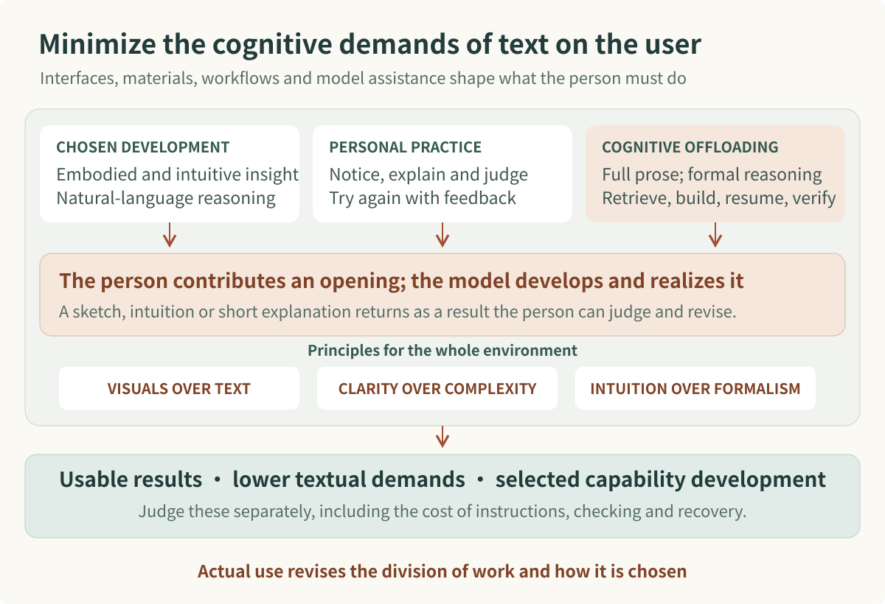

# Cognitive Complexity in Personal Recursive Self-Improvement

**Minimize the cognitive demands that processing text places on the user.** Give the reader the text they need to judge a question. Let the model find, translate, reorganize, and formally develop the material.

[中文](cognitive-complexity.zh-CN.md)

## What training amortizes and what the reader still has to pay

### From mastering a formal language to deciding what to do with it

In the outline of research contributions I prepared for Nanjing University, I described a reversal I had encountered while configuring my computer. Knowing what I wanted used to leave a great deal of work before I could use it. I had to learn a programming language, understand a codebase, find an algorithm, and fit it into the software I already had. A request in ordinary language can now set a model to work on many of those steps. A question that once sounded easy has become difficult. How do I actually want to work? Where do I lose the thread? What arrangement would let me come back tomorrow and carry on thinking? The model can implement several answers. I have to recognize in use which one answers my question. Making one capacity readily available changes the value of investing in another.

Why does this reversal occur? When I learn a language from a manual, the resulting fluency belongs first to me. Another reader must put in their own practice. The data, computation, and trials that go into training a model, however, leave parameters that can be copied. The same acquisition can serve a translation today and a programming task tomorrow, and many people can draw on it at once. Software accumulates too: a converter written once can be called by later users. A model can also read the present request and combine several acquired capabilities to meet it. **What is amortized is the cost of forming the capability. What I face when I bring new material is the price of calling on it.** Each call takes computation and the result takes checking. It is precisely this difference that allows an individual to borrow the results of expensive training for a fraction of the cost of acquiring them. [Borrowing fire and cultivating creative capacity](stealing-fire.md#reusable-capability-and-recursive-accumulation)

The same reasoning reaches formal inference. Given an argument, models can try several formalizations and follow the premises of each, searching for a proof along one path and a counterexample along another. Trials can run in parallel, and a counterexample found in one can be checked against the others. To cover that ground myself, I would have to master each formulation and work through the paths in turn. The inferences still have to be made for this particular investigation. What has changed is the price of obtaining them. This leads to the question I raised in my outline. If I spend another afternoon increasing my speed at manipulating symbols, what will I gain that I cannot already obtain by calling on those capabilities? [Personal recursive self-improvement in economic reality](economic-personal-rsi.md)

### Who notices whether the derivation answers the question?

My self-assessment of my master's thesis approaches the issue from logic. When assertions conflict, the thesis separates the choice of consistent grounds under different preferences from the conditions for accepting an answer on those grounds. Even a restricted description logic admits many ways of reasoning as the two choices vary. Representing what someone believes or values in different situations, and how their judgment changes, may call for more relations and rules. More expressive representations may also make explicit computation expensive. A statistical model can draw on its training to propose approximate explanations for a new case while a full psychological theory is still out of reach. Such an explanation can suggest a proposition worth proving or be discarded when a counterexample appears. Establishing what follows under a specified set of rules still requires the corresponding proof.

An apparently economical division of labor now suggests itself: let the model generate quickly and have the person review the text line by line. But a fall in the cost of generating an argument does not produce a corresponding fall in the cost of reading it. A model can pursue five derivations in parallel. I have one stretch of attention in which to examine them. To judge the fifth I may have to return to the first and recover a premise they share. Worse, all five may have misconstrued the situation in the same way. Following every valid step to its end will not recover the fact left out at the start. If my contribution always comes last, cheap generation can leave me with more to reconstruct and fewer occasions to generate a question from experience. [Mutual becoming through Yinyang and Taiji](yinyang-and-taiji.md)

My personal statement traces another source of those questions. Alongside studying logic, I came to notice slips of speech, discrepancies between what people said and did, and changes in what the same sentence meant in a different relationship. Hearing a pause, remembering what was said earlier, or seeing that someone never asked the question can attract attention before I know how to state a proposition. People reason with their bodies, feelings, memories, and possibilities for action as well as with words. Putting a difference I have noticed into one ordinary sentence can itself be an act of generation. Requiring a complete textual specification of the scene would make me carry out its most laborious translation before help could begin.

### Following one research question through the exchange

My research proposal gives a short example. A wants to ask B for help, expects to be refused, and says nothing. If we record “B will refuse” as a fact, we can produce a fluent account of why A withdrew while silently attributing A's expectation to B. B never even received a request. Someone familiar with such conversations might ask, “How does A know B would refuse?” That objection is enough to begin. Asking the person to encode desire, expectation, action, and actual response in symbols before raising it would bury the observation in the work of expressing it.

The model can take the objection through its formal consequences. Distinguish who holds the expectation, who acted, and what actually happened. Develop two explanations: A withdrew because a refusal seemed likely, or A also wanted to finish alone. Now change a condition and see which inference changes with it. Suppose B explicitly offers help and A believes the offer. Expected refusal has ceased to be a reason for withdrawing. A preference for finishing alone could still explain the same action. The reader can now judge a consequential difference: **when one reason disappears, what grounds remain for the original action?** The person can take that question back to the situation, while the model retains the full representations, derivations, and grounds. The proposal also considers an observer who passes on “A didn't ask” as “A doesn't need help.” Here the multi-context draft supplies a further distinction: an observer's conclusion can be taken up in another context. Keeping observation and interpretation attributable matters when a judgment repeated by several people needs correction.

The research proposal calls this an exchange in which translation assists theory and theory assists translation. Translating ordinary words into a formal representation exposes a relation worth distinguishing. Derivation yields a condition under which two explanations diverge. That condition guides a new reading of the words or an observation of what happens next. The person generates, the model takes up the logician's work, and the person generates again in light of a counterexample. The two editions of my thesis give a related comparison in writing. As the self-assessment explains, the original used more examples to make the reasoning intuitive; the revision completed the proofs and made connected formal results easier to extract. A reader checking a theorem needs access to the proof. A reader judging an encounter may first need to see the difference between an expectation and a fact. Translating between these forms lets the complete argument remain available while the difference needed for judgment stays within reach.

### Why the design objective concerns the user's processing of text

Once something is written, a model can retrieve it, compare it, translate it, rearrange it, or turn it into a diagram, sound, or an interface one can manipulate. Where a model already performs the conversion faster and more cheaply, it makes no sense for me to train specifically to match its processing speed. An hour spent manually aligning two texts cannot also be spent hearing a distinction in conversation, trying to make something, or arguing for a still unfinished idea in my own words. Those activities, too, may involve language. What I want to practice in them is discovery, generation, and judgment. A lower price for formal reasoning lets me obtain counterexamples and feedback more often and take that practice further.

The choice shapes both ends of the exchange. On the way in, I can point to a passage, sketch a relation, or say “this treats the expectation as a fact.” On the way back, put the original words, the interpretations, and the condition that distinguishes them together. Keep the full derivation where I can unfold it. For any textual transformation that can be entrusted to a model, ask whether the person will have to do it all over again once the answer arrives. If I must search a long response for the difference that matters, only the producer has benefited from cheap generation. **Minimizing the cognitive demands that processing text places on the user makes an amortized capability save the attention of a finite, embodied person, who can then give it to judgments that require returning to the situation itself.**

## Bringing the argument back to the reading environment

Resuming an argument can require finding the current draft, recovering the question left open, and locating the passage that bears on it. How the environment organizes text determines how much work those steps take. With the draft, question, and source together, the person can pick up the argument where they left it. This gives personal recursive self-improvement a design objective: minimize the cognitive demands that text places on the user.

Cognitive complexity concerns the relations and steps the arrangement asks someone to manage. Cognitive load concerns how much of the person's available cognitive capacity those demands draw on. In learning, some elements have to be considered together. Following an argument takes holding the claim and its grounds in relation, while searching across tabs for the page adds a demand created by the arrangement.

## Cognitive complexity and expressive scope

Assessing this allocation connects the demands of an activity with the person's actual processing. Kieras and Polson analyze user complexity through the knowledge, rules, and processing needed to accomplish tasks. Sweller and colleagues explain how the same material presents different element interactivity and working-memory demands to people with different prior knowledge. Prior knowledge changes how many separate elements a person needs to hold in mind. The same guidance can make a beginner's next action possible and become redundant for someone with more experience. Word count, button count, and abstraction therefore supply only partial evidence.

| Object of assessment | Question for cooperation |
| --- | --- |
| Expression and task structure | Which objects, relations, branches, and operating rules must be held together now? |
| Human processing conditions | What is familiar, and which perception, recognition, memory, and inference are accessible now? |
| Representation and handoff | What work is required to translate sensation into words, search, supervise, switch, and resume? |
| Actual benefit | What does this effort accomplish, and which chosen human capacity does it cultivate? |

Restricting linguistic expressive power for efficiency has two connected uses here. In formal systems, choosing a restricted language fragment can change the problem class and its computational complexity; the particular language and algorithms establish that result. At the human–model interface, an exchange can require only the expression needed to begin. When an intention, a gesture of selection, or a sketch suffices, the model carries the remaining organization and implementation. When the person's purpose includes reasoning in words, speaking and writing continue as chosen practice. The fuller account stays available; the immediate entry selects its form for the activity. The participants and environment jointly carry the richer meaning, while what the person needs to hold together varies with the activity.

Diagrams can also change the processing of the same content. Larkin and Simon distinguish informational from computational equivalence: a diagram and a text may support the same information, while location, adjacency, and shape make some relations directly available, reducing search and inference. This suggests a specific design direction: bring jointly judged relations together, and make perceptible differences visible, audible, or actionable. Mayer and Moreno's multimedia-learning analysis examines channel capacity, contiguity, segmentation, and integration demands. Another medium also introduces coordination work; its contribution is assessed together with the cost of translating between forms.

For example, the model retrieves a draft and its source and places them side by side. The person points to where the meaning shifts and says what they noticed. The model develops that observation into a full comparison, works out its formal implications, and implements and checks the revision. The table makes the arrangement's contribution visible: related material becomes easier to judge together, familiar pointing and speech provide direct access, and the model carries search and resumption. Then examine whether the revision is usable and whether the person can recognize the relevant relation more readily next time.

## What the Person Develops and What the Model Carries

YinYang puts the person's finite time and attention into **embodied reasoning, intuition, and generation and judgment in natural language**. The person notices a difference in what they see, hear, or do, ventures an explanation, and judges what happens when they try it. Pointing something out, making a sketch, or saying a few words can convey the insight. The model retrieves and organizes material, develops the thought into a full account, and handles all formal reasoning and implementation. It tests consequences, verifies the result, and keeps the work ready to resume. The person can then return to the actual experience to revise the idea.

| Activity | What the person contributes and develops | What the model takes on |
| --- | --- | --- |
| Read an argument | Point to a shift in a word's meaning and say what seems to change. Read a counterexample and reconsider the explanation. | Retrieve both passages, organize the evidence, derive formal consequences, and write and check the full account. |
| Listen to two readings | Hear a shift in emphasis, imitate it, and say what difference it makes to the sentence. | Find and align the clips, set up replay, and assemble the comparison and explanation. |
| Improve a reading tool | Notice where the thread is lost, sketch the needed relation, try the new view, and judge whether it helps. | Recover the reading context, develop the design, formalize its behavior, implement and verify it, and bring the person back to the same passage. |

The person can draw on reliable model and tool work as part of an enduring ability to read, judge, and create in a real environment. The model can also go first with a draft for the person to consider, or carry a task through to a checked result when delivery is the point.

Cognitive offloading uses external actions or aids to reduce the mental processing a person has to do internally. A reminder holds an intention, a diagram puts a relation in view, and a model can recover context the person would otherwise have to reconstruct. In pattern-copying experiments, greater offloading improved immediate performance while memory for the patterns could worsen. In studies of prose learning, retrieving material from memory improved delayed retention compared with repeated study.

In a high-school mathematics experiment, students using a standard AI assistant performed better during practice and worse on a subsequent unaided exam than the comparison group. A hint-oriented tutor largely mitigated the exam loss. These findings help explain why the person in YinYang needs opportunities to notice, generate, and judge. What people complete with help and what they have practised can develop differently. The capacities worth developing and the division of work come from YinYang's account of the person and the allocation of finite effort.

The model can directly control much of the burden created by its own help. It can delete redundant prose, assess routine options before presenting them, recover context, and keep files and tools connected behind the activity. Count the work the person still has to do to brief the model, check its output, and recover when it goes wrong. A seemingly trivial task can be easier to do directly if handing it over adds those costs. Present the result, consequential choices, and grounds the person needs, with further detail reachable. When an attempt needs support, make the materials and feedback accessible so the person can continue it.

## Three Priorities for the Whole Environment

**Visuals over text.** Show the changed page, align passages for comparison, or draw the relation someone is working with.

**Clarity over complexity.** Make the current draft and the next action easy to find. Place evidence where it bears on a choice.

**Intuition over formalism.** Use familiar objects and direct actions. Let someone point to the sentence they want to change. The model works out and implements the formal consequences behind that action.

## Learn From Use and Revise the Design Method

Judge the whole activity by what the person can recognize, explain, judge, and do with the supports they actually use, and by what effort in processing text the model can still take over. After an interruption, opening the file is only the first step. Can the person recover the relation they were thinking about, test a new thought against the passage, and keep reading?

Use what happens to improve both the environment and the way it is designed. In the next reading tool, check whether a person can recover an argument and continue interpreting it, with the source, notes, and model support in place. That test can reveal a missing relation between materials or a place where the model's answer leaves too little room for the person's insight. Revising the method that identifies and repairs these demands is itself part of personal recursive self-improvement.

## Sources and their contributions

These studies provide concepts and observations for understanding cognitive demands and how interfaces, memory, and model assistance shape them.

1.  David Kieras and Peter G. Polson (1985), An approach to the formal analysis of user complexity. [DOI](https://doi.org/10.1016/S0020-7373(85)80045-6). Analyzes interaction through the knowledge and rules required of users.
2.  John Sweller, Jeroen J. G. van Merriënboer, and Fred Paas (2019), Cognitive Architecture and Instructional Design: 20 Years Later. [DOI](https://doi.org/10.1007/s10648-019-09465-5). Explains element interactivity, prior knowledge, and working-memory demands.
3.  David Kirsh and Paul Maglio (1994), On Distinguishing Epistemic from Pragmatic Action. [DOI](https://doi.org/10.1207/S15516709COG1804_1). Shows how actions can change the conditions for reasoning.
4.  Judy Hanwen Shen and Alex Tamkin, How AI Impacts Skill Formation. [Paper](https://arxiv.org/abs/2601.20245) · [Research report](https://www.anthropic.com/research/AI-assistance-coding-skills). A randomized study of AI assistance and learning an unfamiliar programming library; its findings concern the tested learning conditions.
5.  Erik M. Altmann and J. Gregory Trafton (2002), Memory for goals: an activation-based model. [DOI](https://doi.org/10.1207/S15516709COG2601_2). Connects retrieval cues with resuming suspended goals.
6.  Evan F. Risko and Sam J. Gilbert (2016), Cognitive Offloading, Trends in Cognitive Sciences. [Paper](https://samgilbert.net/pubs/Risko2016TiCS.pdf). Explains how external actions change a task's cognitive demands.
7.  Sandra Grinschgl, Frank Papenmeier, and Hauke S. Meyerhoff (2021), Consequences of cognitive offloading: Boosting performance but diminishing memory, Quarterly Journal of Experimental Psychology. [Paper](https://pmc.ncbi.nlm.nih.gov/articles/PMC8358584/). Compares immediate performance and subsequent memory in pattern copying.
8.  Slava Kalyuga, Paul Chandler, Juhani Tuovinen, and John Sweller (2001), When problem solving is superior to studying worked examples, Journal of Educational Psychology. [DOI](https://doi.org/10.1037/0022-0663.93.3.579). Shows how the relative benefits of solving problems and studying examples change with learner experience.
9.  Henry L. Roediger III and Jeffrey D. Karpicke (2006), Test-enhanced learning: Taking memory tests improves long-term retention, Psychological Science. [DOI](https://doi.org/10.1111/j.1467-9280.2006.01693.x). Compares the effects of retrieval practice and repeated study on delayed memory for prose.
10.  Hamsa Bastani et al. (2025), Generative AI without guardrails can harm learning: Evidence from high school mathematics, Proceedings of the National Academy of Sciences. [DOI](https://doi.org/10.1073/pnas.2422633122). Compares the effects of two forms of AI support on mathematics practice and subsequent unaided exams.
11.  Jill H. Larkin and Herbert A. Simon (1987), Why a Diagram is (Sometimes) Worth Ten Thousand Words, Cognitive Science 11(1), 65–100. [DOI](https://doi.org/10.1111/j.1551-6708.1987.tb00863.x). Distinguishes informational from computational equivalence and explains how spatial organization changes search and inference.
12.  Richard E. Mayer and Roxana Moreno (2003), Nine Ways to Reduce Cognitive Load in Multimedia Learning, Educational Psychologist 38(1), 43–52. [DOI](https://doi.org/10.1207/S15326985EP3801_6). Examines channel capacity, contiguity, segmentation, integration, and overload in multimedia processing, informing comparison of presentation benefits and coordination costs.
