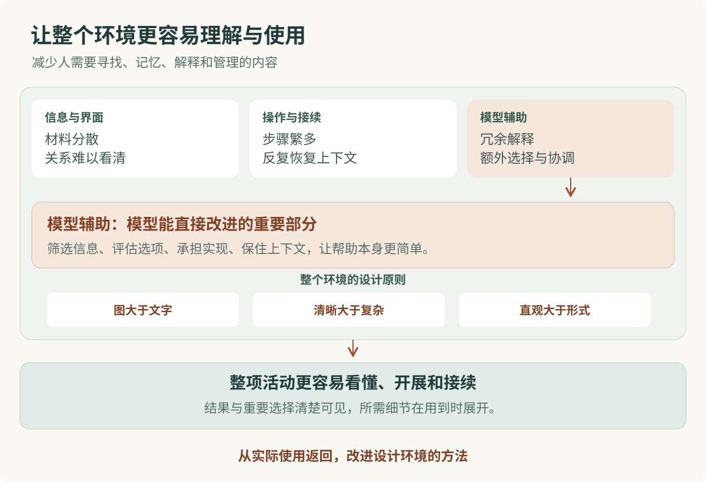

# 个人递归自我进化中的认知复杂性

把整个环境的认知要求控制在本人能接受的范围内，留出足够的空间练习自己想发展的能力。

[English](cognitive-complexity.md)

## 把环境的认知要求控制在可接受范围内

**把个人环境的认知复杂性控制在本人能接受的范围内。** 界面、资料、工作流程和模型辅助，共同决定本人要理解、寻找、记忆、选择、操作和接续些什么。要接着写一段论证，人可能得先辨认哪份是当前草稿，找回悬而未决的问题，再找出相关证据。把草稿、问题和来源放在彼此可达的地方，人就能把心力用在论证上。

认知复杂性关乎一项安排要求人处理哪些关系与步骤。认知负荷关乎这些要求占用了本人多少可用的认知资源。学习时，有些要素必须联系起来处理。要理解一段论证，就得把主张与依据联系起来；在几个标签页之间找原文，则是当前安排额外带来的负担。已有知识会改变本人要同时顾及多少个独立要素。相同的指引能帮初学者走出下一步，对有经验的人却可能已经多余。认知负荷理论据此帮助我们把有限的心力用在本人正在学习的关系上。

## 决定哪些事亲自练，哪些事交给模型

先问本人想发展哪种能力。如果想练习用自然语言讲清一个难懂的观点，本人就需要有机会自己构造解释，判断它能不能成立。模型可以找来相关段落，摆好比较材料，在卡住时给一点提示，再对写好的解释提供反馈。如果开头就给出完整解释，本人虽然得到了答案，也失去了这一次自己作出解释的机会。

认知卸载是借助外部行动或工具改变一项任务对心智的要求。提醒替人记下待办，图把关系放到眼前，模型可以找回原本需要本人重建的语境。在图案复制实验中，更多的卸载改善了当时的复制表现，随后对图案的记忆却可能变差。在文章学习实验中，尝试从记忆中提取内容，比反复学习原文更有利于过一段时间再回忆。

一项高中数学实验里，使用普通 AI 助手的学生比对照组练习得更好，但在之后没有辅助的考试中表现更差。以提示为主的辅导工具大幅缓解了考试表现的下降。这些研究说明，眼下做得怎样，与之后能做到什么，可能受到不同影响。本文据此保留有助于发展所选能力的操作，把可以可靠交接的辅助工作卸载出去。

| 本人的目标 | 本人亲自练习 | 模型可以承担 |
| --- | --- | --- |
| 用自然语言解释论证 | 用自己的话重构推理，回应一个反例。 | 查找并整理段落，准备反例，在本人尝试后给出反馈。 |
| 判断一项设计 | 比较实际影响，说明选择理由，试用后修正判断。 | 准备可比较的预览，把商定的规则形式化，完成实现并核验。 |
| 学习将论证形式化 | 选择符号与条件，检验形式化结果是否表达了原来的主张。 | 搜集例子，运行检查，指出哪一处没有对应上。 |

形式化一旦成为想发展的能力，就从模型负责的工作移到本人练习的部分。资料检索、写代码和其他辅助操作也可以这样移动。与可靠支持一起形成的能力，本身也可以是目标。若想借助可靠的检索做出更好的研究，就看合作的质量和能否持续。若想靠记忆提取材料或独立运用某项技能，就在之后按这个目标的条件检查本人能做到什么。

模型尤其能直接控制自己提供帮助时产生的负担。删去冗余文字，先评估常规选项再呈现，主动找回语境，把文件和工具接在活动背后。判断是否值得交给模型，还要算上本人交代任务、检查结果、出错后恢复的工作。一件琐事如果交接成本更高，自己做可能更省力。把结果、影响使用的选择和本人判断所需的依据放到眼前，更多细节随用随取。练习时给到足以开始下一次尝试的支持，再随本人熟练程度调整。

## 整个环境的三条设计原则

**图优于文字。** 展示改好的页面，把要比较的段落对齐，或画出本人正在处理的关系。

**清晰优于复杂。** 让当前草稿和下一步容易找到，把依据放到需要用来作判断的地方。

**直观优于形式。** 用熟悉的对象和直接的动作组织环境。让人指着要改的那句话说出意见。形式化由模型负责时，就在这个动作背后完成。

## 从使用中改进环境和设计方法

以整项活动来判断。中断后能否继续？付出的心力是否在本人能接受的范围内？本人是否练到了选定的能力，在计划采用的支持下能否做得更多？草稿即使一打开就到眼前，论证也可能很难接着写。辅导即使让人感觉很轻松，留给学习者自己尝试的部分也可能太少。

用这些观察改变环境，也改变下一次设计的验收方式。可以试试休息一段时间后，回到阅读工具里继续解释一个段落。如果目标包括独立记起这段内容，就过一段时间合上原文试一试。如果目标是查着资料作出解释，就保留资料，检查解释的质量。改进判断设计是否成功的方法，也是个人递归自我进化的一部分。

## 来源及其贡献

以下研究为理解环境中的认知要求，以及界面、记忆和模型辅助怎样改变这些要求，提供了概念与观察。

1.  David Kieras 与 Peter G. Polson（1985），An approach to the formal analysis of user complexity。[DOI](https://doi.org/10.1016/S0020-7373(85)80045-6)。通过用户所需的知识和规则分析交互。
2.  John Sweller、Jeroen J. G. van Merriënboer 与 Fred Paas（2019），Cognitive Architecture and Instructional Design: 20 Years Later。[DOI](https://doi.org/10.1007/s10648-019-09465-5)。说明元素交互、先前知识与工作记忆要求。
3.  David Kirsh 与 Paul Maglio（1994），On Distinguishing Epistemic from Pragmatic Action。[DOI](https://doi.org/10.1207/S15516709COG1804_1)。说明行动怎样改变推理条件。
4.  Judy Hanwen Shen 与 Alex Tamkin，How AI Impacts Skill Formation。[论文](https://arxiv.org/abs/2601.20245) · [研究报告](https://www.anthropic.com/research/AI-assistance-coding-skills)。AI 辅助与陌生编程库学习的随机实验；发现以所测的学习条件为范围。
5.  Erik M. Altmann 与 J. Gregory Trafton（2002），Memory for goals: an activation-based model。[DOI](https://doi.org/10.1207/S15516709COG2601_2)。联系提取线索与悬置目标的接续。
6.  Evan F. Risko 与 Sam J. Gilbert（2016），Cognitive Offloading，Trends in Cognitive Sciences。[论文](https://samgilbert.net/pubs/Risko2016TiCS.pdf)。说明外部行动如何改变任务的认知要求。
7.  Sandra Grinschgl、Frank Papenmeier 与 Hauke S. Meyerhoff（2021），Consequences of cognitive offloading: Boosting performance but diminishing memory，Quarterly Journal of Experimental Psychology。[论文](https://pmc.ncbi.nlm.nih.gov/articles/PMC8358584/)。通过图案复制实验比较当时的表现与后续记忆。
8.  Slava Kalyuga、Paul Chandler、Juhani Tuovinen 与 John Sweller（2001），When problem solving is superior to studying worked examples，Journal of Educational Psychology。[DOI](https://doi.org/10.1037/0022-0663.93.3.579)。说明解题与研读示例的相对收益随学习经验变化。
9.  Henry L. Roediger III 与 Jeffrey D. Karpicke（2006），Test-enhanced learning: Taking memory tests improves long-term retention，Psychological Science。[DOI](https://doi.org/10.1111/j.1467-9280.2006.01693.x)。通过文章学习实验比较提取练习与重复学习对延后记忆的影响。
10.  Hamsa Bastani 等（2025），Generative AI without guardrails can harm learning: Evidence from high school mathematics，Proceedings of the National Academy of Sciences。[DOI](https://doi.org/10.1073/pnas.2422633122)。比较两种 AI 辅助方式对数学练习表现和之后无辅助考试的影响。
