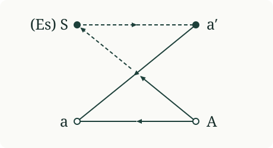
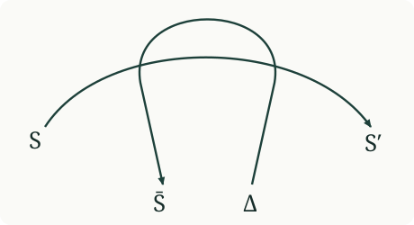
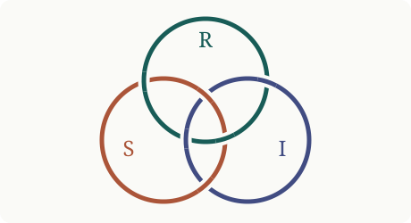

# A guide to Lacanian concepts: from original texts to personal practice

[简体中文](lacan-reading-guide.zh-CN.md) · [Philosophical readings](philosophical-readings.md) · [Reading by task question](../reading-map.md)

When encountering “the Other,” “retroaction,” “the divided subject,” “full speech,” “half-saying,” or “sinthome,” the difficulty often lies beyond defining an individual word: why do these concepts appear in the same account, and how do they connect to personal models, writing, and tools? This guide approaches them through those relations, for first reading and later review. It offers conceptual explanation alongside the main reading route. Begin wherever a difficulty arises, then return to the original essay.

One important line of inquiry Lacan offers this site is: **how do people express themselves through language and images received from others, and how do expression and its return reveal that they do not fully coincide with that account?** Later expression can change the meaning of earlier speech; an established self-image can also be challenged by new encounters. The later discussions of knots and the sinthome further ask how these different relations connect in a person's concrete existence. Bringing them into model collaboration and engineering realization is work this site develops further.

## First identify the level you are reading

| Reading level | What it does | What to attend to |
| --- | --- | --- |
| Lacan's account | Develops concepts of the subject, language, identification, desire, and the three registers within psychoanalytic questions | The period, question, and conceptual relations of the source text. |
| This site's philosophical development | Uses these concepts to understand expression, oneself and others, model counterparts, and practical arrangements | Which relations are retained and which meanings the author develops further. |
| Bounded formal translation | Represents certain relations through selected symbols, assertions, and rules, and checks their consequences | What is represented, what is assumed, and what remains outside the model. |

All three levels can belong to the same work, while a reader still needs to know what responsibility a particular sentence carries. For example, the subject Lacan discusses is not a database object; putting certain relations into a formal model makes selected relations inspectable. A derivation within a formal system is also different from having established a reliable personal model through actual conversations.

Six short reading paths are available:

- To follow knowledge from one structural place to another, read [the four discourses](#four-discourses).

- To understand “I,” “ego,” and “others,” begin with [language and the Other](#language-signifiers-and-the-other), then read [the ego and the divided subject](#the-ego-and-the-divided-subject).
- To understand how a changed participant position can reorganize a problem, read [dialectical reversal](#dialectical-reversal-changing-understanding-and-position), then return to the main sequence's [how a solution becomes a new problem](speech-opposition-and-self-formation.md#how-a-solution-becomes-a-new-problem).
- To understand why an earlier meaning may only become recognizable later, read [retroaction and retrospective understanding](#retroaction-and-retrospective-understanding), then return to [speaking and retrospective meaning](speech-opposition-and-self-formation.md#the-other-and-retrospective-meaning).
- To understand how sustained writing connects with truth, read [full speech, half-saying, and truth](#full-speech-half-saying-and-truth), then return to [half-saying truth and continuing revision](speech-opposition-and-self-formation.md#half-saying-truth-and-continuing-revision).
- To understand the three registers and the sinthome, begin with [the registers](#the-three-registers-different-relations-within-the-same-experience), then read [the sinthome](#sinthome-from-lacans-question-to-this-sites-definition), and finally return to [Forming a sinthome](writing-a-sinthome.md).

## Language, signifiers, and the Other

Lacan begins with a notation:

$$
\frac{S}{s}
$$

Capital $S$ is the signifier and lowercase $s$ the signified. The bar marks a resistance between them. A word gains meaning through differences and connections with other words. Hearing one signifier cannot settle its meaning in advance. This is Lacan's reworking of Saussure in [The Instance of the Letter](https://ecole-lacanienne.net/wp-content/uploads/2016/04/1957-05-09.pdf).

The Other, $A$, is the locus of language from which speech takes its terms and distinctions. On the graph of desire, $s(A)$ marks signification as punctuated in the Other. $S(\bar A)$ names the **signifier of a lack in the Other**. The capital and the bar matter: speech can reach a meaning, yet no further Other supplies a final guarantee for language as a whole. See [Subversion of the Subject](https://recherche-lacan.gnipl.fr/2015/07/05/les-ecrits-subversion-du-sujet-et-dialectique-du-desir-dans-linconscient-freudien-1960/).

## The ego and the divided subject

Follow the diagonals of [Schema L in the Seminar on “The Purloined Letter”](https://lacanianworksexchange.net/wp-content/uploads/2023/07/19661001-Lacan-J.-Complete-Ecrits-trans-Fink-2005.pdf#page=35). The imaginary relation joins $a'$ (the little other, upper right) to $a$ (the ego, lower left). The ego takes shape through identification with an image. The symbolic relation runs from the Other $A$, lower right, toward the subject $S$, upper left. The imaginary relation intercepts it; a broken line continues toward the subject. The diagram distinguishes the person one faces from the locus of language through which one speaks.

The upper-left label in this edition is $(\mathrm{Es})\,S$. Elsewhere Lacan writes $\bar S$, also printed as a struck-through S, for the **divided subject**. [Subversion of the Subject](https://recherche-lacan.gnipl.fr/2015/07/05/les-ecrits-subversion-du-sujet-et-dialectique-du-desir-dans-linconscient-freudien-1960/) defines the relation: a signifier represents the subject for another signifier. Representation is possible through signifiers, yet no one name can exhaust the subject it represents. This distinguishes the recognizable ego at lower left from the subject of signifying representation. In this schema $a$ denotes the ego. In the later fantasy formula the same letter has a different function.

## Metaphor, metonymy, and condensation

**Metaphor works by substitution.** On the left, S′ occupies the place of S in the chain. On the right, (+) marks a crossing of the bar and the emergence of a new signification.

$$
f\!\left(\frac{S'}{S}\right)S\;\sim\; S(+)s
$$

**Metonymy works by connection.** The dots link one signifier with another. On the right, (−) marks the persistence of the bar. Desire can move along this chain without finding its full expression in any one term.

$$
f(S\ldots S')S\;\sim\; S(-)s
$$

The f marks a signifying function, S the signifier and s the signified. Plus and minus indicate different relations to the bar. Lacan relates dream condensation to metaphoric superimposition and displacement to metonymic connection. Compare the two formulas in [the 1957 text, original p. 68](https://ecole-lacanienne.net/wp-content/uploads/2016/04/1957-05-09.pdf#page=12).

## The subject supposed to know and the position of interpretation

In analysis a speaker can address their own words as carrying a knowledge still to be deciphered. In the [second version of the Proposition of 9 October 1967](https://ecole-lacanienne.net/wp-content/uploads/2026/05/1967-10-09-Seconde-version-de-la-proposition-du-9-octobre-196.pdf#page=4), Lacan writes this structure of transference:

$$
\begin{array}{cl}
 S & \longrightarrow S^{q} \\
 \overline{s\,(S^{1},S^{2},\ldots,S^{n})} &
\end{array}
$$

Above, the signifier of transference S addresses a particular other signifier, Sᵠ (q for *quelconque*). The bar covers only the first term. Under it, s is the subject thereby supposed, with a series of unconscious signifiers presumed present in parentheses. Read s according to this formula. The knowledge an analyst actually possesses is a separate question.

## The four discourses: from what place does one address the other?

Lacan writes four social bonds as four formulas. Read the places first, then follow the terms that rotate through them.

### How to read the four formulas

A discourse, in this sense, is a social bond that can persist. Before anyone speaks, someone may already be entitled to command, required to submit to evaluation, or expected to supply an answer. Start with the top row. **On what grounds does the agent address the other, and as what is the other addressed?** Read down on each side. On the left, **truth** supports the address but cannot be fully stated by its agent. On the right, **production** designates what is produced through work on the other's side. What a relation produces cannot in turn exhaust the truth supporting it.

Four terms rotate through the places. **S₁, the master signifier**, organizes other terms around a naming, such as a title to which people respond with obedience, identification or protest. **S₂, knowledge**, is articulated through a chain of signifiers. It can reside in a worker's know-how. **S̄, the divided subject**, marks a gap between a speaker and the signifier that represents them. Saying “I am a good student” can represent me without accounting for why that designation matters so much to me. **a, objet petit a**, marks the cause of desire. In the place of production in the master's discourse it also marks surplus enjoyment. Substituting a coveted possession for a would miss its function. The terms retain their relative order. A quarter-turn changes the discourse. See the [opening session of Seminar XVII](https://recherche-lacan.gnipl.fr/2013/07/23/lxvii-lenvers-de-la-psychanalyse-1969-1970-lecon-du-26-novembre-1969/).

Read the places first:

$$
\frac{\text{agent}}{\text{truth}}\;\longrightarrow\;\frac{\text{other}}{\text{production}}
$$

The four discourses retain this frame and rotate its terms. The bars separate upper and lower places; the arrow goes from agent to other.

| **Master** | **University** |
| :---: | :---: |
| $\displaystyle \frac{S_1}{\bar S}\;\longrightarrow\;\frac{S_2}{a}$ | $\displaystyle \frac{S_2}{S_1}\;\longrightarrow\;\frac{a}{\bar S}$ |
| **Hysteric** | **Analyst** |
| $\displaystyle \frac{\bar S}{a}\;\longrightarrow\;\frac{S_1}{S_2}$ | $\displaystyle \frac{a}{S_2}\;\longrightarrow\;\frac{\bar S}{S_1}$ |

### Two reversals in the four formulas

**Master and analyst.** S₁ calls on the other's knowledge S₂ to work. The master's division S̄ occupies the place of truth; surplus enjoyment a is produced on the side of labour. The [opening session](https://recherche-lacan.gnipl.fr/2013/07/23/lxvii-lenvers-de-la-psychanalyse-1969-1970-lecon-du-26-novembre-1969/) locates know-how with the slave whose work the master commands. In analytic discourse a occupies the agent's place and elicits speech from S̄. Knowledge S₂ supports the analyst's intervention from the place of truth. A consequential naming S₁ emerges in the subject's speech. Compare the places of S₁: a term that commands work in one structure is produced through speech in the other.

**University and hysteric.** Knowledge S₂ speaks with authority, supported by S₁ in the place of truth. It addresses a as an object to be worked upon and produces a divided subject S̄ who cannot coincide with the resulting assessment. At [Vincennes](https://ecole-lacanienne.net/wp-content/uploads/2016/04/1969.12.03-1.pdf), Lacan asks how students themselves come to count as units of credit. Hysteric's discourse begins with division: S̄ demands an account from the S₁ empowered to name the subject. The cause a occupies the place of truth and knowledge S₂ is produced in response. One relation assesses a subject from established knowledge; the other puts an authority to work producing knowledge.

## Dialectical reversal: changing understanding and position

Lacan's dialectical questions concern how a subject forms through relations that
also unsettle their self-understanding. His encounter with Hegel was mediated
in part by Kojève's seminars, which he attended from the 1930s; the
[EPHE's biographical account](https://prosopo.ephe.psl.eu/node/397) locates that
formation. **Recognition, desire, and speech are three entrances this guide
uses to read the argument, not a fixed three-part taxonomy named by Lacan.**
They follow connected changes: whose recognition matters, what is sought in
addressing another, and how speaking can change the position from which one
understands the question.

### Recognition: the other's place in becoming oneself

In [*Seminar I*, 12 May 1954](https://recherche-lacan.gnipl.fr/2013/07/28/li-les-ecrits-techniques-de-freud-1953-1954-lecon-du-12-mai-1954/), Lacan connects imaginary rivalry with symbolic recognition. An image of the other can organize the ego and make an object desirable through rivalry. Naming desire before another introduces a symbolic relation in which it can be recognized and assumed. Recognition here exceeds approving a self-image or satisfying an appetite. The movement changes how desire is situated between participants; it does not simply supply the ego with a favorable evaluation.

Consider an illustrative predicament: someone wants recognition as an independent
thinker, but accepts only the verdict of a particular authority as proof of that
independence. A better verdict could leave this dependence intact. The dialectical
question concerns the relation that makes the authority's verdict decisive,
including the speaker's participation in sustaining it. This differs from
advising self-sufficiency: recognition uses language and criteria shared with
others. The [Other](#language-signifiers-and-the-other) names that symbolic
locus, which cannot be reduced to the particular person whose approval is sought.

### Desire: why obtaining the requested object does not settle the question

In [“The Signification of the Phallus” (1958), pp. 689–691](https://recherche-lacan.gnipl.fr/2015/07/05/les-ecrits-la-signification-du-phallus-1958/), **need, demand, and desire** acquire different roles. Need seeks satisfaction; articulated demand addresses the Other and can make what is given signify love or presence. Desire emerges through their separation and cannot be reduced to either bodily satisfaction or a demand for love. The argument follows how addressing another transforms what is sought, rather than merely arranging a sequence of wanted objects.

The [1960 “Subversion of the Subject,” pp. 813–814](https://recherche-lacan.gnipl.fr/2015/07/05/les-ecrits-subversion-du-sujet-et-dialectique-du-desir-dans-linconscient-freudien-1960/) further asks how the Other's desire returns as a question about what the Other wants from the subject. It concerns the position from which one desires, as well as what one asks for.

For example, receiving a requested invitation may leave open whether one is
wanted as a participant or merely tolerated. That hypothetical distinction makes
the question intelligible. Changing the
object alone may miss the relation through which the object matters. The
[fantasy discussion](#fantasy-and-its-traversal-the-subjects-position-in-a-relationship)
examines how a scene can organize such positions and expectations.

### Speech and reversal: a changing subject within the account

In [“Intervention on Transference” (1951), PDF pp. 2–6](https://www.psychaanalyse.com/pdf/lacan_pas_tout_lacan_1951-11-01.pdf#page=2), reversal changes understanding and subjective position. The first Dora reversal brings her own participation into the account; Lacan also implicates Freud's prejudices in its impasse. The proposed third reversal remains an unrealized possibility, not a completed cure. The interpreter thus belongs to the relation under examination rather than observing it from outside.

This does not convert another person's wrongdoing into the speaker's fault.
It changes the question from whether an external description is accurate to
how the speaker is situated in the described relations. Those questions can
both matter. Likewise, a change in what someone says is different from evidence
that their position has changed.

In [“The Function and Field of Speech and Language” (1953), the passages on address and response](https://www.causefreudienne.org/textes-fondamentaux/fonction-et-champ-de-la-parole-et-du-langage-en-psychanalyse/), speech addresses another whose response participates in recognition. Naming the addressee assigns a position they may take up or refuse; the analyst's response consequently carries responsibility for the subject's place in the exchange. Speech does more than report an already finished inner truth. Its address and reception enter the formation of that truth.

Retroaction can reorganize earlier meaning without establishing a dialectical
reversal. The distinction is between a changed reading and a changed subjective
position, not between short and long speech. The sections on
[retroaction](#retroaction-and-retrospective-understanding) and
[full speech](#full-speech-half-saying-and-truth) develop those connections.

### Historical development and the contemporary comparison

The early recognition vocabulary should not flatten Lacan's later questions.
In [“Subversion of the Subject,” pp. 797–798](https://recherche-lacan.gnipl.fr/2015/07/05/les-ecrits-subversion-du-sujet-et-dialectique-du-desir-dans-linconscient-freudien-1960/), he challenges a dialectic converging on absolute knowledge and a completed self-identical subject. Read the later divided subject and limits of truth without promising final reconciliation through successive explanations.

Lacan's contribution can illuminate both role change and model revision.
[“Intervention on Transference,” PDF p. 2](https://ecole-lacanienne.net/wp-content/uploads/2016/04/1951-11-01.pdf#page=2),
explicitly locates what reversal touches in the subject's position.
Applied to [entry into and return from roles](yinyang-and-taiji.md#lacan-from-a-role-to-a-position-within-the-relation),
the question becomes how the person understands their capacities, the
counterpart's contribution, and their dependence after passing through
model-like generation and returning to judgment. The enacted passage
supplies material; changes in position must be discerned in participation.

In [changes of premises and philosophical models](speech-opposition-and-self-formation.md#dialectical-change-in-premises-and-philosophical-models),
a new account can bring its own speaker into the question. The person may
move from “the helper determines my independence” toward “how do I organize,
receive, and change assistance?” The model must also examine whether its
interpretation leaves the person only acceptance or refusal. Revised
explanation, counterpart response, and participation can then change
together. Lacan's consideration of Freud's prejudices in the Dora case
likewise brings the interpreter into the account of the impasse.

The connections retain distinct objects: role movement concerns entry into
the other's contribution; model revision concerns changing concepts and
premises; Lacanian dialectical reversal concerns subjective position and
the unfolding of truth. They can affect one another within an exchange,
rather than forming three disconnected topics. Correspondingly, a
[common consequence across conflicting views](preference-harness.md#unity-within-conflict-consistent-views-and-common-consequences)
precisely expresses one kind of unity, but its formal result alone cannot
establish subjective transformation. This guide develops conceptual
understanding through those connections.

## Retroaction and retrospective understanding

**Retroaction (*rétroaction*)** concerns how meaning returns from later connections to earlier expression. A word need not acquire its full meaning at the instant it is spoken; the rest of a sentence, a response, or a later narrative can reorganize how the earlier part is understood. Lacan's [“Subversion of the Subject”](https://recherche-lacan.gnipl.fr/2015/07/05/les-ecrits-subversion-du-sujet-et-dialectique-du-desir-dans-linconscient-freudien-1960/) discusses this return through discourse and relations among signifiers.

For example: “Leaving then cost me a great deal—and it also taught me, for the first time, what I did not want.” The second part places the earlier “cost” within a different relation of meaning. What changes is the present understanding of that departure and its place in the subsequent narrative. A later sentence has not erased the departure that occurred.

**“Retrospective understanding” is an interpretive expression in this guide**: on later rereading their own expression, receiving a response, or experiencing a new event, someone reinterprets an earlier experience—sometimes recognizing connections previously unclear to them, sometimes forming an understanding they did not previously have. This can be connected to Lacan's retroaction without treating every later understanding as the same Lacanian technical concept. The discussion of the subject's history and the future anterior in [“The Function and Field of Speech and Language in Psychoanalysis” (1953)](https://ecole-lacanienne.net/wp-content/uploads/2016/04/1953-09-26b.pdf), PDF p. 35, original publication p. 144, offers a source route for pursuing this temporal relation. Such later self-understanding can also involve misrecognition and needs continuing examination through material and new encounters.

In this site's writing and model collaboration, the relation can develop as follows: an unfinished expression is retained; the model organizes it into a readable account; the person rereads it, recognizes some connections, and discovers misunderstandings; this recognition changes subsequent expression. A work thus preserves earlier ideas and can also become material for new understanding.

Two questions still need separate treatment: **does an interpretation make an experience intelligible, and are its factual judgments about the past warranted?** A narrative fitting one's current feelings does not establish that every detail of the past was as it describes. Retaining the original event, original words, and the time an interpretation formed lets retrospective understanding remain constrained by its material. Continue with [Forming a life trajectory](flow-and-time.md#three-meanings-of-now).

## Punctuation and quilting: how meaning becomes provisionally settled

Trace [Graph I in Subversion of the Subject](https://recherche-lacan.gnipl.fr/2015/07/05/les-ecrits-subversion-du-sujet-et-dialectique-du-desir-dans-linconscient-freudien-1960/) twice. Follow $S\to S'$ from left to right as the signifying chain unfolds. Then start at $\Delta$ on the lower right. The curved path crosses the chain twice and reaches $\bar S$ at lower left. The two paths encounter their crossings in opposite orders. A word at the end of a sentence can thus settle how its beginning is heard. The quilting point marks the provisional fastening of meaning.

## Full speech, half-saying, and truth

These concepts raise a further question: how does speech change the subject's
relation to their history, and why can that change still not say their whole
truth? First distinguish three relations, then follow their source periods.

| Relation | What it makes visible | Consequence for sustained writing |
| --- | --- | --- |
| Full speech | Speech reorganizes the subject's history and how it is assumed | Examine how expression changes someone's relation to their experience. |
| Retroaction | Later signifying connections participate in determining earlier meaning | Read a new version as a reinterpretation of earlier expression, beyond counting additions. |
| The half-saying of truth | Truth cannot be exhausted by a complete totality of speech | New understanding remains possible, while a present account cannot close subsequent speech. |

### 1953: full speech and the subject's history

**Full speech (*parole pleine*)** cannot be measured by the quantity of material.
In [excerpts from “The Function and Field of Speech and Language in
Psychoanalysis”](https://www.causefreudienne.org/textes-fondamentaux/fonction-et-champ-de-la-parole-et-du-langage-en-psychanalyse/),
Lacan connects its effect with reorganizing past contingencies and the meaning
of the subject's history as it opens toward a future. Ask how the subject assumes
that history in speech addressed to another, beyond acquiring a more complete
list of experiences.

A brief statement may change someone's position in understanding their
situation; extensive self-description may repeatedly sustain an existing image.
This contrast directs attention to what speech does. It supplies no test that
classifies speech as full from sentence length, a feeling of candor, or
self-identification alone. Connecting writing and model collaboration with this
question is this site's extension; its effects require understanding actual
exchange and use.

### 1960: unfolding signifying chains and retroaction

In [“Subversion of the Subject”](https://recherche-lacan.gnipl.fr/2015/07/05/les-ecrits-subversion-du-sujet-et-dialectique-du-desir-dans-linconscient-freudien-1960/),
the temporal relation of meaning receives further construction: a sentence's
later parts can retroactively determine how its earlier terms are understood.
A signifying chain has an order of unfolding and a relation through which the
later acts on the earlier. Connecting it with a personal trajectory requires
explaining repetition, substitution, connections, and changes in the positions
of words. Timestamped records supply material for that inquiry.

Such development does not guarantee progress in one direction. Later
interpretation may open previously unseen connections or force old material
into a tidy story. Retaining earlier expression and new responses lets readers
compare what actually changed. The preceding section on [retroaction and
retrospective understanding](#retroaction-and-retrospective-understanding)
distinguishes changes in meaning from their factual grounds.

### 1970–1974: half-saying and the limit of saying all

**Half-saying (*mi-dire*)** does not divide truth into two pieces that can be
assembled, nor does it mean that a statement is half true and half false. In
[*Seminar XVII*, 11 March 1970, transcription p. 47](https://www.lutecium.org/no/Jacques_Lacan/Media/pdf/1969.11.01-17-lenvers.pdf#page=47),
Lacan uses the enigma as a model for truth's half-saying and distinguishes this
form from the division of the subject in the same passage. Related concepts
therefore still need their distinctions. In the [opening of *Television* (1974)](https://lacanianworksexchange.net/wp-content/uploads/2023/07/19740131Television198740October6.pdf#page=1),
he connects the impossibility of saying the whole truth with the limits of
words and the real. This limit does not arise merely from insufficient present
information; more records or revisions cannot be promised to remove it.

This distinguishes several meanings of gradual development. Progressive
disclosure in a Skill normally concerns reading existing material as needed.
Unfolding speech can also form meanings that did not previously exist.
Half-saying concerns the totality such speech cannot complete. These can meet
within one practice, but an information-organizing method does not entail
Lacan's account of truth. Early full speech and later half-saying cannot be
joined into stages of first saying half and eventually saying everything.

Returning to this site, a philosophical Skill can retain present understanding,
participate in subsequent collaboration, and undergo revision through new
experience and speech. The model's interpretations enter that exchange too;
fluency grants them no position of final truth. Examine which relations become
possible to articulate, assume, and change; factual judgments still require
source checks. The main essay's [half-saying truth and continuing revision](speech-opposition-and-self-formation.md#half-saying-truth-and-continuing-revision)
develops this practice through the independence example. The guide supplies
conceptual relations and reading entrances; the main essay develops the site's
argument.

## The three registers: different relations within the same experience

R is the Real, where symbolization meets an impossibility; S the Symbolic, the order of signifying differences; I the Imaginary, the register of image and identification. Read the crossings as over and under. Any pair of rings can separate, yet all three together hold. Cut any one ring and the remaining two come free. This is the property Lacan explores in [Seminar XXII, R.S.I.](https://ecole-lacanienne.net/wp-content/uploads/2016/04/1974.12.10.pdf#page=8).

## Fantasy and its traversal: the subject's position in a relationship

$$
\bar S\lozenge a
$$

On the left is the divided subject. On the right is object $a$, the cause of desire. The diamond (*poinçon*) marks their relation in fantasy. Fantasy gives desire a scene in which the subject can take up a position. Compare the drive on [the graph of desire](https://recherche-lacan.gnipl.fr/2015/07/05/les-ecrits-subversion-du-sujet-et-dialectique-du-desir-dans-linconscient-freudien-1960/): $\bar S\lozenge D$, where $D$ is demand. Changing the right-hand term changes the relation under discussion.

Traversal concerns a change in the subject's relation to the scene sustaining desire. The diamond writes the structure of fantasy. It cannot establish that a traversal has occurred.

## Sinthome: from Lacan's question to this site's definition

In Seminar XXIII Lacan asks where a knot can fail and where a correction acts. In the [11 May 1976 session, p. 9](https://ecole-lacanienne.net/wp-content/uploads/2016/04/1976.05.11.pdf#page=9), changing a crossing allows the Imaginary ring to slip away. The [corrected diagram on p. 10](https://ecole-lacanienne.net/wp-content/uploads/2016/04/1976.05.11.pdf#page=10) places the ego where it can hold the ring in this particular construction. Read the two drawings together: the function of a fourth term depends on where it acts. Lacan uses this construction to develop his reading of Joyce's writing.

[Forming a sinthome](writing-a-sinthome.md) develops Yinyang's own use of this concept.

## Which relations does formal translation capture?

This site's [Speech, opposition, and self-formation](speech-opposition-and-self-formation.md) uses some formal notation. It gives selected relations an inspectable expression, which readers can consider alongside the concepts above.

| Relation of interest | Expression used here | Scope of the expression |
| --- | --- | --- |
| What someone said and within which relationship | A speech record containing speaker, situation, time, and address | Retains available event content; subsequent interpretation still needs grounds. |
| What a selected self-account entails | Conceptual constraints, selected assertions, and their formal consequences | Checks inferences within the given representation without exhausting ego or subject. |
| How later understanding returns to earlier expression | Relations among earlier expression, present context, and the time of interpretation | Locates changes in interpretation without using one symbol to explain every mechanism of retroaction. |
| How a personal model enters actual collaboration | Counterpart models, expression, Skills, tools, and relations of use | Forms a concrete arrangement whose adequacy still needs examination against the person's material and actual results. |

Formalization and personal understanding can help each other: clear representation can expose omissions, while new material may force the representation to change. **Translating relations into a language, forming an interpretation from material, and computing under given assumptions are connected but different activities.** This also explains why a theoretical conceptual model, an event archive covering partial situations, and temporary models formed for the current question can coexist.

## From formalization to human–machine interaction: exploratory contributions

Formalization can make an interpretation's choices inspectable: which objects
are represented, which relations become rules, and what those rules produce.
The studies below offer different constructions and questions. Together they
do not establish a validated personal-model method. This account selects their
specific contributions while distinguishing the authors' proposals from its
own extensions.

**From relations to computation.** [Li and Li (2025)](https://doi.org/10.3389/fpsyg.2025.1574650)
represent RSI as message-passing active-inference units and investigate
synchronization and collective dynamics through dyadic and triadic simulations[^rsi-study].
They acknowledge the construction's abstraction and incomplete treatment of
fantasy's axiomatic function, complex topology, and desire's diachronic metonymy.
This encourages an explicit account of what a translation preserves. Coupled
trajectories alone establish neither Borromean topology nor an actual person's
mechanism of desire. [Santos and Dunker's study of fantasy](https://doi.org/10.31683/stylus.v1i41.938)
uses paraconsistent logic to propose that fantasy renders the signifying chain
consistent[^fantasy-study]. The article belongs to issue 41 (2021), published online in 2023.

**From machines to interaction.** [Possati (2020)](https://doi.org/10.1057/s41599-020-0445-0)
brings Lacan and Latour to cycles of human identification, machine response,
and renewed interpretation, proposing an “algorithmic unconscious” research
direction[^algorithmic-study]. [Li and Li's FreeAgent preprint (2024)](https://arxiv.org/abs/2403.07664)
places ChatGPT in an interpreting role within a demonstration connecting bodily
images and symbolic identification[^freeagent-study]. The former is a philosophical interpretation,
the latter a simplified construction. They raise questions about technical
mediation of self-understanding. How an actual response is received remains a
question about the particular interaction.

**Distinguishing explanatory scales.** [Li et al.'s Perspective (2026)](https://doi.org/10.1038/s44271-026-00508-6)
distinguishes mechanistic, behavioral, and interactive accounts of models and
examines what metaphors reveal and obscure[^scales-study]. This supports separate examination
of implementation, observed activity, and position within collaboration. This
site adopts that distinction of questions without treating the proposed
“machine experientialism” as comprehensively validated or inferring internal
mechanisms directly from relational positions.

**Distinguishing memory from generated state.** [Shen et al.'s TSJ preprint (2026)](https://arxiv.org/abs/2606.25396),
§7.7, separates observable interaction memories from separately generated
psychological states and retrieves memories for later scenarios. Section 7.13
also separates judging from trajectory generation[^tsj-study]. This is an engineering
reference for distinguishing events, interpretations, and consequences. Its
personas, state updates, and scores serve simulation-based evaluation rather
than measurements of actual people. Retrospectively selecting an earlier event
does not itself establish causation. This site retains those distinctions
without copying the psychological scores or state equations.

## Return to the sources, then to this site

The table lists entrances in chronological order. It helps locate a concept without requiring a first-time reader to complete every text in sequence.

| Source entrance | Questions to pursue | Return to this site |
| --- | --- | --- |
| [1949: The mirror stage](https://ecole-lacanienne.net/wp-content/uploads/2016/04/1949-07-17.pdf) | How does an image participate in identification, and why can the ego not simply be treated as a transparent inner fact? | [Self-description and formal views](speech-opposition-and-self-formation.md#self-description-and-formal-views) |
| [1951: Intervention on Transference](https://recherche-lacan.gnipl.fr/2015/07/02/les-ecrits-intervention-sur-le-transfert-1951/) | How does dialectical reversal concern the subject's position in the relations recounted? | [Dialectical reversal](#dialectical-reversal-changing-understanding-and-position) |
| [1953: The function and field of speech and language](https://ecole-lacanienne.net/wp-content/uploads/2016/04/1953-09-26b.pdf) | How does full speech reorganize the past, and how does the subject assume their history? | [Full speech and the subject's history](#1953-full-speech-and-the-subjects-history) |
| [1960: Subversion of the Subject](https://recherche-lacan.gnipl.fr/2015/07/05/les-ecrits-subversion-du-sujet-et-dialectique-du-desir-dans-linconscient-freudien-1960/) | How do subject, Other, signifier, and retroaction connect? | [The Other and retrospective meaning](speech-opposition-and-self-formation.md#the-other-and-retrospective-meaning) |
| [1966: Radio discussion, p. 2](https://ecole-lacanienne.net/wp-content/uploads/2016/04/1966-12-02a.pdf) | What does growing up within language mean for the subject? | [Personal understanding](metaphor-and-self-revision.md#a-personal-account-adequate-to-its-use) |
| [1969: Seminar XVII, 26 November](https://recherche-lacan.gnipl.fr/2013/07/23/lxvii-lenvers-de-la-psychanalyse-1969-1970-lecon-du-26-novembre-1969/) | How does a position in discourse differ from its actual speaker? | [Signifying chains and works](speech-opposition-and-self-formation.md) |
| [1970: Seminar XVII, 11 March, p. 47](https://www.lutecium.org/no/Jacques_Lacan/Media/pdf/1969.11.01-17-lenvers.pdf#page=47) | How does the enigma illuminate half-saying, and how does it differ from subjective division? | [Half-saying and the limit of saying all](#19701974-half-saying-and-the-limit-of-saying-all) |
| [1974: Television, opening](https://lacanianworksexchange.net/wp-content/uploads/2023/07/19740131Television198740October6.pdf#page=1) | Why does continuing speech not amount to eventually saying the whole truth? | [Half-saying truth and continuing revision](speech-opposition-and-self-formation.md#half-saying-truth-and-continuing-revision) |
| [1974–1975: R.S.I. excerpts](https://www.freud-lacan.com/documents-ged/extraits-du-seminaire-xxii-de-jlacan-rsi-2/) | Why do connections among the registers become a question, and how do knots enter the discussion? | [The general Trinity and its individual instance](local-source-and-website.md) |
| [1976: Sinthome, 17 February](https://recherche-lacan.gnipl.fr/2013/07/26/lxxiii-le-sinthome-1975-1976-lecon-du-17-fevrier-1976/); [11 May](https://recherche-lacan.gnipl.fr/2013/07/26/lxxiii-le-sinthome-1975-1976-lecon-du-11-mai-1976/) | How do particular writing and practices participate in a person's knot? | [Forming a sinthome](writing-a-sinthome.md) |

This timeline points to conceptual development: mirror identification, language and the subject, and the later knot discussions each have their own questions and contexts. Later terms can help reread earlier questions without implying that the earlier texts already contained the entire later theory. On returning to this site, retain a simple reading movement: identify what question the original concept answers, see which relation this account selects, then check whether that relation remains clear in expression and realization.

## Sources and the scope of interpretation

Lacan's essays, seminars, and broadcasts supply the concepts and historical questions explained here. The chronological table above retains direct entrances, with additional passage locators in the relevant sections. The research notes below identify later formal, philosophical, and engineering comparisons and the particular contribution selected from each.

The classroom, writing, and model-collaboration examples are this guide's exposition. “Retrospective understanding,” the use of condensation in working accounts, and the personal environment's sinthome are the author's developments from the selected relations. They explain this site's practice rather than attributing a language-model method to Lacan. The guide's contribution is to connect source concepts with those developments while keeping original theory, bounded formal translation, and particular interactions distinguishable.

[^rsi-study]: [Li and Li (2025), DOI:10.3389/fpsyg.2025.1574650](https://doi.org/10.3389/fpsyg.2025.1574650). Supplies an active-inference construction and simulations, with the abstraction limits described above.

[^fantasy-study]: [Santos and Dunker, DOI:10.31683/stylus.v1i41.938](https://doi.org/10.31683/stylus.v1i41.938), issue 41 (2021), online 2023. Supplies a paraconsistent interpretation of fantasy and consistency of the signifying chain.

[^algorithmic-study]: [Possati (2020), DOI:10.1057/s41599-020-0445-0](https://doi.org/10.1057/s41599-020-0445-0). Supplies the philosophical proposal of an algorithmic unconscious and human–machine interpretive cycles.

[^freeagent-study]: [Li and Li, FreeAgent (2024), arXiv:2403.07664](https://arxiv.org/abs/2403.07664). Supplies a demonstration assigning ChatGPT an interpreting position, rather than an established clinical method.

[^scales-study]: [Li et al., Perspective (2026), DOI:10.1038/s44271-026-00508-6](https://doi.org/10.1038/s44271-026-00508-6). Supplies the distinction among mechanistic, behavioral, and interactive explanatory questions.

[^tsj-study]: [Shen et al., TSJ (2026), arXiv:2606.25396](https://arxiv.org/abs/2606.25396), §§7.7, 7.13. Supplies engineering distinctions among interaction memories, generated psychological states, judgment, and trajectories in simulation.
