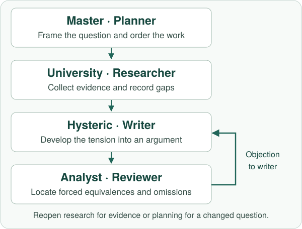

# Relational positions: who speaks to whom, and who answers next

In [YY-03, Yinyang and Taiji](yinyang-and-taiji.md), the person takes the position of generator and offers the language model an intuition, conjecture, or interpretation. The model takes the position of examiner, developing the argument and looking for counterexamples. The two can also switch. The model proposes an interpretation, and the person draws on lived experience or the original text to show where it fails. There is a practical reason for this arrangement. Before seeing the inference worked out, a person may already sense that the situation it rests on has been misunderstood. When they take part in generating the account from the start, the difference they sense can change the whole question.

The two fish make this exchange visible. When each takes the other's role, both original participants remain present. The person brings their body, experience, and purpose into generation. The model brings its linguistic capacities, materials, and tools into examination. A further question follows. In examining a judgment, the model might be carrying out a requirement the person set, teaching from what it already knows, or asking what the person's explanation leaves out. Each counts as examination and leaves the other participant a different kind of room to answer. Knowing that it is the model's turn tells us little about how the exchange will continue.

A **relational position** in [YY-04](core-views.md#yy-04) concerns the grounds on which person and model speak to each other in a shared activity, what each calls on the other to do, and what the other's response can change. The **four discourses** give us four ways to recognize that relation. Person and model are the actual participants. Master, university, hysteric, and analyst name discursive relations they can enter in the course of the activity. The same person or model can name a research direction, answer from what they know, ask a question from a gap in an explanation, and give the other participant a chance to articulate their understanding anew. For the arrangement of the symbols and their original meaning, see [A guide to Lacan's concepts](lacan-reading-guide.md#four-discourses).

## How the four discourses enter cooperation between person and model

**In the master's discourse, one participant sets a direction and puts the other's knowledge to work.** The person says that today they want to practice hearing the difference between two performances. The model finds the original recordings, extracts the corresponding phrases, and prepares them for repeated listening. The person's purpose gives these otherwise unrelated capabilities an order. The direction can also come from the model. Given a request to prepare a listening exercise, the model might check the recordings and decide to start with two renditions of the same line, then play the full passage. The person has temporarily entrusted the sequence to the model, giving it the authority to organize the exercise. This position makes it possible to settle on a course of action. A decision to begin with one thing brings order to possibilities that could otherwise stay open indefinitely. If the recordings turn out to be two cuts from the same performance, the comparison needs to change. Setting a task also means letting the knowledge it mobilizes come back and reshape it.

**In the university discourse, organized knowledge supplies the grounds for speaking.** A language model can gather scattered materials and distinguish a point backed by an original record from one that appears only in a retelling. This position can give it considerable authority. The person is halfway through asking a question, and the model can already offer definitions, a history, and a whole system of classification. The more neatly the knowledge is organized, the more it matters to ask what question guided its selection. If the person wants to hear how a change in stress affects the tone of a phrase and the model ranks two excerpts by pitch error, the calculation may be right while the answer misses the question. A person can also speak to the model from knowledge. When they point out that the two recordings were made before and after a change of key, they supply material the model lacked and give it grounds to redo the comparison. The relevant knowledge may come from either participant.

**In the hysteric's discourse, a difference that the current account cannot accommodate sets the other participant to work.** A person may say, “I understood each paragraph, but when I put them together I can't see what warrants the author's inference.” That difficulty is enough to question the existing explanation even before the person can formulate a full objection. A model that explains each paragraph again will miss the question. It can put the two inferences side by side and identify the premise they depend on, or offer a case where both paragraphs hold and the conclusion fails. The model can also speak from a point of doubt. In designing a reading environment, the person may treat “I can get back to the page I was on” as equivalent to “I can pick up the thought I was having.” The model can distinguish them by pointing out that a reader can recover the page and reading position and still lose the connection between passages. The counterexample gives the design a new question. This discourse takes its form from questioning an established name or account at the point where something splits or fails to fit. Both participants can bring grounds for objection.

**In the analyst's discourse, the response gives the other participant room to form their own judgment again.** A reader says they cannot continue. The model can bring up the passages before and after they left the main text and let them point to the connection they want to recover. Retrieving, selecting, and juxtaposing the passages gives the reader practical help and leaves them free to say what happened. If they then say, “I remember the paragraphs. I forgot why I was looking something up after I opened the note,” that new account can change what happens next. A person can do something similar with the model's work. If the model attributes a requirement to the person, the person can ask it to put their actual words alongside its inference and revise its understanding in light of the difference. Each participant can hear a possible conflation and return the question to whoever can answer it. A follow-up earns its place by helping the other participant continue. A stream of questions can leave someone who was already thinking busy answering the model.

The four relations depend on one another. A direction lets inquiry begin, and verification establishes whether the materials the plan depends on are available. Knowledge can clarify a question and bring to light experiences its distinctions cannot explain. An objection can open a new question, which someone still has to take up and develop into accounts that can be compared. Person and model can change what they contribute at these junctures. To judge whether a step is complete, return to the judgment that position can make. A counterexample from the model can show that an inference fails. The person's original purpose may be sound, and the method currently used to pursue it may need to change.

## How discursive rotation becomes a way for models to work

[Bonomo's Gira Discursiva](https://www.preprints.org/manuscript/202606.1503) puts the four discourses to work on a concrete task. Bonomo maps master, university, hysteric, and analyst onto Planner, Researcher, Writer, and Reviewer, respectively. A language model can be entrusted with the whole task, while the work at each step still depends on what happens at the others. Planning can come first. A conclusion has to wait for verification. Writing has to develop a claim of its own and expose it to a grounded challenge. The arrows in the opening diagram trace these dependencies.

Read from top to bottom, the diagram shows each step passing along what the next one needs. The question goes to research, the evidence to writing, and the written judgment to review. Follow the arrow back from the right to see how an objection can change the work. A reviewer might find that the draft attributes a conclusion to an author on the strength of another researcher's interpretation. Distinguishing those two sources is enough to challenge the attribution. The writer must then decide whether to present it as someone else's interpretation, look for the author's original words, or withdraw the conclusion. When the reviewer settles the matter on the writer's behalf as soon as a problem appears, an independent objection quickly becomes a command that escapes scrutiny.

The arrows show where the question goes next. The table shows what warrants a decision when it gets there. The last column identifies work in each row that another position must still do. The limit applies to the authority of a particular contribution. A model can finish reviewing, move into writing, and revise the work itself. When it changes a claim as writer, it owes fresh grounds for the revised claim.

| Discourse | Agent | Authority | Outside its remit |
| --- | --- | --- | --- |
| Master | Planner | Set the research objective and sequence the work | Conducting the research |
| University | Researcher | Find, collect, and verify materials and identify gaps | Writing the manuscript |
| Hysteric | Writer | Develop an argument from tensions between the plan and the materials | Final verification |
| Analyst | Reviewer | Question implicit positions, avoided questions, and conceptual conflations | Directly rewriting the manuscript |

Bonomo describes a difficult case. The researcher could find much more material on Lacan than on Ferenczi, while the plan called for an equal comparison of their traditions. Faithful research makes that uneven coverage more apparent. A writer who simply fills out the outline can turn an imbalance in available material into an apparent imbalance between the theories. Here the difference between the four positions starts to matter. Once the researcher makes the limits of the collection clear, the writer can challenge the kind of comparison the plan called for. The reviewer can point out that the concepts in the two traditions cannot be treated as equivalent on that basis. The resulting account may have a narrower scope than the plan and say more clearly what we actually know.

Yinyang brings this interplay into work that one model can complete independently. After giving the model a purpose, the person can leave it to take up the four roles. The model can set a direction, check the evidence, form an interpretation, and then ask from the review position where an inference went beyond what the material supports. A question about attribution can go back to the sources. If verification overturns a premise of the plan, the question itself can change. The point of rotation appears in the result delivered, where a grounded objection has had the chance to change a judgment. A single model can also carry the same misunderstanding across several positions. Independent evidence comes from original texts, the objects themselves, human feedback, and actual use. These can interrupt a judgment from outside the model's own account.

## Where the person can enter, the model can respond

Positions can rotate inside the model's work and in the relationship between person and model. The first table follows the responsibilities in an engineered workflow. This table follows the participants. Read across a row to see how the same discourse can be taken up by either the person or the model. Read down either participant's column to see how that participant can change position in the shared activity. This is Yinyang's use of discursive rotation and a concrete form of the exchange of roles proposed in YY-03.

| Discursive position | How the person takes it up | How the language model takes it up |
| --- | --- | --- |
| Master — set a direction | Choose what they want to understand or accomplish and decide what to delegate | Frame the question and order the work within the delegated scope. Replan if a premise fails |
| University — answer from knowledge | Bring an original, a situation they experienced, or the result of an actual operation and supply facts the model lacked | Recover sources, compare materials, and explain what has support and what remains conjecture |
| Hysteric — question what fails to fit | Challenge a current explanation where something feels wrong and share an intuition still taking shape | Find a counterexample to the person's assumption or the model's earlier conclusion and develop another reading that can be tested |
| Analyst — make room for a new judgment | Point out whom the model has spoken for or what it has conflated, then have it explain again and revise | Hear what remains open and offer material or candidate interpretations that the person can recognize and judge from experience |

The person often enters in the middle of the table. Something feels wrong, and they point it out before deciding whether it calls for research, a tool, or an explanation. That contribution can already change the collaboration. If the model takes up planning whenever it receives an unformed intuition and immediately lists objectives and steps, the person has to correct a task settled too early. The model can begin by listening and developing what it hears. It can restore the context of the intuition, make two possible interpretations visible together, or make a small enough change to let the person compare. When the person's next judgment indicates a direction worth pursuing, the model can move into planning. The person's uncertainty supplies material for the work, and the model develops that material to the point where a choice becomes possible.

The model can also enter before the person has worked out a complete question. Sometimes the person hands over a task with a clear purpose precisely because they want the model to use what it knows and take the work all the way through. Returning every judgment to the person turns the right to participate into a requirement to stay present. When the grounds for a decision are available, taking over the work gives the person room to choose another activity. A listening position therefore has a moment to yield. Once the person's purpose is clear and the task needs verification or action, the model can verify or act. The decision turns on which contribution, if any, only the other participant can make at that moment.

## If both can rotate, why does it still matter who is who?

Person and model can enter all four discourses, and each brings different grounds to the same position. When the question is what sounded different, the person's listening experience and the model's acoustic measurements can each tell part of the story. When the question is whether a setting took effect on a device, reading the settings and testing the device supply other kinds of evidence. The model may establish a version difference faster, while the person may be the first to notice that the measurement tracks the wrong thing. A role title leaves these differences intact. Cooperation depends on knowing where each contribution in the same position comes from and whose objection can actually change the other's judgment.

Sometimes the person asks for independent verification and hopes their original judgment will stand up to it. A model that follows the person's conjecture and finds a great deal of similar material may have found something useful. It may also have shown that the search was organized around that conjecture from the start. If the person wants to keep an idea worth developing, the model can first help formulate its strongest version. When it takes up verification, it must give a different conclusion a real chance to prevail. The person can ask the same of the model. Which claims can the original settle? Which are your inferences? What would make you change your mind? Who gets to propose an explanation and on what terms it will be tested are decisions that can be made separately.

The difference also appears when a result comes back. The model delivers a coherent explanation with consistent terms, and the person says, “You've been solving a different problem from the one I got stuck on.” Proving the explanation coherent all over again leaves that objection unanswered. The participants can first identify which relation was misunderstood. Perhaps the model took a difficulty in reading to be a lack of knowledge, or took over the part the person wanted to practice on their own. That difference tells them which position to return to. The person may also read the model's materials and recognize that their first intuition pointed to the wrong thing. The person can retain their purpose and initiative while the model challenges a factual judgment. When each can be corrected by the other, the four positions can sustain cooperation.

## How one rotation carries into the next encounter

A diagram of discursive rotation can make cooperation look orderly, as if it always begins with a direction and ends with review. The person's activity can begin with unfinished reading, a work already delivered, or an objection to the model's last answer. A quotation that can be checked on the spot may take just a question and a verification. Someone practicing a skill may want to stay in one position longer, digesting the model's counterexample before trying again. A model completing a delegated task can go through several rotations internally and bring back only the choices that affect the purpose. Rotation makes positions available. Person and model enter and leave them according to what the activity calls for.

We can judge what a rotation accomplishes by returning to a third term beyond the two fish, the world they are facing together. Person and model may agree that a reading tool will help the reader keep their train of thought. At that point they have reached a shared understanding. To see whether the person can pick up the argument after opening a note, the tool has to enter an actual reading session. That session can overturn the design they both endorsed. The person points out where they lost the connection, and the model revises its understanding of the problem and redesigns the support. The model's own proposal has come back to teach it something, and the result can also change the person's original explanation. Without that return, mutually agreeable discourses can run smoothly while drifting further from the activity they were meant to support.

At the end of an encounter, attention can move from who is right to who can now continue. When the person first points out that two passages do not connect, they may only want to understand this one reading. The model supplies the premise, both agree on the explanation, and the question can close. If the person wants to go further, they can try to find an unstated premise in another text and then ask the model to check it. The two activities draw on much the same knowledge and make different opportunities available. One lets the person resume reading at once. The other gives them the opportunity to form a judgment themselves. A model that remembers supplying the inference last time and automatically does so again would turn a direction that suited one encounter into a standing arrangement.

Likewise, a person who raises strong objections in one exchange can choose to see only the result the next time and have the model use the earlier errors to improve its checks. The earlier review still matters, and its work now has a different bearer. Through records, tools, and completed works, a contribution from either participant can become a condition for the next round. Whether the change is worth keeping depends on what happens. Does the person do less unnecessary supervision? Does the model catch similar mistakes sooner? Does the new arrangement still leave room for the objections that mattered?

This is how YY-03's return through the other takes concrete form in the relations of YY-04. The person can generate again with the model's counterexample in hand, and the model can redirect the question with the person's observation in hand. The person can also step out of a task they have delegated and let the model complete it. [Shared reflection and continued cultivation](participation-and-support.md) asks what these completed activities leave behind. At the next difficulty, can the person enter more readily through their own intuition? Can the model better tell when to verify, when to object, and when to take over the work? A division of work that helps can carry forward. A position that impedes participation can change. The relationship can finish the work at hand and leave new possibilities for the next encounter.
