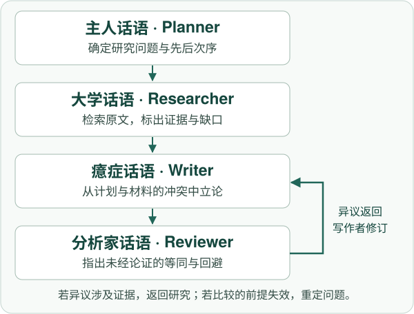

# 关系位置：谁在对谁说，接下来由谁回答

[YY-03《阴阳与太极》](yinyang-and-taiji.zh-CN.md)论证了人和模型都能提出解释，也都能检验对方的解释。[YY-04](core-views.zh-CN.md#yy-04)接着问：当我把一份稿子交给你，我交给你的是定题、查证、写作，还是审阅？你若发现问题，可以改哪一部分，又该把什么交还给我？

## 一份稿子怎样在四个位置之间流转

[Bonomo 的话语轮转](https://www.preprints.org/manuscript/202606.1503)给每个位置一项可以负责到底的工作，也给它一个交接处。沿着图往下读，是一份稿子怎样写成；沿着右边的箭头往回读，是一次异议怎样进入下一稿。

| 话语 | Agent | 有权做什么 | 不负责什么 |
| --- | --- | --- | --- |
| 主人 | Planner | 确定研究目标与任务顺序 | 不亲自研究 |
| 大学 | Researcher | 检索、收集和核对材料，标记缺口 | 不撰写正文 |
| 癔症 | Writer | 质疑计划与材料之间的矛盾，发展论证 | 不承担最终核验 |
| 分析家 | Reviewer | 追问隐含立场、回避与概念混同 | 不直接重写正文 |

审阅者若发现两段引文支持不了稿中的结论，应当指出推论在哪一步出了问题。写作者据此判断：是收窄结论，还是请研究者核对原文？如果重查发现题目本身预设了一个无法成立的比较，改题的责任才回到规划者。**异议落在哪里，就把工作交回能处理它的位置。**

## 人和模型怎样接手、转位

在《阴阳》里，同一个位置可以换人，同一个参与者也可以换位置。看一份稿子怎样改，比按发言次数判断更清楚。

| 眼前发生的变化 | 谁接下什么责任 |
| --- | --- |
| 模型交回出处，人从手边的初版补上一句原文 | 研究的位置由模型交到人手里。写作者随后要根据两份材料重新判断。 |
| 模型刚指出稿子把“译词相同”写成了“原意相同”，随后受托改稿 | 同一个模型从审阅转到写作。先前它只需指出哪一步缺证据，现在它要为改写后的论断负责。 |
| 人读了修订稿，指出自己原本想问的是“译者为什么选这个词” | 人接过定题的位置。模型可以沿新问题继续查证，已有的原文仍然用得上。 |

一开始也可能只有一句“这里听起来不对”。这时模型可以先把相关的两句话并排放回上下文，让人认出自己在意的差别。问题一旦清楚，人可以继续写，也可以把整项工作委托给模型，让它自行轮转、改稿并交回结果。关系位置是否真的发生了变化，最后看一件具体的事：对方的回答有没有改变接下来的问题、证据或作品。
